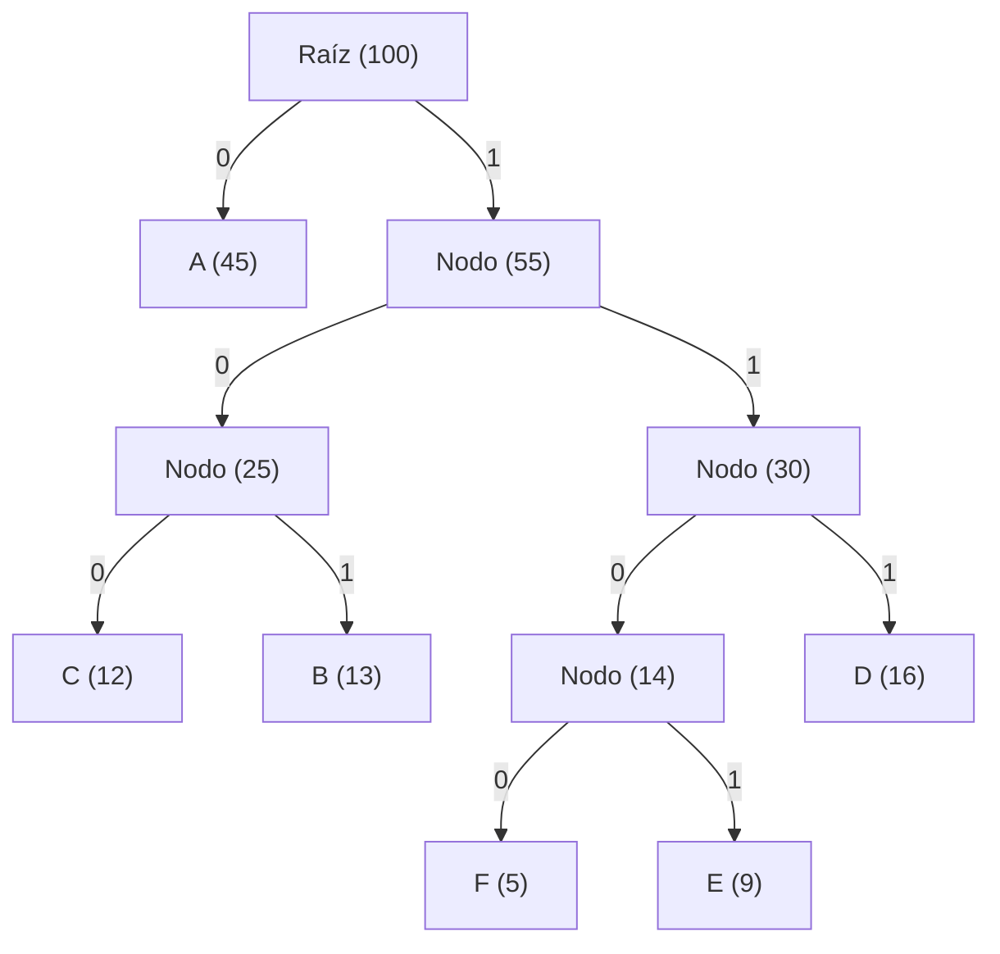

# Apuntes: Codificación de Huffman (*Huffman Coding*)

La **Codificación de Huffman** es uno de los algoritmos más elegantes, influyentes y trascendentales en la historia de las Ciencias de la Computación y la Teoría de la Información. Desarrollado por **David A. Huffman** en 1952, es un método voraz (*greedy*) para la construcción de **códigos de longitud variable libres de prefijo** (*prefix-free variable-length codes*) que garantizan una **compresión de datos sin pérdida (*lossless*) matemáticamente óptima** a nivel de símbolo individual.

En el marco de la materia **Análisis y Diseño de Algoritmos**, Huffman representa el ejemplo paradigmático de cómo una estrategia voraz miope (*greedy choice*) y la existencia de subestructura óptima (*optimal substructure*) permiten resolver un problema combinatorio complejo en tiempo cuasilineal $O(k \log k)$, demostrando de manera formal la convergencia hacia el óptimo global sin necesidad de recurrir a programación dinámica o fuerza bruta.

---

## 1. Contexto Histórico y Origen

### El estudiante que superó a su profesor en el MIT
En la primavera de 1951, **David Albert Huffman** (1925–1999) era un estudiante de posgrado en el Instituto Tecnológico de Massachusetts (MIT) cursando la materia de Teoría de la Información impartida por el profesor **Robert M. Fano**. 

Como evaluación final del curso, Fano dio a sus alumnos una alternativa inusual: podían presentar un examen final tradicional o redactar una monografía de investigación sobre un problema abierto: **encontrar el código de compresión binario más eficiente y de menor redundancia posible para un conjunto de probabilidades dadas**.

> *"Fano había estado trabajando en este problema junto a Claude Shannon (el padre de la Teoría de la Información), logrando una solución heurística aproximada pero no óptima conocida como el algoritmo de Shannon-Fano. Huffman pasó meses frustrado intentando demostrar la optimalidad de varios enfoques. A punto de rendirse y resignado a estudiar para el examen final, mientras tiraba sus hojas de borrador a la basura, tuvo una epifanía repentina: en lugar de construir el árbol de arriba hacia abajo (top-down), debía construirlo de abajo hacia arriba (bottom-up), combinando primero los símbolos menos probables."*

El resultado fue tan revolucionario que no solo eximió a Huffman del examen, sino que fue publicado en septiembre de 1952 en los *Proceedings of the IRE* bajo el título:
**"A Method for the Construction of Minimum-Redundancy Codes"**. 

El algoritmo demostró matemáticamente que el método de Shannon y Fano era subóptimo y estableció la técnica estándar para la asignación de códigos de longitud variable que se sigue utilizando más de siete décadas después en prácticamente todo el software moderno.

---

## 2. Fundamentos de la Teoría de la Información

Para comprender por qué funciona el algoritmo de Huffman, es indispensable revisar los fundamentos matemáticos de la compresión de datos y la codificación de fuentes de información formalizados por **Claude Shannon** en 1948.

```
                     ┌────────────────────────────────────────┐
                     │          Tipos de Compresión           │
                     └───────────────────┬────────────────────┘
                                         │
                     ┌───────────────────┴────────────────────┐
                     ▼                                        ▼
       ┌───────────────────────────┐            ┌───────────────────────────┐
       │   Con Pérdida (Lossy)     │            │   Sin Pérdida (Lossless)  │
       ├───────────────────────────┤            ├───────────────────────────┤
       │ Descarta información no   │            │ Reconstrucción exacta bit │
       │ perceptible por humanos.  │            │ por bit del archivo orig. │
       │ Ej: MP3, JPEG, H.264.     │            │ Ej: ZIP, PNG, Huffman.    │
       └───────────────────────────┘            └───────────────────────────┘
```

### 2.1 Códigos de Longitud Fija vs. Longitud Variable
Supongamos un alfabeto fuente $\Sigma = \{A, B, C, D\}$.

* **Código de longitud fija:** Cada símbolo recibe una palabra binaria de tamaño idéntico:
  $$\lceil \log_2 |\Sigma| \rceil = \lceil \log_2 4 \rceil = 2 \text{ bits por carácter}$$
  $$A \to 00, \quad B \to 01, \quad C \to 10, \quad D \to 11$$
  Si un texto tiene 100,000 caracteres, consumirá indefectiblemente $200,000\text{ bits}$, sin importar si la letra $A$ aparece 99,000 veces y las demás casi nunca.

* **Código de longitud variable (VLC):** Asigna secuencias de bits más cortas a los símbolos muy frecuentes y secuencias más largas a los símbolos infrecuentes (análogo a la filosofía del Código Morse, donde la letra más común en inglés, la `E`, es un simple punto `·`, mientras que la `Q` es `--·-`).

### 2.2 La Condición de Prefijo (*Prefix-Free Codes*)
Si asignamos códigos de diferente longitud, surge de inmediato el **problema de la ambigüedad en la decodificación**:
* Supongamos que asignamos: $A \to 0$, $B \to 1$, $C \to 01$.
* Al recibir el flujo de bits transmitido: `01`
* ¿Cómo debe interpretarse? ¿Es el carácter $C$, o es la secuencia de caracteres $AB$?

Para resolver esto sin necesidad de enviar delimitadores o espacios adicionales (que desperdiciarían bits), se exige que el código sea un **código libre de prefijo** (también denominado *código instantáneo*):

> [!IMPORTANT]
> **Definición (Propiedad del Prefijo):**
> Un conjunto de palabras de código $C = \{c_1, c_2, \dots, c_k\}$ es **libre de prefijo** si ninguna palabra de código $c_i$ es un prefijo propio de otra palabra $c_j$ con $i \ne j$. Es decir, no existe ninguna secuencia de bits en el diccionario que coincida con el comienzo de otra palabra del mismo diccionario.

Gracias a esta propiedad, la decodificación es **inmediata y determinista**: se lee el flujo binario bit a bit y, en el instante exacto en que la secuencia leída coincide con un código del diccionario, dicho símbolo se emite y se reinicia la búsqueda, sin necesidad de consultar bits futuros (*lookahead*).

### 2.3 Correspondencia entre Códigos de Prefijo y Árboles Binarios
Cualquier código libre de prefijo sobre un alfabeto binario $\{0, 1\}$ puede representarse formalmente como un **árbol binario**:
1. Cada **nodo hoja** representa un símbolo del alfabeto $\Sigma$.
2. Cada **arista izquierda** representa el bit `0`.
3. Cada **arista derecha** representa el bit `1`.
4. El camino único desde la raíz hasta una hoja define la palabra de código binario de ese símbolo.
5. Puesto que ningún nodo hoja puede ser ancestro de otra hoja, **se cumple automáticamente y por construcción la propiedad libre de prefijo**.

```
                   Raíz (·)
                  /        \
             0   /          \   1
               (·)           D [11]
              /   \
         0   /     \   1
           A [00]   (·)
                   /   \
              0   /     \   1
                B [010]  C [011]
```

### 2.4 Árboles Binarios Estrictos (Completos)
Un árbol binario para un código de prefijo óptimo debe ser **estricto**: **todo nodo interno debe tener exactamente dos hijos**. Si existiese un nodo interno con un único hijo, podríamos eliminar dicho nodo intermedio y subir al hijo directamente, reduciendo la longitud de código de al menos un símbolo sin alterar la validez del código.

### 2.5 Entropía de Shannon y la Desigualdad de Kraft
¿Cuál es el límite físico absoluto de compresión? 

#### 1. Entropía de Shannon ($H$)
Dada una variable aleatoria discreta $X$ que emite símbolos del alfabeto $\Sigma = \{s_1, \dots, s_k\}$ con probabilidades $P(X = s_i) = p_i$, la **entropía** mide la cantidad promedio de información (en bits por símbolo) inherente a la fuente:

$$H(X) = - \sum_{i=1}^k p_i \log_2(p_i) = \sum_{i=1}^k p_i \log_2\left(\frac{1}{p_i}\right)$$

#### 2. Longitud Media Ponderada ($L$)
La longitud media del código por símbolo es el valor esperado de la longitud de las palabras de código:

$$L(C) = \sum_{i=1}^k p_i \cdot l_i$$

Donde $l_i = |c(s_i)|$ es la cantidad de bits asignada al símbolo $s_i$.

#### 3. Teorema de Codificación de Fuente de Shannon
Shannon demostró que para cualquier código decodificable de manera unívoca:

$$H(X) \le L(C) < H(X) + 1$$

* La entropía $H(X)$ representa la **cota inferior infranqueable**. Es imposible comprimir sin pérdida por debajo de $H(X)$ bits por símbolo.
* El algoritmo de Huffman minimiza $L(C)$ y garantiza que la solución construida sea la más cercana posible a $H(X)$ entre todos los códigos libres de prefijo símbolo a símbolo.

#### 4. Desigualdad de Kraft-McMillan
Una condición matemática necesaria y suficiente para que exista un código libre de prefijo con longitudes de palabra $\{l_1, l_2, \dots, l_k\}$ sobre un alfabeto binario es:

$$\sum_{i=1}^k 2^{-l_i} \le 1$$

En un árbol binario estricto (completo), la suma cumple la igualdad exacta: $\sum_{i=1}^k 2^{-l_i} = 1$.

---

## 3. El Criterio Voraz (*Greedy*) en Huffman

### 3.1 Planteamiento del Problema de Optimización
Dado un alfabeto de $k$ caracteres $\Sigma = \{c_1, c_2, \dots, c_k\}$ y un vector de frecuencias absolutas asociadas $F = \{f(c_1), f(c_2), \dots, f(c_k)\}$.

El costo de un árbol binario $T$ viene dado por la **suma ponderada de las longitudes de camino**:

$$B(T) = \sum_{c \in \Sigma} f(c) \cdot d_T(c)$$

Donde $d_T(c)$ representa la **profundidad** del nodo hoja $c$ en el árbol $T$ (que equivale a la cantidad de bits de su código).

* **Objetivo:** Encontrar un árbol binario estricto $T$ que minimice la función objetivo $B(T)$.

### 3.2 La Elección Voraz Local (*Bottom-Up*)
A diferencia de los enfoques *top-down* (como Shannon-Fano, que intenta dividir el conjunto en dos mitades de peso similar y con frecuencia comete errores de redondeo), el algoritmo de Huffman procede de forma **ascendente**:

> [!TIP]
> **Regla de Selección Voraz de Huffman:**
> En cada paso, identifica los **dos árboles con las menores frecuencias acumuladas** en el conjunto disponible, extráelos y fusiónalos creando un nuevo nodo padre cuya frecuencia sea la suma de ambas. Los dos árboles extraídos pasan a ser los hijos izquierdo y derecho de este nuevo nodo.

```
Paso i:
[Árbol A (peso 3)]   [Árbol B (peso 5)]   ... [Árboles restantes]
         \                  /
          ▼                ▼
        ┌────────────────────┐
        │  Padre (peso 8)    │
        │   /            \   │
        │ [Árbol A]   [Árbol B]
        └────────────────────┘
         (Se reinserta en la cola de candidatos)
```

¿Por qué esta elección es intuitivamente correcta?
Porque los nodos combinados en las primeras etapas son los que terminarán a **mayor profundidad** en el árbol final. Puesto que queremos minimizar $\sum f(c) \cdot d_T(c)$, los caracteres con menor frecuencia $f(c)$ deben multiplicarse por los valores más grandes de profundidad $d_T(c)$, y los caracteres con frecuencias gigantescas deben permanecer lo más cerca posible de la raíz ($d_T \approx 1 \text{ o } 2$).

---

## 4. Demostración Formal de Optimalidad

Para validar rigurosamente que el algoritmo de Huffman alcanza el **óptimo global**, se debe probar que cumple las dos propiedades canónicas del paradigma voraz descritas por Cormen, Leiserson, Rivest y Stein (CLRS):

### 4.1 Lema 1: Propiedad de Elección Voraz (*Greedy Choice Property*)

> **Lema:**
> Sea $C$ un alfabeto de caracteres donde cada $c \in C$ tiene una frecuencia $f(c)$. Sean $x, y \in C$ los dos caracteres con las **frecuencias mínimas absolutas** en $C$. Entonces existe un árbol de prefijo óptimo para $C$ en el cual $x$ e $y$ son **nodos hermanos en la máxima profundidad del árbol**.

#### Demostración por argumento de intercambio (*Exchange Argument*):
Sea $T$ un árbol de código de prefijo óptimo cualquiera. 

1. Como $T$ es óptimo, debe ser un árbol binario estricto. Tomemos dos nodos hermanos $a$ y $b$ que se encuentren a la **máxima profundidad** en $T$.
2. Sin pérdida de generalidad, supongamos que $f(x) \le f(y)$ y que $f(a) \le f(b)$.
3. Como $x$ e $y$ son los dos símbolos con menor frecuencia de todo el alfabeto, se tiene necesariamente que:
   $$f(x) \le f(a) \quad \text{y} \quad f(y) \le f(b)$$
4. Si $x = a$ e $y = b$, el lema ya se cumple de forma trivial en $T$.
5. Si no, construimos un nuevo árbol $T'$ intercambiando de posición la hoja $a$ con la hoja $x$. Evaluemos la diferencia de costo $B(T) - B(T')$:
   $$B(T) - B(T') = \sum_{c} f(c) d_T(c) - \sum_{c} f(c) d_{T'}(c)$$
   $$B(T) - B(T') = f(a) d_T(a) + f(x) d_T(x) - f(a) d_{T'}(a) - f(x) d_{T'}(x)$$
   Dado que $d_{T'}(a) = d_T(x)$ y $d_{T'}(x) = d_T(a)$:
   $$B(T) - B(T') = f(a) d_T(a) + f(x) d_T(x) - f(a) d_T(x) - f(x) d_T(a)$$
   $$B(T) - B(T') = (f(a) - f(x))(d_T(a) - d_T(x))$$
6. Como $a$ está a máxima profundidad, $d_T(a) \ge d_T(x) \implies (d_T(a) - d_T(x)) \ge 0$.
7. Como $x$ es el mínimo global de frecuencia, $f(a) \ge f(x) \implies (f(a) - f(x)) \ge 0$.
8. Por lo tanto:
   $$B(T) - B(T') \ge 0 \implies B(T') \le B(T)$$
   Como $T$ ya era óptimo por hipótesis ($B(T)$ era mínimo), debe ser $B(T') = B(T)$, lo que significa que el árbol modificado $T'$ **también es estrictamente óptimo**.
9. Repitiendo el mismo procedimiento de intercambio entre $b$ e $y$ sobre el árbol $T'$, obtenemos un árbol $T''$ en el cual $x$ e $y$ son hermanos en la máxima profundidad, y $B(T'') = B(T)$. $\blacksquare$

---

### 4.2 Lema 2: Subestructura Óptima (*Optimal Substructure*)

> **Lema:**
> Sea $C$ un alfabeto con frecuencias $f$. Sean $x, y \in C$ los dos caracteres de menor frecuencia fusionados en un nodo ficticio $z$ con frecuencia $f(z) = f(x) + f(y)$, definiendo un alfabeto reducido $C' = (C \setminus \{x, y\}) \cup \{z\}$.
> Si $T'$ es un árbol óptimo para $C'$, entonces el árbol $T$ obtenido al sustituir la hoja $z$ en $T'$ por un nodo interno con hijos $x$ e $y$ es un **árbol óptimo para $C$**.

#### Demostración:
Para cualquier hoja $c \in C \setminus \{x, y\}$, su profundidad en $T$ es idéntica a su profundidad en $T'$: $d_T(c) = d_{T'}(c)$.
Para $x$ e $y$, su profundidad en $T$ es $d_T(x) = d_T(y) = d_{T'}(z) + 1$.

Calculamos el costo de $T$:
$$B(T) = \sum_{c \in C} f(c) d_T(c)$$
$$B(T) = \sum_{c \in C \setminus \{x, y\}} f(c) d_T(c) + f(x)(d_{T'}(z) + 1) + f(y)(d_{T'}(z) + 1)$$
$$B(T) = \sum_{c \in C \setminus \{x, y\}} f(c) d_{T'}(c) + (f(x) + f(y)) d_{T'}(z) + f(x) + f(y)$$
Dado que $f(z) = f(x) + f(y)$:
$$B(T) = B(T') + f(x) + f(y)$$

Supongamos por contradicción que $T$ no es óptimo para $C$. Entonces debe existir un árbol alternativo $T_{\text{alt}}$ tal que:
$$B(T_{\text{alt}}) < B(T)$$
Por el Lema 1, podemos asumir sin pérdida de generalidad que en $T_{\text{alt}}$, $x$ e $y$ son hermanos. Si reemplazamos $x$ e $y$ en $T_{\text{alt}}$ por su padre $z$, obtenemos un árbol $T'_{\text{alt}}$ para el alfabeto $C'$.
Su costo cumpliría:
$$B(T'_{\text{alt}}) = B(T_{\text{alt}}) - f(x) - f(y) < B(T) - f(x) - f(y) = B(T')$$
Esto implicaría que $B(T'_{\text{alt}}) < B(T')$, lo cual **contradice la premisa de que $T'$ es un árbol óptimo para $C'$**.

Por lo tanto, la elección voraz es consistente y el subproblema resultante tiene subestructura óptima. $\blacksquare$

---

## 5. El Algoritmo: Paso a Paso y Complejidad

### 5.1 Estructura de Datos Central: Min-Heap
El algoritmo requiere extraer repetidamente los dos elementos mínimos de una colección dinámica de árboles. La estructura de datos idónea es un **Montículo Binario de Mínimos (*Min-Heap*)** o **Cola de Prioridad**:
* Inserción de un elemento: $O(\log k)$.
* Extracción del mínimo (`extract_min`): $O(\log k)$.

### 5.2 Pseudocódigo Formal

```text
ALGORITMO HUFFMAN(C)
Entrada: Conjunto C de k caracteres, cada uno con frecuencia c.frec
Salida: Raíz del árbol binario de Huffman

1.  n = |C|
2.  Q = CREAR_MIN_HEAP()
3.  PARA cada carácter c en C HACER:
4.      nodo = CREAR_NODO_HOJA(c, c.frec)
5.      INSERTAR(Q, nodo)
6.  FIN PARA
7.
8.  PARA i = 1 HASTA n - 1 HACER:
9.      izq = EXTRAER_MINIMO(Q)
10.     der = EXTRAER_MINIMO(Q)
11.     padre = CREAR_NODO_INTERNO(frec = izq.frec + der.frec)
12.     padre.izquierdo = izq
13.     padre.derecho = der
14.     INSERTAR(Q, padre)
15. FIN PARA
16.
17. RETORNAR EXTRAER_MINIMO(Q)  // Raíz del árbol final
```

### 5.3 Análisis de Complejidad Asintótica

Supongamos un texto de entrada de longitud $N$ caracteres, sobre un alfabeto de $k$ caracteres distintos ($k = |\Sigma|$). En casi todos los casos prácticos, $k \le 256$ (para bytes individuales en ASCII extendido) o $k \le 65536$ (Unicode BMP).

| Fase del Algoritmo | Operaciones Realizadas | Complejidad Temporal | Complejidad Espacial |
| :--- | :--- | :--- | :--- |
| **1. Conteo de frecuencias** | Recorrer el texto completo una vez | $\Theta(N)$ | $O(k)$ |
| **2. Construcción del Heap** | Construir el montículo inicial con $k$ nodos (`heapify`) | $O(k)$ | $O(k)$ |
| **3. Fusión Voraz del Árbol** | $k-1$ iteraciones, cada una con 2 `extract_min` y 1 `insert` | $O(k \log k)$ | $O(k)$ (árbol de $2k-1$ nodos) |
| **4. Generación de Códigos** | Recorrido DFS (preorden) sobre el árbol de $2k-1$ nodos | $O(k)$ | $O(k)$ (pila de recursión / tabla) |
| **5. Codificación del Texto** | Búsqueda en tabla hash $O(1)$ por carácter y concatenación | $\Theta(N)$ | $O(N)$ (buffer de bits de salida) |
| **6. Decodificación del Texto** | Recorrido del árbol bit a bit hasta hojas | $\Theta(N)$ | $O(N)$ (texto reconstruido) |

$$\text{Tiempo Total de Construcción y Codificación} = \Theta(N + k \log k)$$
$$\text{Memoria Adicional de Estructuras} = O(k)$$

> [!NOTE]
> **Optimización en tiempo lineal $O(k)$ (Algoritmo de van Leeuwen, 1976):**
> Si las frecuencias de los $k$ caracteres ya vienen previamente ordenadas (o se ordenan mediante *Counting Sort* / *Radix Sort* en $O(k)$), es posible construir el árbol en **tiempo lineal estricto $O(k)$** empleando **dos colas FIFO estándar** en vez de un Heap:
> 1. Cola 1: Contiene los nodos hoja iniciales ordenados por frecuencia.
> 2. Cola 2: Almacena los nodos internos recién creados.
> 
> En cada paso, el mínimo siempre se encuentra en la cabeza de una de las dos colas, lo que permite extraer los dos mínimos en $O(1)$.

---

## 6. Ejemplo Práctico Resuelto Paso a Paso

Para comprender visualmente cada paso de la construcción, analicemos un ejemplo detallado.

### 6.1 Datos del Problema
Consideremos un mensaje con un total de **100 caracteres** compuesto por un alfabeto de 6 letras $\{A, B, C, D, E, F\}$ con las siguientes frecuencias absolutas:

| Símbolo | Frecuencia ($f$) | Probabilidad ($p_i$) | Bits Fijos ($\lceil \log_2 6 \rceil = 3$) | Bits en ASCII (8 bits) |
| :---: | :---: | :---: | :---: | :---: |
| **A** | 45 | 0.45 | 3 bits | 8 bits |
| **B** | 13 | 0.13 | 3 bits | 8 bits |
| **C** | 12 | 0.12 | 3 bits | 8 bits |
| **D** | 16 | 0.16 | 3 bits | 8 bits |
| **E** | 9 | 0.09 | 3 bits | 8 bits |
| **F** | 5 | 0.05 | 3 bits | 8 bits |
| **Total**| **100** | **1.00** | **300 bits** | **800 bits** |

---

### 6.2 Traza de Ejecución de la Cola de Prioridad (*Min-Heap*)

#### Estado Inicial:
El montículo contiene los 6 nodos hoja:
```
Q = [ (F: 5), (E: 9), (C: 12), (B: 13), (D: 16), (A: 45) ]
```

---

#### Iteración 1:
* Extraer 2 mínimos: `F (5)` y `E (9)`.
* Crear nodo interno `(EF: 14)` con hijos izquierdo `F(5)` y derecho `E(9)`.
* Insertar `(EF: 14)` en el Heap.
```
Q = [ (C: 12), (B: 13), (EF: 14), (D: 16), (A: 45) ]
```

---

#### Iteración 2:
* Extraer 2 mínimos: `C (12)` y `B (13)`.
* Crear nodo interno `(CB: 25)` con hijos `C(12)` y `B(13)`.
* Insertar `(CB: 25)` en el Heap.
```
Q = [ (EF: 14), (D: 16), (CB: 25), (A: 45) ]
```

---

#### Iteración 3:
* Extraer 2 mínimos: `EF (14)` y `D (16)`.
* Crear nodo interno `(EFD: 30)` con hijos `EF(14)` y `D(16)`.
* Insertar `(EFD: 30)` en el Heap.
```
Q = [ (CB: 25), (EFD: 30), (A: 45) ]
```

---

#### Iteración 4:
* Extraer 2 mínimos: `CB (25)` y `EFD (30)`.
* Crear nodo interno `(CBEFD: 55)` con hijos `CB(25)` y `EFD(30)`.
* Insertar `(CBEFD: 55)` en el Heap.
```
Q = [ (A: 45), (CBEFD: 55) ]
```

---

#### Iteración 5:
* Extraer 2 mínimos: `A (45)` y `CBEFD (55)`.
* Crear nodo interno raíz `(Total: 100)` con hijos `A(45)` y `CBEFD(55)`.
* Insertar en el Heap.
```
Q = [ (Total: 100) ]  <-- Termina el ciclo (n - 1 = 5 fusiones)
```

---

### 6.3 Diagrama del Árbol de Huffman Resultante

Asignamos convencionalmente: **Rama Izquierda = `0`**, **Rama Derecha = `1`**.

```
                           [Raíz: 100]
                          /           \
                     0   /             \   1
                        /               \
                    [A: 45]          [Nodo: 55]
                                    /          \
                               0   /            \   1
                                  /              \
                             [Nodo: 25]       [Nodo: 30]
                             /        \        /        \
                        0   /      1   \  0   /      1   \
                           /            \    /            \
                       [C: 12]       [B: 13] [Nodo: 14]  [D: 16]
                                             /        \
                                        0   /      1   \
                                           /            \
                                        [F: 5]         [E: 9]
```

En formato Mermaid para visualización de grafos:



---

### 6.4 Tabla Final de Códigos y Cálculo de Ahorro

Recorriendo desde la raíz hasta cada hoja generamos la tabla:

| Símbolo | Frecuencia ($f$) | Código Binario | Longitud ($l_i$) | Total de bits ($f_i \cdot l_i$) |
| :---: | :---: | :---: | :---: | :---: |
| **A** | 45 | `0` | 1 | $45 \times 1 = 45$ |
| **B** | 13 | `101` | 3 | $13 \times 3 = 39$ |
| **C** | 12 | `100` | 3 | $12 \times 3 = 36$ |
| **D** | 16 | `111` | 3 | $16 \times 3 = 48$ |
| **E** | 9 | `1101` | 4 | $9 \times 4 = 36$ |
| **F** | 5 | `1100` | 4 | $5 \times 4 = 20$ |
| **Totales** | **100** | — | — | **224 bits** |

#### Verificación de la Propiedad Libre de Prefijo:
* `0` (A) no es prefijo de ningún código que empiece con `1`.
* `100` (C) y `101` (B) no son prefijos entre sí ni de `11...`
* `111` (D), `1100` (F) y `1101` (E) son mutuamente disjuntos.

#### Eficiencia Comparativa:
1. **ASCII Estándar (8 bits/carácter):**
   $$100 \times 8 = 800\text{ bits}$$
2. **Código de Longitud Fija (3 bits/carácter):**
   $$100 \times 3 = 300\text{ bits}$$
3. **Código de Huffman:**
   $$224\text{ bits}$$

$$\text{Ahorro frente a Longitud Fija} = \frac{300 - 224}{300} \times 100\% = 25.33\%$$
$$\text{Ahorro frente a ASCII} = \frac{800 - 224}{800} \times 100\% = 72.00\%$$

#### Comparación con la Entropía Teórica de Shannon:
$$H(X) = - \sum_{i=1}^6 p_i \log_2(p_i)$$
* $p(A) \log_2 p(A) = 0.45 \times (-1.152) = -0.518$
* $p(B) \log_2 p(B) = 0.13 \times (-2.943) = -0.383$
* $p(C) \log_2 p(C) = 0.12 \times (-3.059) = -0.367$
* $p(D) \log_2 p(D) = 0.16 \times (-2.644) = -0.423$
* $p(E) \log_2 p(E) = 0.09 \times (-3.474) = -0.313$
* $p(F) \log_2 p(F) = 0.05 \times (-4.322) = -0.216$
* **Entropía Total:** $H(X) \approx 2.220\text{ bits por símbolo}$.

Longitud media de Huffman:
$$L = \frac{224\text{ bits}}{100\text{ símbolos}} = 2.240\text{ bits por símbolo}$$

> **¡El resultado de Huffman ($2.240$) está a escasas dos centésimas de bit del límite teórico de Shannon ($2.220$)!**

---

### 6.5 Simulación de Decodificación Paso a Paso
Supongamos que recibimos la siguiente trama de bits comprimidos:
```
110001011110
```

El decodificador lee bit a bit desde la raíz:
1. `1` $\to$ va a nodo 55.
2. `1` $\to$ va a nodo 30.
3. `0` $\to$ va a nodo 14.
4. `0` $\to$ llega a hoja **`F`**. *(Emite `F`, reinicia cursor a la raíz)*.
5. `0` $\to$ llega inmediatamente a hoja **`A`**. *(Emite `A`, reinicia cursor)*.
6. `1` $\to$ va a nodo 55.
7. `0` $\to$ va a nodo 25.
8. `1` $\to$ llega a hoja **`B`**. *(Emite `B`, reinicia cursor)*.
9. `1` $\to$ va a nodo 55.
10. `1` $\to$ va a nodo 30.
11. `1` $\to$ llega a hoja **`D`**. *(Emite `D`, reinicia cursor)*.
12. `0` $\to$ llega a hoja **`A`**. *(Emite `A`, reinicia cursor)*.

**Mensaje original recuperado sin ambigüedades:** `"FABDA"`

---

## 7. Métodos y Variantes de la Codificación de Huffman

En la ingeniería de software y telecomunicaciones moderna existen distintas variantes especializadas del algoritmo según las restricciones de memoria, streaming y hardware:

```
                          Variantes de Huffman
                                   │
      ┌─────────────────┬──────────┴──────────┬─────────────────┐
      ▼                 ▼                     ▼                 ▼
[Estático Tradicional] [Adaptativo / Dinámico] [Huffman Canónico] [Longitud Limitada]
- 2 pasadas            - 1 sola pasada        - Estructura fija - Máx bits fijados
- Envía tabla          - Sin tabla previa     - Solo longitudes - HW eficiente
```

### 7.1 Huffman Estático (*Static Huffman*)
Es el método clásico descrito anteriormente.
* **Proceso:** Realiza **dos pasadas** sobre la entrada:
  1. Primera pasada: Lee todo el archivo y calcula la tabla de frecuencias de cada símbolo.
  2. Construye el árbol y genera los códigos.
  3. Segunda pasada: Lee el archivo nuevamente y emite los bits correspondientes.
* **Desventaja:** Para que el receptor pueda decodificar, el archivo comprimido **debe incluir la tabla de frecuencias o la descripción del árbol en la cabecera**, lo que genera una sobrecarga (*overhead*) perjudicial en archivos pequeños.

### 7.2 Huffman Adaptativo o Dinámico (*Adaptive/Dynamic Huffman*)
Diseñado para situaciones donde no es posible realizar dos pasadas (por ejemplo, transmisión de flujos de datos en tiempo real o sensores de memoria restringida):
* **Proceso:** Comienza con un árbol prácticamente vacío con un nodo especial llamado **NYT** (*Not Yet Transmitted* o ESCAPE).
* Cuando se lee un símbolo por primera vez, se emite el código del nodo NYT seguido del código ASCII/fijo del símbolo, y se inserta en el árbol.
* Conforme se leen más símbolos, el árbol de Huffman se **reorganiza dinámicamente en tiempo real** mediante rotaciones e intercambios de nodos.
* **Algoritmos principales:**
  * **Algoritmo FGK** (Faller, Gallager, Knuth).
  * **Algoritmo de Vitter** (1987), que optimiza las rotaciones manteniendo la **propiedad de hermandad (*sibling property*)**: los nodos del árbol, al listarse en orden de recorrido por niveles, deben tener frecuencias monótonamente no decrecientes.

### 7.3 Huffman Canónico (*Canonical Huffman Coding*)
Es el método que se utiliza en los formatos de compresión del mundo real (ZIP, GZIP, JPEG).

#### El problema de la cabecera:
En Huffman estándar, dos implementaciones pueden desempatar frecuencias idénticas de diferente forma, generando árboles con topologías distintas pero igual costo. Guardar el árbol completo en el archivo ocupa mucho espacio.

#### La solución canónica:
El **código de Huffman canónico** estandariza la asignación de bits imponiendo dos reglas estrictas basadas **únicamente en la longitud de código $l_i$ de cada símbolo**:
1. Todos los códigos de una misma longitud de bits se asignan en **orden lexicográfico / numérico consecutivo creciente**.
2. El primer código de longitud $L_{k}$ se calcula a partir del último código de longitud $L_{k-1}$ mediante la fórmula:
   $$\text{código}_0(L_k) = (\text{código}_{\text{último}}(L_{k-1}) + 1) \ll (L_k - L_{k-1})$$

> [!NOTE]
> **Ventaja colosal en espacio:**
> El compresor **no necesita transmitir el árbol ni los códigos**. Solo necesita almacenar una pequeña lista con la **cantidad de bits que mide el código de cada carácter** (por ejemplo, 8 bits por carácter para almacenar una longitud de hasta 16 bits). El descompresor puede reconstruir exactamente la misma tabla de códigos mediante un bucle trivial de unas cuantas líneas.

### 7.4 Huffman de Longitud Limitada (*Length-Limited Huffman*)
En procesadores empotrados y protocolos de hardware, procesar códigos de longitud arbitraria (por ejemplo, un carácter infrecuente que reciba 35 bits) es problemático porque excede los registros de CPU de 16 o 32 bits.
* Se impone la restricción: $l_i \le L_{\max}$ (por ejemplo, $L_{\max} = 16$).
* Se resuelve de forma óptima mediante el **Algoritmo Package-Merge** (Larmore y Hirschberg, 1990) con complejidad temporal $O(k \cdot L_{\max})$.

---

## 8. Implementaciones en Código

A continuación se presentan implementaciones de nivel profesional en **Python** y **Java**, los dos lenguajes centrales del curso.

### 8.1 Implementación Completa en Python (Compresión Binaria Real)

Esta implementación no se limita a manipular cadenas de texto de ceros y unos `"0101"`, sino que implementa el empaquetado real a nivel de bytes (`bytearray`), manejo de padding y descompresión bit a bit:

```python
"""
Implementación académica completa de la Codificación de Huffman
Materia: Análisis y Diseño de Algoritmos - ESCOM IPN
"""

from __future__ import annotations
import heapq
from collections import Counter
from typing import Optional


class NodoHuffman:
    """Nodo del árbol binario de Huffman."""
    
    def __init__(self, char: Optional[str], frec: int):
        self.char: Optional[str] = char
        self.frec: int = frec
        self.izq: Optional[NodoHuffman] = None
        self.der: Optional[NodoHuffman] = None

    def es_hoja(self) -> bool:
        return self.izq is None and self.der is None

    # Criterio de comparación para el Min-Heap
    def __lt__(self, otro: NodoHuffman) -> bool:
        if self.frec == otro.frec:
            # Desempate determinista para evitar errores de comparación
            return (self.char or "") < (otro.char or "")
        return self.frec < otro.frec


class CompresorHuffman:
    """Clase encargada de construir el árbol, codificar y decodificar datos."""

    def __init__(self):
        self.raiz: Optional[NodoHuffman] = None
        self.tabla_codigos: dict[str, str] = {}

    def construir_arbol(self, texto: str) -> Optional[NodoHuffman]:
        """Fase Voraz: Construye el árbol de Huffman a partir de un texto."""
        if not texto:
            return None

        # Paso 1: Conteo de frecuencias en Theta(N)
        frecuencias = Counter(texto)

        # Paso 2: Crear el Min-Heap inicial en O(k)
        heap: list[NodoHuffman] = [NodoHuffman(char, frec) for char, frec in frecuencias.items()]
        heapq.heapify(heap)

        # Caso especial: Alfabeto de un solo carácter distinto
        if len(heap) == 1:
            nodo_unico = heapq.heappop(heap)
            raiz = NodoHuffman(None, nodo_unico.frec)
            raiz.izq = nodo_unico
            self.raiz = raiz
            self._generar_codigos(self.raiz, "")
            return self.raiz

        # Paso 3: Fusiones voraces en O(k log k)
        while len(heap) > 1:
            # Elección voraz: extraer los dos de menor peso
            menor1 = heapq.heappop(heap)
            menor2 = heapq.heappop(heap)

            # Combinar en un nodo padre
            padre = NodoHuffman(None, menor1.frec + menor2.frec)
            padre.izq = menor1
            padre.der = menor2

            # Reinsertar en la cola
            heapq.heappush(heap, padre)

        self.raiz = heapq.heappop(heap)
        self._generar_codigos(self.raiz, "")
        return self.raiz

    def _generar_codigos(self, nodo: Optional[NodoHuffman], prefijo_actual: str) -> None:
        """Recorrido DFS recursivo para poblar la tabla de códigos."""
        if nodo is None:
            return

        if nodo.es_hoja():
            # Si el texto solo tiene un carácter, asignarle bit '0'
            self.tabla_codigos[nodo.char] = prefijo_actual if prefijo_actual else "0"
            return

        self._generar_codigos(nodo.izq, prefijo_actual + "0")
        self._generar_codigos(nodo.der, prefijo_actual + "1")

    def comprimir(self, texto: str) -> tuple[bytes, int]:
        """
        Codifica el texto y lo empaqueta en bytes reales.
        Retorna la tupla: (bytes_comprimidos, cantidad_bits_padding).
        """
        if not texto:
            return b"", 0

        self.construir_arbol(texto)

        # Traducir texto a secuencia de bits
        cadena_bits = "".join(self.tabla_codigos[c] for c in texto)

        # Calcular padding para múltiplos de 8 bits
        padding = (8 - len(cadena_bits) % 8) % 8
        cadena_bits_alineada = cadena_bits + ("0" * padding)

        # Empaquetar a bytes reales
        buffer = bytearray()
        for i in range(0, len(cadena_bits_alineada), 8):
            byte = cadena_bits_alineada[i:i + 8]
            buffer.append(int(byte, 2))

        return bytes(buffer), padding

    def descomprimir(self, datos: bytes, padding: int) -> str:
        """Decodifica un flujo de bytes navegando el árbol de Huffman."""
        if not datos or self.raiz is None:
            return ""

        # Reconstruir la cadena binaria
        cadena_bits = "".join(f"{byte:08b}" for byte in datos)
        if padding > 0:
            cadena_bits = cadena_bits[:-padding]

        # Navegación sobre el árbol bit a bit
        resultado = []
        nodo_actual = self.raiz

        for bit in cadena_bits:
            nodo_actual = nodo_actual.izq if bit == "0" else nodo_actual.der

            if nodo_actual.es_hoja():
                resultado.append(nodo_actual.char)
                nodo_actual = self.raiz

        return "".join(resultado)


# -------------------------------------------------------------
# Demostración Práctica
# -------------------------------------------------------------
if __name__ == "__main__":
    mensaje = "ESTRUCTURA DE DATOS Y ANALISIS DE ALGORITMOS EN ESCOM IPN"
    compresor = CompresorHuffman()

    bytes_comprimidos, pad = compresor.comprimir(mensaje)
    texto_recuperado = compresor.descomprimir(bytes_comprimidos, pad)

    tam_original = len(mensaje.encode("utf-8"))
    tam_comprimido = len(bytes_comprimidos)

    print("=" * 60)
    print(" DEMOSTRACIÓN: CODIFICACIÓN DE HUFFMAN")
    print("=" * 60)
    print(f"Texto original ({len(mensaje)} caracteres):")
    print(f"  '{mensaje}'")
    print(f"\nTabla de Códigos Generada ({len(compresor.tabla_codigos)} símbolos):")
    for ch, code in sorted(compresor.tabla_codigos.items(), key=lambda x: (len(x[1]), x[0])):
        rep = "<ESPACIO>" if ch == " " else ch
        print(f"  [{rep}]: {code} (longitud: {len(code)})")

    print("\nResultados de Compresión:")
    print(f"  - Tamaño original:   {tam_original} bytes ({tam_original * 8} bits)")
    print(f"  - Tamaño comprimido: {tam_comprimido} bytes ({tam_comprimido * 8 - pad} bits útiles)")
    print(f"  - Tasa de ahorro:    {((tam_original - tam_comprimido) / tam_original) * 100:.2f}%")
    print(f"\nVerificación de integridad: {'EXITOSA' if mensaje == texto_recuperado else 'FALLIDA'}")
```

---

### 8.2 Implementación en Java

Para complementar el soporte multilingüe del repositorio:

```java
import java.util.*;

public class CodificacionHuffman {

    // Clase que representa un nodo en el árbol
    static class NodoHuffman implements Comparable<NodoHuffman> {
        char caracter;
        int frecuencia;
        NodoHuffman izq, der;

        public NodoHuffman(char caracter, int frecuencia) {
            this.caracter = caracter;
            this.frecuencia = frecuencia;
        }

        public NodoHuffman(int frecuencia, NodoHuffman izq, NodoHuffman der) {
            this.caracter = '\0';
            this.frecuencia = frecuencia;
            this.izq = izq;
            this.der = der;
        }

        public boolean esHoja() {
            return this.izq == null && this.der == null;
        }

        @Override
        public int compareTo(NodoHuffman otro) {
            return Integer.compare(this.frecuencia, otro.frecuencia);
        }
    }

    // Construcción del árbol mediante Min-Heap (PriorityQueue)
    public static NodoHuffman construirArbol(Map<Character, Integer> frecuencias) {
        PriorityQueue<NodoHuffman> heap = new PriorityQueue<>();

        for (Map.Entry<Character, Integer> entrada : frecuencias.entrySet()) {
            heap.add(new NodoHuffman(entrada.getKey(), entrada.getValue()));
        }

        while (heap.size() > 1) {
            NodoHuffman izq = heap.poll();
            NodoHuffman der = heap.poll();
            NodoHuffman padre = new NodoHuffman(izq.frecuencia + der.frecuencia, izq, der);
            heap.add(padre);
        }

        return heap.poll();
    }

    // Generar el diccionario de palabras de código
    public static void generarCodigos(NodoHuffman raiz, String prefijo, Map<Character, String> mapaCodigos) {
        if (raiz == null) return;

        if (raiz.esHoja()) {
            mapaCodigos.put(raiz.caracter, prefijo.isEmpty() ? "0" : prefijo);
            return;
        }

        generarCodigos(raiz.izq, prefijo + "0", mapaCodigos);
        generarCodigos(raiz.der, prefijo + "1", mapaCodigos);
    }

    public static void main(String[] args) {
        String texto = "ALGORITMOS VORACES ESCOM";
        Map<Character, Integer> frecuencias = new HashMap<>();

        for (char c : texto.toCharArray()) {
            frecuencias.put(c, frecuencias.getOrDefault(c, 0) + 1);
        }

        NodoHuffman raiz = construirArbol(frecuencias);
        Map<Character, String> codigos = new HashMap<>();
        generarCodigos(raiz, "", codigos);

        System.out.println("Códigos de Huffman calculados en Java:");
        for (Map.Entry<Character, String> e : codigos.entrySet()) {
            System.out.println("'" + e.getKey() + "' -> " + e.getValue());
        }
    }
}
```

---

## 9. Usos y Aplicaciones en la Actualidad

A menudo los estudiantes perciben a Huffman como un algoritmo de libro de texto de los años 50. Sin embargo, **está activo en prácticamente todas las transmisiones de datos que ocurren en Internet en este segundo**:

```
                 ¿Dónde se utiliza Huffman hoy?
                               │
 ┌──────────────┬──────────────┼──────────────┬──────────────┐
 ▼              ▼              ▼              ▼              ▼
[ DEFLATE ]   [ JPEG ]     [ Audio ]     [ HTTP/2 & 3 ]  [ Redes Neuronales ]
ZIP, GZIP,    Imágenes     MP3, AAC      HPACK, QPACK    Cuantización en
PNG, zlib     fotográficas espectrales   headers web     Deep Compression
```

### 9.1 Algoritmo DEFLATE: El motor de ZIP, GZIP y PNG
El formato de compresión más utilizado del planeta no es un solo algoritmo, sino una combinación de dos técnicas en cascada:
1. **Paso 1 (LZ77):** Busca secuencias repetidas de bytes en una ventana deslizante y las reemplaza por punteros `(distancia, longitud)`.
2. **Paso 2 (Huffman Canónico):** Comprime las secuencias de literales y las distancias producidas por LZ77.

> Los archivos `.zip`, `.tar.gz`, `.png`, los paquetes de instalación de Linux (`.deb`, `.rpm`), los archivos Office modernos (`.docx`, `.xlsx` son contenedores ZIP) y el streaming de respuestas HTTP con `Content-Encoding: gzip` dependen enteramente de Huffman Canónico.

### 9.2 Formato de Imagen JPEG
En el estándar de compresión de imágenes fotográficas JPEG:
1. La imagen se transforma mediante la Transformada Discreta del Coseno (**DCT**).
2. Se cuantizan las altas frecuencias visuales (etapa con pérdida).
3. Los coeficientes resultantes se ordenan en zigzag y se comprimen mediante **Codificación RLE seguida de Codificación de Huffman** (etapa sin pérdida final).

### 9.3 Formatos de Audio Digital: MP3 y AAC
Tanto en el veterano MP3 como en su sucesor moderno AAC (utilizado por YouTube, Spotify y Apple Music):
* El oído humano no percibe ciertas frecuencias sonoras adyacentes a sonidos fuertes (enmascaramiento psicoacústico).
* Tras eliminar esa información inaudible, los coeficientes cuantizados se empaquetan en tramas de bits empleando **tablas de Huffman predefinidas**.

### 9.4 Protocolos de Red Web Modernos: HTTP/2 y HTTP/3
En la web moderna, la latencia es crítica. Una página típica realiza cientos de peticiones con cabeceras redundantes (`User-Agent`, `Cookie`, `Authorization`):
* **HPACK (RFC 7541)** en HTTP/2 y **QPACK (RFC 9204)** en HTTP/3 comprimen las cabeceras HTTP.
* Ambos protocolos implementan una **tabla de Huffman estática preentrenada** sobre millones de peticiones web reales. Cada carácter de una URL o cabecera viaja codificado en Huffman sin necesidad de negociar tablas previamente.

### 9.5 Compresión de Modelos de Inteligencia Artificial (LLMs y Redes Profundas)
En la técnica de **Deep Compression** (Song Han et al., Stanford/MIT), los pesos de modelos masivos de Deep Learning se reducen para ejecutarse en smartphones:
1. *Pruning* (poda de sinapsis irrelevantes).
2. *Quantization* (cuantización a 4 u 8 bits con *k-means*).
3. **Codificación de Huffman:** Como los centroides de pesos no tienen una distribución uniforme, Huffman comprime los pesos cuantizados logrando hasta un $30\times$ a $50\times$ de reducción de memoria sin degradar la precisión del modelo.

---

## 10. Limitaciones y Alternativas Modernas

A pesar de su elegancia y optimalidad demostrada para códigos basados en símbolos individuales, Huffman presenta limitaciones teóricas intrínsecas:

### 10.1 La Barrera de 1 Bit por Símbolo
Por definición, Huffman debe asignar al menos **1 bit entero** a cada símbolo del alfabeto.
* Supongamos un archivo donde el carácter `'A'` aparece con una probabilidad del **$99\%$** ($p = 0.99$), y el carácter `'B'` con un **$1\%$** ($p = 0.01$).
* La entropía de Shannon es:
  $$H(X) = -(0.99 \log_2 0.99 + 0.01 \log_2 0.01) \approx 0.08\text{ bits/carácter}$$
* Sin embargo, el algoritmo de Huffman no puede otorgar menos de un bit a `'A'`:
  $$\text{Código de Huffman: } A \to \text{'0'} \quad (1\text{ bit})$$
  $$\text{Consumo promedio: } 1.00\text{ bit por carácter}$$
* **¡Huffman gasta $12.5$ veces más espacio que el límite teórico ideal ($1.00$ frente a $0.08$)!**

### 10.2 Alternativas Superiores en Compresión Extrema

```
                  Evolución Histórica de Entropía
┌──────────────────┐      ┌─────────────────────────┐      ┌───────────────────────────┐
│ Huffman (1952)   │ ───► │ Cod. Aritmética (1970s) │ ───► │ ANS / tANS / rANS (2014)  │
│ - Rápido         │      │ - Fracciones de bit     │      │ - Fracciones de bit       │
│ - Mínimo 1 bit   │      │ - Lento / Patentado     │      │ - Ultra rápido (SIMD/LUT) │
└──────────────────┘      └─────────────────────────┘      └───────────────────────────┘
```

1. **Codificación Aritmética (*Arithmetic Coding*):**
   * En lugar de asignar bits a símbolos individuales, mapea todo el mensaje a un único número decimal dentro del intervalo $[0.0, 1.0)$.
   * Permite asignar longitudes no enteras de bits (ej. $0.08$ bits para una `'A'`), alcanzando prácticamente el $100\%$ de la entropía de Shannon.
   * *Desventaja histórica:* Complejidad computacional alta (divisiones y multiplicaciones de alta precisión) y patentes comerciales de IBM que frenaron su adopción durante décadas.

2. **Asymmetric Numeral Systems (ANS):**
   * Descubierto por **Jarosław (Jarek) Duda** entre 2006 y 2014.
   * Combina la **precisión fraccionaria de la codificación aritmética** con la **velocidad extrema basada en tablas de Huffman**.
   * Es el núcleo de los algoritmos de compresión de última generación:
     * **Zstandard (`zstd`)** de Meta/Facebook (utilizado en bases de datos modernas, Linux kernel y Git).
     * **LZFSE** de Apple (utilizado en macOS e iOS).

### 10.3 Tabla Comparativa de Paradigmas

| Característica | Huffman Estándar | Huffman Canónico | Codificación Aritmética | Asymmetric Numeral Systems (tANS) |
| :--- | :---: | :---: | :---: | :---: |
| **Límite mínimo por símbolo** | $\ge 1$ bit | $\ge 1$ bit | Fraccionario ($< 1$ bit) | Fraccionario ($< 1$ bit) |
| **Cercanía a la Entropía** | Buena | Buena | Casi Perfecta | Casi Perfecta |
| **Velocidad de Compresión** | Muy Alta | Altísima | Media / Baja | Excepcionalmente Alta |
| **Velocidad de Descompresión**| Muy Alta | Altísima | Baja | Excepcionalmente Alta |
| **Complejidad de Implementación** | Baja | Media | Alta | Alta |
| **Estado de Patentes** | Libre de patentes | Libre de patentes | Patentes expiradas | Dominio Público |
| **Uso Principal** | Didáctico / Básico | DEFLATE, JPEG, ZIP | JPEG 2000, H.265 | Zstandard (`zstd`), LZFSE |

---

## 11. Preguntas Frecuentes y Errores de Examen

### 1. ¿El árbol de Huffman es único para un conjunto de frecuencias dado?
**No.** Existen dos fuentes de no-unicidad:
1. Al extraer dos nodos con la misma frecuencia, el orden de selección puede variar.
2. La convención de qué nodo colocar a la izquierda (`0`) y cuál a la derecha (`1`) es arbitraria.
* **Importante:** Aunque la topología del árbol o los códigos específicos cambien, **la longitud media del código $L$ y la cantidad total de bits del archivo resultante son idénticas y óptimas en todos los casos**.

### 2. ¿Puede comprimirse un archivo de datos completamente aleatorios con Huffman?
**No.** Si los datos provienen de ruido blanco o de un archivo ya comprimido o cifrado uniformemente:
* Todas las probabilidades son idénticas ($p_i \approx 1/k$).
* La entropía es máxima: $H(X) = \log_2 k$.
* Huffman asignará a cada símbolo un código de longitud fija $\log_2 k$. Al sumar el tamaño de la tabla o cabecera, **el archivo resultante será más grande que el original**. Por el **Principio del Palomar**, es matemáticamente imposible construir un algoritmo que comprima sin pérdida cualquier archivo arbitrario.

### 3. ¿Por qué Shannon-Fano no es siempre óptimo y Huffman sí?
Shannon-Fano trabaja *top-down*: divide el conjunto en dos mitades con pesos lo más parecidos posible. Sin embargo, no siempre es posible dividir exactamente al $50\%$. Un mal corte inicial en la raíz arrastra un error que nunca se corrige. Huffman trabaja *bottom-up*: une siempre los dos elementos más pequeños garantizando que los dos nodos de menor peso queden en el fondo, lo cual preserva la subestructura óptima probada en el Lema 1 y 2.

---

## 12. Resumen Ejecutivo para Examen

* **Tipo de Algoritmo:** Voraz (*Greedy*), determinista, de compresión sin pérdida (*lossless*).
* **Entrada:** Alfabeto $\Sigma$ con $k$ símbolos y sus frecuencias relativas $f$.
* **Estructura Central:** Min-Heap binario (cola de prioridad).
* **Complejidad Temporal:** $O(N + k \log k)$ general; $O(k)$ si las frecuencias están ordenadas.
* **Complejidad Espacial:** $O(k)$ para el árbol y la tabla.
* **Propiedad Clave del Código:** Libre de prefijo (*prefix-free* / instantáneo).
* **Condiciones de Optimalidad Voraz:**
  1. *Greedy-Choice Property:* Los dos caracteres con menor frecuencia son hermanos a máxima profundidad en algún árbol óptimo.
  2. *Optimal Substructure:* Al sustituir los dos hermanos por su padre, el árbol resultante es óptimo para el alfabeto reducido.
* **Límite Teórico:** Entropía de Shannon $H(X) \le L < H(X) + 1$.
* **Estándar en Producción:** DEFLATE (ZIP/GZIP/PNG), JPEG, MP3, HTTP/2 HPACK, HTTP/3 QPACK.
