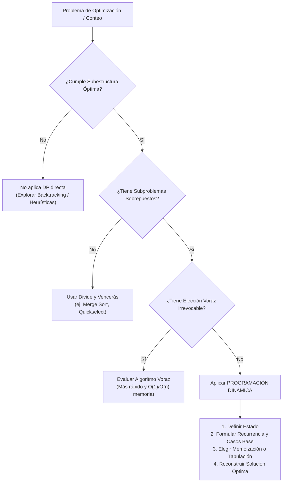

# Apuntes: Programación Dinámica (*Dynamic Programming*)

La **Programación Dinámica** (**DP**, por sus siglas en inglés *Dynamic Programming*) es uno de los paradigmas de diseño algorítmico más poderosos y versátiles de las Ciencias de la Computación. Fue formalizada en la década de 1950 por el matemático estadounidense **Richard Bellman** para resolver problemas secuenciales de toma de decisiones y optimización combinatoria.

> [!NOTE]
> **¿Por qué se llama "Programación Dinámica"?**  
> El término *"programación"* no proviene de escribir código de computadora, sino del argot matemático y militar de la década de 1950 (*linear programming*, *mathematical programming*), donde significaba **planificación u optimización tabular**. Bellman añadió *"dinámica"* para reflejar la naturaleza secuencial y variante en el tiempo de las decisiones, y porque sonaba académicamente impresionante ante sus financiadores.

La idea central del paradigma se condensa en el aforismo de George Santayana adaptado a la algoritmia:
> **"Quien no recuerda las soluciones ya calculadas está condenado a recomputarlas exponencialmente."**

En lugar de resolver repetidamente las mismas instancias menores en un árbol recursivo ingenuo, la Programación Dinámica **intercambia memoria por tiempo**: almacena el resultado de cada subproblema la primera vez que se resuelve y lo reutiliza en tiempo constante $O(1)$ cada vez que vuelve a necesitarse.

---

## 1. Los Dos Pilares Fundamentales

Para que un problema pueda resolverse de manera exacta y eficiente mediante Programación Dinámica, debe exhibir **dos propiedades matemáticas indispensables**:

### 1.1 Subestructura Óptima (*Optimal Substructure*)
Un problema presenta **subestructura óptima** si una solución óptima global puede construirse combinando soluciones óptimas a sus subproblemas componentes. Este principio se conoce formalmente como el **Principio de Optimalidad de Bellman**:

> *"Una política óptima tiene la propiedad de que, cualesquiera que sean el estado y la decisión iniciales, las decisiones restantes deben constituir una política óptima con respecto al estado resultante de la primera decisión."*

* **¿Cuándo SÍ existe?**  
  - **Camino más corto sin pesos negativos:** Si la ruta óptima de $u \to v$ pasa por un vértice intermedio $w$, entonces el tramo $u \to w$ debe ser óptimo y el tramo $w \to v$ también debe ser óptimo.
  - **Mochila 0/1, Cambio de Monedas, LCSq y Subcadena Común:** La decisión óptima en el paso $i$ depende únicamente del valor óptimo alcanzado en los prefijos o capacidades menores.
* **¿Cuándo NO existe?**  
  - **Camino simple más largo** entre dos vértices en un grafo con ciclos: los subcaminos $u \to w$ y $w \to v$ no son independientes porque compartir un vértice invalidaría la condición de *camino simple*. Al haber acoplamiento global entre subproblemas, la subestructura óptima se rompe.

### 1.2 Subproblemas Sobrepuestos (*Overlapping Subproblems*)
Un algoritmo recursivo genera **subproblemas sobrepuestos** cuando, al descomponer el problema original, las distintas ramas del árbol de recursión invocan **exactamente los mismos subproblemas una y otra vez**.

Consideremos el ejemplo elemental de la sucesión de Fibonacci $F(n) = F(n-1) + F(n-2)$:

```text
Árbol de Recursión Ingenua (Redundante)          DAG de Estados en DP (Sin repetición)
                 F(5)
               /      \
            F(4)      F(3) ◀─┐                    F(5) ──▶ F(4) ──▶ F(3) ──▶ F(2) ──▶ F(1)
           /    \     /  \   │                     │        ▲        ▲        ▲        ▲
        F(3)   F(2) F(2) F(1)│                     └────────┴────────┴────────┴────────┘
        /  \    │    │       │                        Cada estado se evalúa UNA sola vez
     F(2) F(1) F(1) F(1)─────┘                        y forma un Grafo Acíclico Dirigido (DAG)
```

* En **Divide y Vencerás** (ej. *Merge Sort*), los subproblemas son **disjuntos** (mitad izquierda vs. mitad derecha); memorizar resultados no aporta beneficio.
* En **Programación Dinámica**, el espacio de subproblemas distintos suele ser **polinomial** (por ejemplo, $O(n)$, $O(n \cdot W)$ o $O(m \cdot n)$), pero el árbol de recursión ingenuo los visita un número **exponencial** de veces ($O(2^n)$ o $O(3^n)$).

---

## 2. Metodología de Diseño en Cuatro Pasos (CLRS)

Siguiendo la metodología estándar de Cormen, Leiserson, Rivest y Stein (*Introduction to Algorithms*), diseñar un algoritmo de Programación Dinámica consiste en:



1. **Caracterizar el estado:** Elegir las variables mínimas que describen completamente un subproblema (ej. índice de ítem $i$ y capacidad restante $c$; monto restante $v$; longitudes de prefijos $(i, j)$).
2. **Definir la ecuación de recurrencia:** Expresar el valor óptimo de un estado en función de estados estrictamente más pequeños (garantizando que las dependencias formen un **DAG** sin ciclos) y establecer los casos base.
3. **Calcular el valor óptimo:** Evaluar la recurrencia guardando resultados mediante **Memoización** (*Top-down*) o **Tabulación** (*Bottom-up*).
4. **Reconstruir la solución óptima:** A partir de la tabla o de un arreglo auxiliar de decisiones (`padre`), rastrear en sentido inverso qué elecciones produjeron el valor óptimo.

---

## 3. Las Tres Estrategias de Implementación

En la [**Práctica 5: Programación Dinámica**](../practicas/practica%205.%20programacion%20dinamica/programacion_dinamica.py) se implementaron y contrastaron experimentalmente las tres aproximaciones sobre cuatro problemas clásicos:

### 3.1 Recursividad Ingenua (*Naive Recursion*)
Traduce directamente la definición matemática de la recurrencia a llamadas recursivas puras, **sin almacenar estados previos**.
* **Ventaja:** Código extremadamente breve y útil como referencia (*oracle*) para validar casos pequeños en pruebas unitarias.
* **Desventaja:** Complejidad **exponencial** ($O(2^n)$, $O(k^V)$, $O(2^{m+n})$, $O(3^{m+n})$); colapsa rápidamente ante entradas de tamaño moderado ($n \approx 20-30$).

### 3.2 Memoización (*Top-down DP*)
Conserva la estructura recursiva natural desde el problema completo hacia los casos base, pero consulta y actualiza una estructura de caché (diccionario *hash* o arreglo inicializado con centinelas).
* **Ventajas:**
  - Evalúa **únicamente los subproblemas alcanzables** (*lazy evaluation*). Si el espacio de estados es disperso, puede visitar una fracción mínima de la tabla completa.
  - Transforma la complejidad temporal de exponencial a polinomial o pseudo-polinomial.
* **Desventajas:**
  - **Sobrecarga de pila (*Call Stack Overhead*):** Cada llamada crea un marco en memoria; en Python, profundidades mayores a `1000` lanzan `RecursionError` si no se ajusta `sys.setrecursionlimit()`.
  - **Sobrecarga de memoria en *Heap*:** Las tablas *hash* (`dict` con claves tipo tupla `(i, c)`) consumen mucha más RAM y sufren peor localidad de caché que los arreglos contiguos.

### 3.3 Tabulación (*Bottom-up DP*)
Elimina por completo la recursión. Llena iterativamente una tabla (1D o 2D) siguiendo el **orden topológico** del DAG de dependencias, comenzando por los casos base hasta llegar al estado objetivo.
* **Ventajas:**
  - **Sin riesgo de *Stack Overflow*** ni costo por invocación de funciones.
  - **Excelente localidad espacial de caché:** Recorre listas o matrices en orden secuencial.
  - Facilita enormemente la **reconstrucción de la solución** y permite aplicar **optimizaciones de espacio** (*rolling arrays*).
* **Desventaja:** Evalúa todos los estados de la tabla aunque algunos no sean necesarios para la respuesta final.

### Comparativa Técnica y Evidencia Empírica (Práctica 5)

| Criterio | Recursividad Ingenua | Memoización (*Top-down*) | Tabulación (*Bottom-up*) |
| :--- | :--- | :--- | :--- |
| **Flujo de ejecución** | Recursivo ($N \to 0$) | Recursivo con caché ($N \to 0$) | Iterativo ($0 \to N$) |
| **Subproblemas evaluados** | Todos con repetición masiva | Solo los estados alcanzables | Todo el dominio de la tabla |
| **Riesgo de desbordamiento de pila** | Crítico | Alto (depende de la profundidad) | Nulo ($O(1)$ en pila) |
| **Tiempo en Mochila ($n=20, W=81$)** | $109.31\text{ ms}$ ($1,170,310$ llamadas) | $0.281\text{ ms}$ ($1,061$ estados) | **$0.149\text{ ms}$** (**$732.9\times$ speedup**) |
| **Escalabilidad Mochila ($n=300, W=1500$)** | Intratable ($> 2^{300}$ ops) | $128.12\text{ ms}$ / $63,566.57\text{ KiB}$ | **$46.81\text{ ms}$** / **$10,441.20\text{ KiB}$** |

> [!TIP]
> **Observación de ingeniería de la Práctica 5:** En Python, la Tabulación resultó ser consistentemente **entre $2.4\times$ y $2.7\times$ más rápida** que la Memoización en instancias grandes de la Mochila 0/1, consumiendo **$\sim 6\times$ menos memoria RAM** al evitar la sobrecarga de los cubos *hash* y tuplas en el *heap*.

---

## 4. Comparativa Integral de Paradigmas

| Dimensión | Fuerza Bruta / Recursión Ingenua | Divide y Vencerás | Algoritmos Voraces (*Greedy*) | Programación Dinámica (*DP*) |
| :--- | :--- | :--- | :--- | :--- |
| **Naturaleza de subproblemas** | Solapados o combinatorios | Independientes y disjuntos | Un único subproblema residual | **Solapados** con **subestructura óptima** |
| **Estrategia de decisión** | Prueba todas las rutas | Divide, resuelve y combina | Elige el **óptimo local** sin retroceso | Evalúa todas las decisiones y **memoriza** el óptimo |
| **Garantía de optimalidad** | Sí (si termina) | Sí (para su dominio) | **Solo** si existe propiedad de elección voraz | **Siempre** (si hay subestructura óptima) |
| **Complejidad temporal típica** | Exponencial $O(2^n), O(n!)$ | $O(n \log n), O(n^{\log_b a})$ | $O(n)$ o $O(n \log n)$ | Polinomial o pseudo-polinomial $O(n^2), O(nW)$ |
| **Ejemplos canónicos** | Mochila ingenua, TSP bruto | Merge Sort, Quickselect, Strassen | Huffman, Kruskal, Prim, Mochila Fraccionaria | **Mochila 0/1, Cambio de Monedas, LCSq, LCS** |

---

## 5. Problemas Clásicos, Trazas de Escritorio e Implementación

A continuación se desarrollan formalmente los cuatro problemas implementados en [`programacion_dinamica.py`](../practicas/practica%205.%20programacion%20dinamica/programacion_dinamica.py), junto con sus ecuaciones de recurrencia, pruebas de escritorio paso a paso y código canónico en Python.

---

### 5.1 Problema de la Mochila 0/1 (*0/1 Knapsack Problem*)

#### Planteamiento Formal
Dados $n$ objetos, cada uno con peso entero $w_i > 0$ y valor entero $v_i > 0$ ($i = 0, \dots, n-1$), y una mochila de capacidad máxima entera $W \ge 0$, seleccionar un subconjunto de objetos tal que cada objeto se tome completo ($x_i = 1$) o se deje ($x_i = 0$), maximizando el beneficio total sin rebasar $W$:

$$\max \sum_{i=0}^{n-1} v_i x_i \qquad \text{sujeto a} \qquad \sum_{i=0}^{n-1} w_i x_i \le W, \quad x_i \in \{0, 1\}$$

> [!WARNING]
> **Diferencia crítica con la Mochila Fraccionaria:** En los [apuntes de Algoritmos Voraces](./Algoritmos%20voraces.md#caso-1-el-problema-de-la-mochila-knapsack-problem) vimos que si los objetos pueden fraccionarse, ordenar por densidad $v_i / w_i$ es óptimo en $O(n \log n)$. Cuando los objetos son **indivisibles (0/1)**, el algoritmo voraz **fracasa**, siendo obligatoria la Programación Dinámica.

#### Ecuación de Recurrencia de Bellman
Sea $DP(i, c)$ el valor máximo alcanzable considerando los primeros $i$ objetos (índices $0 \dots i-1$) con capacidad disponible $c$:

$$DP(i, c) = \begin{cases}
0 & \text{si } i = 0 \lor c \le 0 \\
DP(i - 1, c) & \text{si } w_{i-1} > c \\
\max\Big(DP(i - 1, c),\; v_{i-1} + DP(i - 1, c - w_{i-1})\Big) & \text{si } w_{i-1} \le c
\end{cases}$$

#### Prueba de Escritorio (Caso Clásico de la Práctica)
Consideremos la instancia por defecto de `programacion_dinamica.py`:
* **Objetos ($n = 4$):**  
  - Objeto `0`: $w_0 = 2,\; v_0 = 3$  
  - Objeto `1`: $w_1 = 3,\; v_1 = 4$  
  - Objeto `2`: $w_2 = 4,\; v_2 = 5$  
  - Objeto `3`: $w_3 = 5,\; v_3 = 8$  
* **Capacidad máxima:** $W = 8$

Llenado de la matriz `dp[i][c]` de tamaño $5 \times 9$:

| $i$ \ $c$ | $0$ | $1$ | $2$ | $3$ | $4$ | $5$ | $6$ | $7$ | $8$ | Objeto considerado |
| :---: | :---: | :---: | :---: | :---: | :---: | :---: | :---: | :---: | :---: | :--- |
| **$0$** | $0$ | $0$ | $0$ | $0$ | $0$ | $0$ | $0$ | $0$ | $0$ | Ninguno (caso base) |
| **$1$** | $0$ | $0$ | $3$ | $3$ | $3$ | $3$ | $3$ | $3$ | $3$ | Objeto `0` ($w=2, v=3$) |
| **$2$** | $0$ | $0$ | $3$ | $4$ | $4$ | $7$ | $7$ | $7$ | $7$ | Objeto `1` ($w=3, v=4$) |
| **$3$** | $0$ | $0$ | $3$ | $4$ | $5$ | $7$ | $8$ | $9$ | $9$ | Objeto `2` ($w=4, v=5$) |
| **$4$** | $0$ | $0$ | $3$ | $4$ | $5$ | $8$ | $8$ | $11$ | **$12$** | Objeto `3` ($w=5, v=8$) |

* **Traza de reconstrucción desde `(i=4, c=8)`:**
  1. `dp[4][8] = 12 != dp[3][8] = 9` $\implies$ **Se incluye el Objeto `3`** ($w_3 = 5, v_3 = 8$). Capacidad restante: $c = 8 - 5 = 3$.
  2. `dp[3][3] = 4 == dp[2][3] = 4` $\implies$ No se incluye el Objeto `2`.
  3. `dp[2][3] = 4 != dp[1][3] = 3` $\implies$ **Se incluye el Objeto `1`** ($w_1 = 3, v_1 = 4$). Capacidad restante: $c = 3 - 3 = 0$.
  4. `c == 0` (o `dp[1][0] == dp[0][0]`) $\implies$ Fin.
* **Resultado óptimo:** Valor máximo $= \mathbf{12}$, objetos seleccionados $= \texttt{[1, 3]}$ (peso total $3 + 5 = 8 \le 8$).

#### Análisis de Complejidad: ¿Por qué es Pseudo-polinomial?
* **Recursividad Ingenua:** Tiempo $O(2^n)$, Espacio en pila $O(n)$.
* **Memoización:** Tiempo $O(n \cdot W)$, Espacio $O(n \cdot W)$ en tabla *hash* + $O(n)$ en pila.
* **Tabulación:** Tiempo $\Theta(n \cdot W)$, Espacio $\Theta(n \cdot W)$.
* **Naturaleza Pseudo-polinomial:** La magnitud numérica $W$ requiere únicamente $b = \lfloor \log_2 W \rfloor + 1$ bits para codificarse en la entrada. Como $W \approx 2^b$, el tiempo $O(n \cdot W) = O(n \cdot 2^b)$ es **exponencial respecto al tamaño en bits de $W$**. Por ello, la Mochila 0/1 es un problema **NP-completo débil**.

#### Implementación en Python (Tres Versiones)

```python
def mochila_recursiva(pesos: list[int], valores: list[int], capacidad: int) -> int:
    def _rec(i: int, cap: int) -> int:
        if i == 0 or cap <= 0:
            return 0
        if pesos[i - 1] > cap:
            return _rec(i - 1, cap)
        return max(
            _rec(i - 1, cap),
            valores[i - 1] + _rec(i - 1, cap - pesos[i - 1])
        )
    return _rec(len(pesos), capacidad)


def mochila_memo(pesos: list[int], valores: list[int], capacidad: int) -> int:
    memo: dict[tuple[int, int], int] = {}

    def _rec(i: int, cap: int) -> int:
        if i == 0 or cap <= 0:
            return 0
        if (i, cap) in memo:
            return memo[(i, cap)]
        if pesos[i - 1] > cap:
            res = _rec(i - 1, cap)
        else:
            res = max(
                _rec(i - 1, cap),
                valores[i - 1] + _rec(i - 1, cap - pesos[i - 1])
            )
        memo[(i, cap)] = res
        return res

    return _rec(len(pesos), capacidad)


def mochila_tabulacion(
    pesos: list[int], valores: list[int], capacidad: int
) -> tuple[int, list[int]]:
    n = len(pesos)
    dp = [[0] * (capacidad + 1) for _ in range(n + 1)]

    for i in range(1, n + 1):
        w, v = pesos[i - 1], valores[i - 1]
        for c in range(capacidad + 1):
            if w > c:
                dp[i][c] = dp[i - 1][c]
            else:
                dp[i][c] = max(dp[i - 1][c], v + dp[i - 1][c - w])

    # Reconstrucción por retroceso
    seleccionados = []
    c_actual = capacidad
    for i in range(n, 0, -1):
        if dp[i][c_actual] != dp[i - 1][c_actual]:
            seleccionados.append(i - 1)
            c_actual -= pesos[i - 1]
    seleccionados.reverse()
    return dp[n][capacidad], seleccionados
```

---

### 5.2 Problema del Cambio de Monedas (*Coin Change — Mínimas Monedas*)

#### Planteamiento Formal
Dado un conjunto de $k$ denominaciones de monedas enteras positivas $C = \{c_1, c_2, \dots, c_k\}$ (con suministro ilimitado de cada denominación) y un monto objetivo entero $V \ge 0$, determinar la **cantidad mínima de monedas** cuya suma sea exactamente $V$ (o reportar `-1` / $\infty$ si es imposible formar $V$).

#### Ecuación de Recurrencia
Sea $DP(v)$ el mínimo número de monedas requerido para formar exactamente el monto $v$:

$$DP(v) = \begin{cases}
0 & \text{si } v = 0 \\
\infty & \text{si } v < 0 \\
1 + \min_{\substack{c \in C \\ c \le v}} DP(v - c) & \text{si } v > 0
\end{cases}$$

#### Análisis de Optimalidad: DP vs. Heurística Voraz
Un sistema monetario se dice **canónico** si la estrategia voraz (tomar siempre la moneda de mayor valor $\le v$) garantiza el óptimo global (ej. monedas MXN `[1, 2, 5, 10, 20]` o USD `[1, 5, 10, 25]`). Sin embargo, en **sistemas no canónicos**, el algoritmo voraz queda atrapado en óptimos locales subóptimos:

| Instancia de la Práctica 5 | Monedas $C$ | Monto $V$ | Solución Voraz (*Greedy*) | Solución Óptima (DP) | Ventaja DP |
| :--- | :---: | :---: | :--- | :--- | :---: |
| `no_canonico_1_3_4_m6` | `[1, 3, 4]` | $6$ | `[4, 1, 1]` $\to 3$ monedas | **`[3, 3]` $\to 2$ monedas** | $-1$ moneda |
| `no_canonico_1_15_25_m30` | `[1, 15, 25]` | $30$ | `[25, 1, 1, 1, 1, 1]` $\to 6$ monedas | **`[15, 15]` $\to 2$ monedas** | $-4$ monedas |
| `no_canonico_1_6_10_m12` | `[1, 6, 10]` | $12$ | `[10, 1, 1]` $\to 3$ monedas | **`[6, 6]` $\to 2$ monedas** | $-1$ moneda |
| `imposible_pares_monto_impar` | `[2, 4, 6]` | $15$ | `-1` (Imposible) | **`-1` (Imposible)** | Exacto |

#### Prueba de Escritorio (`C = [1, 3, 4]`, `V = 6`)
Llenado de `dp[0..6]` y del arreglo de reconstrucción `padre[0..6]` (última moneda elegida):

| $v$ | $0$ | $1$ | $2$ | $3$ | $4$ | $5$ | $6$ |
| :--- | :---: | :---: | :---: | :---: | :---: | :---: | :---: |
| **`dp[v]`** | $0$ | $1$ | $2$ | $1$ | $1$ | $2$ | **$2$** |
| **`padre[v]`** | `-1` | `1` | `1` | `3` | `4` | `1` | **`3`** |
| **Cálculo** | Base | $1+dp[0]$ | $1+dp[1]$ | $\min(1+dp[2], 1+dp[0])$ | $\min(1+dp[3], 1+dp[1], 1+dp[0])$ | $\min(1+dp[4], 1+dp[2], 1+dp[1])$ | $\min(1+dp[5], \mathbf{1+dp[3]}, 1+dp[2])$ |

* **Reconstrucción desde `curr = 6`:**
  1. `padre[6] = 3` $\implies$ moneda `3`, restante $6 - 3 = 3$.
  2. `padre[3] = 3` $\implies$ moneda `3`, restante $3 - 3 = 0$.
* **Resultado óptimo:** $2$ monedas (`[3, 3]`), superando al voraz (`[4, 1, 1]`).

#### Complejidad
* **Recursividad Ingenua:** Tiempo $O(k^V)$ en el peor caso (cuando existe la moneda `1`), Espacio $O(V)$ en pila.
* **Memoización:** Tiempo $O(k \cdot V)$, Espacio $O(V)$ en tabla + $O(V)$ en pila.
* **Tabulación:** Tiempo $\Theta(k \cdot V)$, Espacio $\Theta(V)$.

#### Implementación en Python (Tres Versiones)

```python
import math

def cambio_recursivo(monedas: list[int], monto: int) -> int:
    def _rec(m: int) -> float:
        if m == 0:
            return 0
        if m < 0:
            return math.inf
        mejor = math.inf
        for c in monedas:
            res = _rec(m - c)
            if res != math.inf:
                mejor = min(mejor, 1 + res)
        return mejor

    ans = _rec(monto)
    return int(ans) if ans != math.inf else -1


def cambio_memo(monedas: list[int], monto: int) -> int:
    memo: dict[int, float] = {}

    def _rec(m: int) -> float:
        if m == 0:
            return 0
        if m < 0:
            return math.inf
        if m in memo:
            return memo[m]
        mejor = math.inf
        for c in monedas:
            res = _rec(m - c)
            if res != math.inf:
                mejor = min(mejor, 1 + res)
        memo[m] = mejor
        return mejor

    ans = _rec(monto)
    return int(ans) if ans != math.inf else -1


def cambio_tabulacion(monedas: list[int], monto: int) -> tuple[int, list[int]]:
    dp = [float("inf")] * (monto + 1)
    padre = [-1] * (monto + 1)
    dp[0] = 0.0

    for v in range(1, monto + 1):
        for c in monedas:
            if v >= c and dp[v - c] + 1 < dp[v]:
                dp[v] = dp[v - c] + 1
                padre[v] = c

    if dp[monto] == float("inf"):
        return -1, []

    usadas = []
    curr = monto
    while curr > 0:
        usadas.append(padre[curr])
        curr -= padre[curr]
    return int(dp[monto]), usadas
```

---

### 5.3 Subsecuencia Común Más Larga (*LCSq — Longest Common Subsequence*)

#### Definición Formal
Dadas dos secuencias $X = \langle x_0, x_1, \dots, x_{m-1} \rangle$ e $Y = \langle y_0, y_1, \dots, y_{n-1} \rangle$, una **subsecuencia** de $X$ se obtiene eliminando cero o más elementos **sin alterar el orden relativo** de los caracteres conservados (**no requiere contigüidad**). Se busca la subsecuencia común de mayor longitud posible.

#### Ecuación de Recurrencia
Sea $DP(i, j)$ la longitud de la LCSq de los prefijos $X[0 \dots i-1]$ e $Y[0 \dots j-1]$:

$$DP(i, j) = \begin{cases}
0 & \text{si } i = 0 \lor j = 0 \\
1 + DP(i - 1, j - 1) & \text{si } X[i - 1] == Y[j - 1] \\
\max\big(DP(i - 1, j),\; DP(i, j - 1)\big) & \text{si } X[i - 1] \neq Y[j - 1]
\end{cases}$$

#### Prueba de Escritorio (Caso Clásico CLRS)
* $X = \texttt{"ABCBDAB"}$ ($m = 7$), $Y = \texttt{"BDCABA"}$ ($n = 6$).

| $i$ \ $j$ | $0$ ($\varepsilon$) | $1$ (`B`) | $2$ (`D`) | $3$ (`C`) | $4$ (`A`) | $5$ (`B`) | $6$ (`A`) |
| :---: | :---: | :---: | :---: | :---: | :---: | :---: | :---: |
| **$0$ ($\varepsilon$)** | $0$ | $0$ | $0$ | $0$ | $0$ | $0$ | $0$ |
| **$1$ (`A`)** | $0$ | $0$ | $0$ | $0$ | $1$ | $1$ | $1$ |
| **$2$ (`B`)** | $0$ | **`1`** | $1$ | $1$ | $1$ | $2$ | $2$ |
| **$3$ (`C`)** | $0$ | $1$ | $1$ | **`2`** | $2$ | $2$ | $2$ |
| **$4$ (`B`)** | $0$ | $1$ | $1$ | $2$ | $2$ | **`3`** | $3$ |
| **$5$ (`D`)** | $0$ | $1$ | $2$ | $2$ | $2$ | $3$ | $3$ |
| **$6$ (`A`)** | $0$ | $1$ | $2$ | $2$ | $3$ | $3$ | **`4`** |
| **$7$ (`B`)** | $0$ | $1$ | $2$ | $2$ | $3$ | $4$ | $4$ |

* **Traza de reconstrucción desde `(7, 6)`:**
  - `(7, 6)`: `B != A`, `dp[6][6] = 4 >= dp[7][5] = 4` $\to$ sube a `(6, 6)`.
  - `(6, 6)`: `A == A` $\to$ toma **`'A'`**, diagonal a `(5, 5)`.
  - `(5, 5)`: `D != B`, `dp[4][5] = 3 >= dp[5][4] = 2` $\to$ sube a `(4, 5)`.
  - `(4, 5)`: `B == B` $\to$ toma **`'B'`**, diagonal a `(3, 4)`.
  - `(3, 4)`: `C != A`, `dp[2][4] = 1 < dp[3][3] = 2` $\to$ izquierda a `(3, 3)`.
  - `(3, 3)`: `C == C` $\to$ toma **`'C'`**, diagonal a `(2, 2)`.
  - `(2, 2)`: `B != D`, `dp[1][2] = 0 < dp[2][1] = 1` $\to$ izquierda a `(2, 1)`.
  - `(2, 1)`: `B == B` $\to$ toma **`'B'`**, diagonal a `(1, 0)` $\to$ fin.
* Al invertir los caracteres recolectados (`['A', 'B', 'C', 'B']`) se obtiene **`"BCBA"`** (longitud $4$). *(Nota: otras LCSq válidas de longitud $4$ son `"BDAB"` y `"BCAB"`, dependiendo de la regla de desempate en la reconstrucción).*

#### Complejidad
* **Recursividad Ingenua:** Tiempo $O(2^{m+n})$, Espacio $O(m+n)$ en pila.
* **Memoización:** Tiempo $O(m \cdot n)$, Espacio $O(m \cdot n)$ en tabla + $O(m+n)$ en pila.
* **Tabulación:** Tiempo $\Theta(m \cdot n)$, Espacio $\Theta(m \cdot n)$ (reconstrucción en $O(m + n)$).

#### Implementación en Python (Tres Versiones)

```python
def lcsq_recursiva(s1: str, s2: str) -> int:
    def _rec(i: int, j: int) -> int:
        if i == 0 or j == 0:
            return 0
        if s1[i - 1] == s2[j - 1]:
            return 1 + _rec(i - 1, j - 1)
        return max(_rec(i - 1, j), _rec(i, j - 1))
    return _rec(len(s1), len(s2))


def lcsq_memo(s1: str, s2: str) -> int:
    memo: dict[tuple[int, int], int] = {}

    def _rec(i: int, j: int) -> int:
        if i == 0 or j == 0:
            return 0
        if (i, j) in memo:
            return memo[(i, j)]
        if s1[i - 1] == s2[j - 1]:
            res = 1 + _rec(i - 1, j - 1)
        else:
            res = max(_rec(i - 1, j), _rec(i, j - 1))
        memo[(i, j)] = res
        return res

    return _rec(len(s1), len(s2))


def lcsq_tabulacion(s1: str, s2: str) -> tuple[int, str]:
    m, n = len(s1), len(s2)
    dp = [[0] * (n + 1) for _ in range(m + 1)]

    for i in range(1, m + 1):
        for j in range(1, n + 1):
            if s1[i - 1] == s2[j - 1]:
                dp[i][j] = 1 + dp[i - 1][j - 1]
            else:
                dp[i][j] = max(dp[i - 1][j], dp[i][j - 1])

    caracteres = []
    i, j = m, n
    while i > 0 and j > 0:
        if s1[i - 1] == s2[j - 1]:
            caracteres.append(s1[i - 1])
            i -= 1
            j -= 1
        elif dp[i - 1][j] >= dp[i][j - 1]:
            i -= 1
        else:
            j -= 1
    caracteres.reverse()
    return dp[m][n], "".join(caracteres)
```

---

### 5.4 Subcadena Común Más Larga (*LCS — Longest Common Substring*)

#### Definición y Diferencia Estructural con LCSq
Una **subcadena** exige que los caracteres compartidos sean **estrictamente contiguos** en ambas cadenas. Por ejemplo, para `s1 = "ALGORITMOS_ESCOM"` y `s2 = "AVANZADO_ALGORITMOS_IPN"`:
* **Subcadena Común Más Larga (LCS):** `"ALGORITMOS_"` (longitud $11$).
* **Subsecuencia Común Más Larga (LCSq):** podría tomar también letras posteriores como `'O'`, `'S'` o `'M'` saltando huecos.

#### Ecuación de Recurrencia (Sufijos Comunes)
Dado que la contigüidad se rompe ante cualquier discrepancia, definimos el estado $LCSuf(i, j)$ como la longitud del **sufijo común más largo** de los prefijos $X[0 \dots i-1]$ e $Y[0 \dots j-1]$:

$$LCSuf(i, j) = \begin{cases}
0 & \text{si } i = 0 \lor j = 0 \\
1 + LCSuf(i - 1, j - 1) & \text{si } X[i - 1] == Y[j - 1] \\
0 & \text{si } X[i - 1] \neq Y[j - 1]
\end{cases}$$

La respuesta global del problema es el **máximo en toda la tabla**, no necesariamente la última celda $(m, n)$:

$$\text{LCS}(X, Y) = \max_{\substack{1 \le i \le m \\ 1 \le j \le n}} LCSuf(i, j)$$

#### Prueba de Escritorio (`s1 = "HOLA"`, `s2 = "SOLAR"`)

| $i$ \ $j$ | $0$ ($\varepsilon$) | $1$ (`S`) | $2$ (`O`) | $3$ (`L`) | $4$ (`A`) | $5$ (`R`) |
| :---: | :---: | :---: | :---: | :---: | :---: | :---: |
| **$0$ ($\varepsilon$)** | $0$ | $0$ | $0$ | $0$ | $0$ | $0$ |
| **$1$ (`H`)** | $0$ | $0$ | $0$ | $0$ | $0$ | $0$ |
| **$2$ (`O`)** | $0$ | $0$ | **`1`** | $0$ | $0$ | $0$ |
| **$3$ (`L`)** | $0$ | $0$ | $0$ | **`2`** | $0$ | $0$ |
| **$4$ (`A`)** | $0$ | $0$ | $0$ | $0$ | **`3`** | $0$ |

* **Máximo global:** `max_len = 3` alcanzado en `fin_s1 = 4`.
* **Reconstrucción directa en $O(1)$ adicional:** `s1[fin_s1 - max_len : fin_s1] = s1[1:4] = "OLA"`.

#### Complejidad y Trampa en la Versión Recursiva / Memoizada
* **Recursividad Ingenua:** La formulación con 3 parámetros `(i, j, longitud_actual)` explora 3 ramas en cada coincidencia: continuar racha `(i-1, j-1, len+1)`, reiniciar en `i-1` y reiniciar en `j-1`. Su complejidad es $O(3^{m+n})$. Como comprobamos en la práctica con `"ALGORITMO"` y `"LOGARITMO"` ($L=9$), la recursión ingenua realizó **$266,548$ llamadas**.
* **Memoización:** Memoizar `_sufijo_comun(i, j)` evaluando cada par `(i, j)` garantiza que cada estado se calcule a lo sumo una vez, reduciendo las llamadas en el mismo ejemplo de $266,548$ a apenas **$174$ llamadas** ($81$ subproblemas), con complejidad $O(m \cdot n)$ y profundidad de pila $O(\min(m, n))$.
  > [!CAUTION]
  > **Error sutil de implementación:** Si en la memoización se invocan ramas hijas como `(i-1, j)` y `(i, j-1)` *antes* de guardar `memo[(i, j)]`, los subproblemas sobrepuestos se vuelven a visitar exponencialmente antes de cachearse. Siempre debe calcularse primero `memo[(i, j)]` para el estado actual.
* **Tabulación:** Tiempo $\Theta(m \cdot n)$, Espacio $\Theta(m \cdot n)$.

#### Implementación en Python (Tres Versiones)

```python
def lcs_subcadena_recursiva(s1: str, s2: str) -> int:
    def _rec(i: int, j: int, longitud_actual: int) -> int:
        if i == 0 or j == 0:
            return longitud_actual
        c1 = longitud_actual
        if s1[i - 1] == s2[j - 1]:
            c1 = _rec(i - 1, j - 1, longitud_actual + 1)
        c2 = _rec(i - 1, j, 0)
        c3 = _rec(i, j - 1, 0)
        return max(longitud_actual, c1, c2, c3)

    if not s1 or not s2:
        return 0
    return _rec(len(s1), len(s2), 0)


def lcs_subcadena_memo(s1: str, s2: str) -> int:
    m, n = len(s1), len(s2)
    memo: dict[tuple[int, int], int] = {}

    def _sufijo(i: int, j: int) -> int:
        if i == 0 or j == 0:
            return 0
        if (i, j) in memo:
            return memo[(i, j)]
        res = (1 + _sufijo(i - 1, j - 1)) if s1[i - 1] == s2[j - 1] else 0
        memo[(i, j)] = res
        return res

    max_len = 0
    for i in range(1, m + 1):
        for j in range(1, n + 1):
            max_len = max(max_len, _sufijo(i, j))
    return max_len


def lcs_subcadena_tabulacion(s1: str, s2: str) -> tuple[int, str]:
    m, n = len(s1), len(s2)
    dp = [[0] * (n + 1) for _ in range(m + 1)]
    max_len = 0
    fin_s1 = 0

    for i in range(1, m + 1):
        for j in range(1, n + 1):
            if s1[i - 1] == s2[j - 1]:
                dp[i][j] = 1 + dp[i - 1][j - 1]
                if dp[i][j] > max_len:
                    max_len = dp[i][j]
                    fin_s1 = i
            else:
                dp[i][j] = 0

    subcadena = s1[fin_s1 - max_len : fin_s1] if max_len > 0 else ""
    return max_len, subcadena
```

---

## 6. Síntesis de Resultados Experimentales (Práctica 5)

Los experimentos de la práctica ([`benchmark.py`](../practicas/practica%205.%20programacion%20dinamica/benchmark.py) y [`tablas.md`](../practicas/practica%205.%20programacion%20dinamica/resultados/tablas.md)) arrojaron evidencia concluyente sobre dos ejes: **eficiencia asintótica** y **optimalidad**.

### 6.1 Quiebre Exponencial vs. Polinomial (Instancias Pequeñas)

| Problema (Mayor tamaño evaluado en 3 variantes) | Tiempo Recursiva | Llamadas Recursivas | Tiempo Memoización | Tiempo Tabulación | *Speedup* Tab / Rec |
| :--- | :---: | :---: | :---: | :---: | :---: |
| **Mochila 0/1** ($n=20, W=81$) | $109.31356\text{ ms}$ | $1,170,310$ | $0.28143\text{ ms}$ | $0.14916\text{ ms}$ | **$732.9\times$** |
| **Cambio de Monedas** ($V=18, C=[1,2,5]$) | $4.21313\text{ ms}$ | $38,869$ | $0.00932\text{ ms}$ | $0.00486\text{ ms}$ | **$866.9\times$** |
| **LCSq** ($L=7$) | $0.10690\text{ ms}$ | $1,233$ | $0.01213\text{ ms}$ | $0.00872\text{ ms}$ | **$12.3\times$** |
| **Subcadena LCS** ($L=7$) | $1.39015\text{ ms}$ | $15,355$ | $0.00940\text{ ms}$ | $0.00520\text{ ms}$ | **$267.3\times$** |

* En **Mochila 0/1 ($n=4, W=13$)** se observó el punto de cruce inferior: la recursión ingenua ($0.0036\text{ ms}$) superó ligeramente a la tabulación ($0.00747\text{ ms}$, $0.5\times$) porque el costo de asignar la matriz supera a las $20$ llamadas recursivas. Desde $n \ge 8$, DP domina de forma irreversible.

### 6.2 Escalabilidad: Memoización vs. Tabulación (Mochila 0/1)

| $n$ | Capacidad $W$ | Tiempo Memo (ms) | Tiempo Tab (ms) | Memoria Memo (KiB) | Memoria Tab (KiB) | Relación Tiempo (Memo/Tab) |
| :---: | :---: | :---: | :---: | :---: | :---: | :---: |
| $50$ | $250$ | $2.81308$ | $1.15738$ | $1,012.316$ | $293.992$ | $2.43\times$ |
| $100$ | $500$ | $13.04842$ | $4.96092$ | $4,720.641$ | $1,125.738$ | $2.63\times$ |
| $150$ | $750$ | $29.67346$ | $11.22533$ | $15,330.562$ | $2,483.891$ | $2.64\times$ |
| $200$ | $1000$ | $54.53604$ | $20.21367$ | $20,021.547$ | $4,555.098$ | $2.70\times$ |
| $300$ | $1500$ | $128.11596$ | $46.80933$ | $63,566.570$ | $10,441.195$ | $2.74\times$ |

---

## 7. Optimización Avanzada de Espacio (*Space Optimization*)

En la tabulación de muchos problemas 2D, calcular la fila `i` depende **únicamente de la fila `i - 1`**. Esto permite reducir el espacio auxiliar en un orden de magnitud:

### 7.1 Mochila 0/1 en Espacio $O(W)$ (Arreglo 1D Inverso)
Podemos reemplazar la matriz `dp[n+1][W+1]` por un solo arreglo `dp[W+1]`, **siempre y cuando recorramos la capacidad $c$ de mayor a menor** (`W` hasta `w`):

```python
def mochila_espacio_optimizado(pesos: list[int], valores: list[int], W: int) -> int:
    dp = [0] * (W + 1)
    for w, v in zip(pesos, valores):
        # ¡CRÍTICO! Recorrido inverso para no reutilizar el mismo objeto múltiples veces
        for c in range(W, w - 1, -1):
            dp[c] = max(dp[c], v + dp[c - w])
    return dp[W]
```

> [!CAUTION]
> **¿Qué ocurre si recorres `c` de izquierda a derecha (`w` hasta `W`)?**  
> Al leer `dp[c - w]` ya actualizado en la misma iteración `i`, estarías permitiendo tomar el objeto `i` **infinitas veces**, transformando accidentalmente el problema de **Mochila 0/1** en **Mochila Ilimitada (*Unbounded Knapsack*)**.

* **Trade-off de ingeniería:** Reducir el espacio a $O(W)$ (o a $O(\min(m, n))$ en LCSq/LCS usando dos filas alternadas) ahorra gigabytes en instancias grandes, pero **imposibilita la reconstrucción directa por retroceso**, salvo que se combine con estrategias divide y vencerás como el **Algoritmo de Hirschberg** (para LCSq en $O(\min(m, n))$ de espacio con reconstrucción).

---

## 8. Aplicaciones en el Mundo Real

1. **Sistemas de Control de Versiones (`git diff`) y Bioinformática:** Utilizan variantes optimizadas de **LCSq** (algoritmo de Myers) para detectar diferencias mínimas entre archivos de código fuente y alinear secuencias de ADN/ARN/proteínas.
2. **Enrutamiento en Redes de Computadoras:** Los algoritmos **Bellman-Ford** (distancia vectorial, base de RIP) y **Floyd-Warshall** (caminos mínimos entre todos los pares) son aplicaciones directas de programación dinámica sobre grafos.
3. **Procesamiento de Lenguaje Natural y Correctores Ortográficos:** La **Distancia de Levenshtein** (distancia de edición entre cadenas mediante inserciones, borrados y sustituciones) extiende directamente la matriz DP de LCSq.
4. **Tipografía Digital ($\LaTeX$):** El algoritmo de Knuth-Plass para dividir párrafos en líneas minimizando la deformación de espacios usa programación dinámica.
5. **Finanzas y Optimización de Recursos:** Asignación de portafolios de inversión y planeación de inventarios (generalizaciones de la Mochila y control óptimo).

---

## 9. Trampas Comunes y Preguntas de Examen

1. **¿La Mochila 0/1 se resuelve en tiempo polinomial con DP?**  
   **No en sentido estricto.** Su complejidad $\Theta(n \cdot W)$ es **pseudo-polinomial**, pues $W$ es exponencial respecto al número de bits $\log_2 W$ necesarios para representarlo.
2. **¿Cuál es la diferencia fundamental entre LCSq y LCS (Subcadena)?**  
   En **LCSq** los caracteres comunes pueden estar separados (si no coinciden, se propaga $\max(dp[i-1][j], dp[i][j-1])$). En **LCS** los caracteres deben ser contiguos (si no coinciden, $dp[i][j] = 0$ y la respuesta es el máximo global de toda la matriz).
3. **¿Por qué no siempre conviene usar algoritmos voraces en el Cambio de Monedas?**  
   Porque solo garantizan el óptimo en sistemas canónicos. En conjuntos como $\{1, 3, 4\}$ para $V = 6$, la elección miope del `4` impide alcanzar la solución óptima `3 + 3`.
4. **¿Cuándo preferir Memoización sobre Tabulación?**  
   Cuando el espacio de estados es multidimensional y **disperso** (muchos estados son inalcanzables desde la raíz), o cuando resulta mucho más claro expresar las transiciones recursivamente. Si la mayoría de la tabla se visitará (**espacio denso**), la **Tabulación** gana en velocidad, memoria y seguridad de pila.

---

## 10. Formulario General de Programación Dinámica

### 10.1 Resumen de Recurrencias y Complejidades

| Problema | Estado | Caso Base | Ecuación de Transición | Tiempo DP | Espacio DP (con rec.) | Tiempo Ingenuo |
| :--- | :--- | :--- | :--- | :---: | :---: | :---: |
| **Mochila 0/1** | $DP(i, c)$ | $DP(0, c)=0$, $DP(i, 0)=0$ | $\max\big(DP(i-1, c),\; v_{i-1} + DP(i-1, c - w_{i-1})\big)$ si $w_{i-1} \le c$, si no $DP(i-1, c)$ | $\Theta(n \cdot W)$ | $\Theta(n \cdot W)$ *(ó $O(W)$)* | $O(2^n)$ |
| **Cambio (Mín. Monedas)** | $DP(v)$ | $DP(0)=0$, $DP(<0)=\infty$ | $1 + \min_{c \in C,\, c \le v} DP(v - c)$ | $\Theta(k \cdot V)$ | $\Theta(V)$ | $O(k^V)$ |
| **LCSq (Subsecuencia)** | $DP(i, j)$ | $DP(0, j)=0$, $DP(i, 0)=0$ | $1+DP(i-1, j-1)$ si $X_{i-1}=Y_{j-1}$; si no $\max\big(DP(i-1,j), DP(i,j-1)\big)$ | $\Theta(m \cdot n)$ | $\Theta(m \cdot n)$ *(ó $O(\min(m,n))$)* | $O(2^{m+n})$ |
| **LCS (Subcadena)** | $LCSuf(i, j)$ | $LCSuf(0,j)=0$, $LCSuf(i,0)=0$ | $1+LCSuf(i-1, j-1)$ si $X_{i-1}=Y_{j-1}$; si no **$0$** *(Max global)* | $\Theta(m \cdot n)$ | $\Theta(m \cdot n)$ *(ó $O(\min(m,n))$)* | $O(3^{m+n})$ |

### 10.2 Reglas de Reconstrucción Rápida (*Backtracking*)
* **Mochila 0/1:** Iniciar en $(n, W)$. Si $DP[i][c] \neq DP[i-1][c]$, se tomó el objeto $i-1$ y $c \gets c - w_{i-1}$; siempre $i \gets i - 1$.
* **Cambio de Monedas:** Mantener `padre[v] = c` cuando `dp[v - c] + 1 < dp[v]`. Retroceder desde `curr = V` restando `padre[curr]` hasta `0`.
* **LCSq:** Iniciar en $(m, n)$. Si $X[i-1] == Y[j-1]$, emitir carácter y moverse en diagonal $(i-1, j-1)$; si no, moverse hacia el mayor entre $(i-1, j)$ y $(i, j-1)$. Invertir al final.
* **Subcadena LCS:** Guardar `max_len` y el índice final `fin_s1` durante el llenado de la tabla; la subcadena es directamente el corte `s1[fin_s1 - max_len : fin_s1]`.

---

## 11. Referencias

1. **Cormen, T. H., Leiserson, C. E., Rivest, R. L., & Stein, C.** (2022). *Introduction to Algorithms* (4th ed.). MIT Press. Capítulo 14: *Dynamic Programming*.
2. **Kleinberg, J., & Tardos, É.** (2006). *Algorithm Design*. Addison-Wesley. Capítulo 6: *Dynamic Programming*.
3. **Dasgupta, S., Papadimitriou, C. H., & Vazirani, U. V.** (2008). *Algorithms*. McGraw-Hill. Capítulo 6: *Dynamic Programming*.
4. **Bellman, R.** (1957). *Dynamic Programming*. Princeton University Press.
5. **Práctica 5 del Repositorio:** [`programacion_dinamica.py`](../practicas/practica%205.%20programacion%20dinamica/programacion_dinamica.py) y [`REPORTE.md`](../practicas/practica%205.%20programacion%20dinamica/REPORTE.md).
