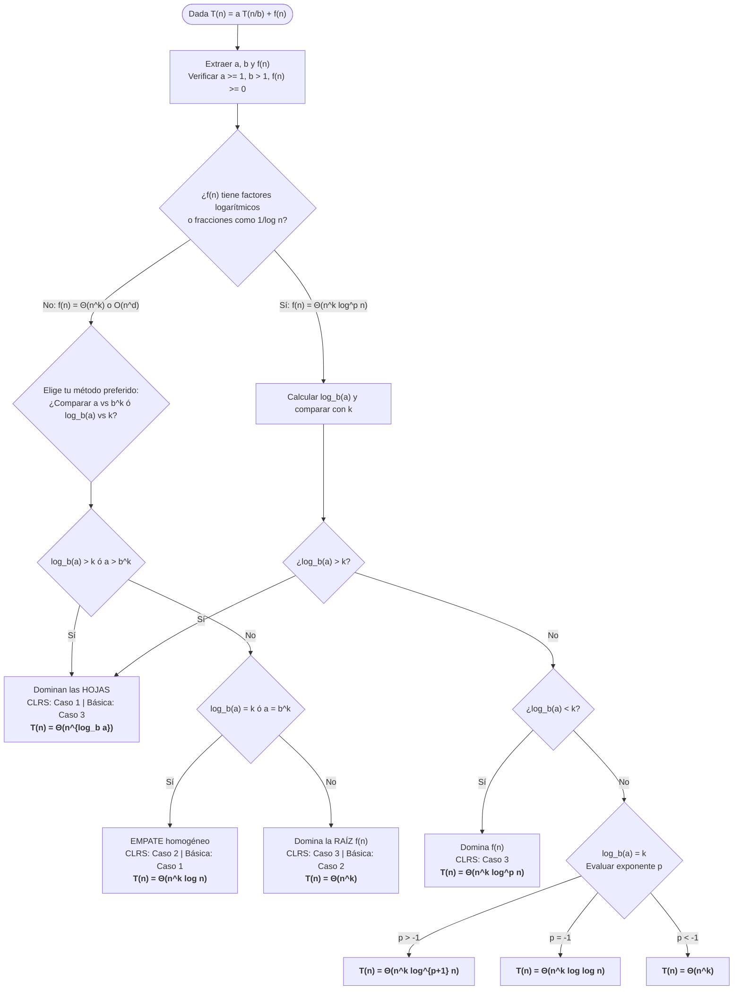

# Apuntes: El Teorema Maestro (*Master Theorem*)

El **Teorema Maestro** es la herramienta matemática más importante en el Análisis de Algoritmos para determinar de manera directa e inmediata la complejidad temporal asintótica ($\Theta$) de los algoritmos recursivos que siguen el paradigma **Divide y Vencerás** (*Divide and Conquer*).

Formulado originalmente por Jon Bentley, Dorothea Haken y James B. Saxe en 1980, y popularizado en el libro *Introduction to Algorithms* (CLRS), funciona como una "fórmula directa" (*cookbook method*) que evita tener que expandir series algebraicas o dibujar árboles de recursión desde cero en cada problema.

---

## 1. Anatomía de la Recurrencia Estándar

El Teorema Maestro se aplica a relaciones de recurrencia que tienen la siguiente forma canónica:

$$T(n) = a\,T\!\left(\frac{n}{b}\right) + f(n)$$

Donde las constantes y funciones tienen un significado físico directo en el comportamiento del algoritmo:

| Símbolo | Condición | Nombre técnico | Significado en el algoritmo y en el código |
|---------|-----------|----------------|--------------------------------------------|
| **$n$** | $n > 0$ | Tamaño de la entrada | Cantidad de datos (longitud de la lista, número de dígitos, dimensión de matriz). |
| **$a$** | $a \ge 1$ (constante) | Factor de ramificación | **Cuántas llamadas recursivas** se ejecutan efectivamente en cada invocación. |
| **$b$** | $b > 1$ (constante) | Factor de reducción | En cuántas partes iguales se **divide el tamaño** de la entrada para cada llamada ($n/b$). |
| **$f(n)$** | Función asintótica positiva | Costo no recursivo (trabajo local) | Tiempo invertido **fuera** de las llamadas recursivas: dividir la entrada $D(n)$ + combinar resultados $C(n)$. |

> **Nota sobre pisos y techos ($\lfloor n/b \rfloor$ y $\lceil n/b \rceil$):** En programación real, al dividir un arreglo de tamaño impar con `n // 2`, un subproblema recibe $\lfloor n/2 \rfloor$ y otro $\lceil n/2 \rceil$. Está demostrado matemáticamente que los pisos y techos **no alteran el comportamiento asintótico**, por lo que el Teorema Maestro permite ignorarlos y escribir simplemente $n/b$.

### El Exponente Crítico y la Función de Hojas
Todo el Teorema Maestro gira en torno a un número fundamental llamado **exponente crítico** ($c_{\text{crit}}$):

$$c_{\text{crit}} = \log_b a$$

A partir de él se define la **función de trabajo en las hojas**:

$$L(n) = n^{\log_b a}$$

Esta expresión representa exactamente **cuántas hojas (casos base)** tiene el árbol de recursión en su último nivel.

---

## 2. De Código en Python a la Ecuación Matemática

Antes de aplicar el teorema, un programador debe saber **extraer $a$, $b$ y $f(n)$ directamente leyendo el código**.

### Reglas de extracción a partir del código:
1. **Para hallar $a$:** Cuenta cuántas llamadas recursivas se llegan a ejecutar **en una misma ejecución** de la función (en el peor caso).
   * *Cuidado:* Si hay llamadas en ramas mutuamente excluyentes (`if ... elif ... else`), solo se ejecuta una de ellas, no la suma de todas.
2. **Para hallar $b$:** Observa cómo disminuye el tamaño de los datos pasados como argumento (ej. `arr[:len(arr)//2]` o `izq, medio` divide el rango entre $2 \implies b = 2$).
3. **Para hallar $f(n)$:** Calcula la complejidad temporal del resto de las líneas de la función (asignaciones $O(1)$, un ciclo `for` de $0$ a $n$ es $\Theta(n)$, dos ciclos anidados de $0$ a $n$ son $\Theta(n^2)$).

### Ejemplos prácticos de extracción

#### Ejemplo A: Conteo directo
```python
def misterio_1(arr):
    n = len(arr)
    if n <= 1:
        return 1
    
    # Dos llamadas recursivas con un tercio del arreglo cada una
    izq = misterio_1(arr[:n // 3])
    der = misterio_1(arr[2 * n // 3:])
    
    # Un bucle lineal de tamaño n para combinar
    suma = 0
    for x in arr:
        suma += x
        
    return izq + der + suma
```
* **¿Cuántas llamadas recursivas se hacen?** $2 \implies \mathbf{a = 2}$.
* **¿Cómo se reduce el tamaño de `arr`?** Se divide entre $3 \implies \mathbf{b = 3}$.
* **¿Cuánto cuesta el resto del código?** El bucle `for` recorre $n$ elementos $\implies \mathbf{f(n) = \Theta(n)}$.
* **Recurrencia resultante:** $T(n) = 2\,T(n/3) + \Theta(n)$.

---

#### Ejemplo B: El error clásico de llamadas duplicadas vs. reutilización
Observa cómo una mínima diferencia en código cambia radicalmente el parámetro $a$:

```python
# ❌ VERSIÓN 1: Dos llamadas recursivas explícitas
def calc_lento(n):
    if n <= 1:
        return 1
    return calc_lento(n // 2) + calc_lento(n // 2)
```
* Aquí el intérprete ejecuta `calc_lento(n // 2)` **dos veces**.
* Parámetros: $a = 2, \; b = 2, \; f(n) = \Theta(1)$.
* Recurrencia: $T(n) = 2\,T(n/2) + \Theta(1) \implies \Theta(n^{\log_2 2}) = \mathbf{\Theta(n)}$.

```python
# ✅ VERSIÓN 2: Una sola llamada guardada en variable
def calc_rapido(n):
    if n <= 1:
        return 1
    mitad = calc_rapido(n // 2)
    return mitad + mitad
```
* Aquí solo se realiza **una** llamada recursiva.
* Parámetros: $a = 1, \; b = 2, \; f(n) = \Theta(1)$.
* Recurrencia: $T(n) = 1\,T(n/2) + \Theta(1) \implies \mathbf{\Theta(\log n)}$.

---

#### Ejemplo C: Ramas condicionales (`if / else`)
```python
def buscar_en_tercios(arr, objetivo, izq, der):
    if izq > der:
        return -1
    tercio = (der - izq) // 3
    m1 = izq + tercio
    m2 = der - tercio
    
    if arr[m1] == objetivo:
        return m1
    elif objetivo < arr[m1]:
        return buscar_en_tercios(arr, objetivo, izq, m1 - 1)
    elif objetivo > arr[m2]:
        return buscar_en_tercios(arr, objetivo, m2 + 1, der)
    else:
        return buscar_en_tercios(arr, objetivo, m1 + 1, m2 - 1)
```
* Aunque la palabra `buscar_en_tercios` aparece 3 veces en el cuerpo, están dentro de un `if / elif / else` **mutuamente excluyente**. En cualquier llamada **solo se ejecuta 1 rama**.
* Por lo tanto, $\mathbf{a = 1}$ (no $3$).

---

## 3. Intuición y Demostración Matemática

Para entender por qué existen exactamente **tres casos** en el Teorema Maestro, basta con observar el **Árbol de Recursión** de $T(n) = a\,T(n/b) + f(n)$:

```
Nivel 0 (Raíz):                 f(n)                       ──► Costo nivel 0:   1 · f(n)
                         /       |       \
Nivel 1:             f(n/b)    f(n/b) ... f(n/b)           ──► Costo nivel 1:   a · f(n/b)
                     / | \     / | \      / | \
Nivel i:           ...   ...    ...        ...             ──► Costo nivel i:   a^i · f(n/b^i)
                   .      .      .          .
Nivel h = log_b(n): [Θ(1)] [Θ(1)] [Θ(1)] ... [Θ(1)]        ──► Costo en hojas:  a^(log_b n) = Θ(n^(log_b a))
```

### Deducción algebraica
1. **Altura del árbol ($h$):** En cada nivel dividimos $n$ entre $b$. Llegamos al caso base de tamaño $1$ cuando $\frac{n}{b^h} = 1 \iff b^h = n \iff \mathbf{h = \log_b n}$.
2. **Cantidad de hojas en la base:** En el nivel $i$ hay $a^i$ nodos. En el último nivel ($i = \log_b n$), la cantidad de hojas es:
   $$a^{\log_b n} = n^{\log_b a}$$
   *(Por la propiedad logarítmica de cambio de base: $a^{\log_b n} = (b^{\log_b a})^{\log_b n} = (b^{\log_b n})^{\log_b a} = n^{\log_b a}$)*.
3. **Suma total del trabajo en todos los niveles:**
   $$T(n) = \underbrace{\Theta(n^{\log_b a})}_{\text{Costo de las hojas}} + \underbrace{\sum_{i=0}^{\log_b n - 1} a^i \, f\!\left(\frac{n}{b^i}\right)}_{\text{Costo de los niveles internos}}$$

Si suponemos que $f(n) = n^k$, el término general dentro de la sumatoria es:
$$a^i \left(\frac{n}{b^i}\right)^k = n^k \left(\frac{a}{b^k}\right)^i$$

Esto es una **serie geométrica** cuya razón es $r = \frac{a}{b^k}$. En una serie geométrica solo pueden ocurrir tres comportamientos al sumar sus términos:

1. **Serie Creciente ($r > 1 \iff a > b^k \iff \log_b a > k$):**
   El trabajo se multiplica nivel tras nivel. El último nivel (las **hojas**) es tan masivo que él solo domina la suma de todos los niveles anteriores juntos $\implies$ **Caso 1**: $T(n) = \Theta(n^{\log_b a})$.
2. **Serie Constante ($r = 1 \iff a = b^k \iff \log_b a = k$):**
   El aumento en el número de subproblemas ($a$) se compensa exactamente con la reducción de su tamaño ($b^k$). **Cada nivel del árbol cuesta exactamente lo mismo** ($n^k$). Como hay $\log_b n$ niveles, el total es $(\text{costo por nivel}) \times (\text{altura}) \implies$ **Caso 2**: $T(n) = \Theta(n^{\log_b a} \log n)$.
3. **Serie Decreciente ($r < 1 \iff a < b^k \iff \log_b a < k$):**
   El trabajo disminuye tan rápido al bajar de nivel que el **primer nivel (la raíz)** concentra la mayor parte del costo total $\implies$ **Caso 3**: $T(n) = \Theta(f(n))$.

---

## 4. Enunciado Formal de los Tres Casos

Sea $T(n) = a\,T(n/b) + f(n)$ con constantes $a \ge 1$ y $b > 1$. Calculamos la función crítica de hojas $n^{\log_b a}$ y la comparamos con $f(n)$:

---

### Caso 1: Dominan las hojas ($n^{\log_b a}$ es polinomialmente mayor que $f(n)$)
* **Condición formal:** Existe una constante $\varepsilon > 0$ tal que:
  $$f(n) = O\!\left(n^{\log_b a - \varepsilon}\right)$$
* **Significado:** $f(n)$ crece más lento que $n^{\log_b a}$ por al menos un factor polinómico $n^\varepsilon$.
* **Solución:**
  $$\boxed{T(n) = \Theta\!\left(n^{\log_b a}\right)}$$

---

### Caso 2: Equilibrio entre hojas y niveles ($f(n)$ y $n^{\log_b a}$ crecen igual salvo factores logarítmicos)
* **Condición formal (Versión Estándar y Extendida):** Existe una constante $p \ge 0$ tal que:
  $$f(n) = \Theta\!\left(n^{\log_b a} \log^p n\right)$$
  *(Nota: El caso más habitual ocurre cuando $p = 0$, es decir, $f(n) = \Theta(n^{\log_b a})$ simplemente).*
* **Solución:** Se multiplica por un factor adicional $\log n$:
  $$\boxed{T(n) = \Theta\!\left(n^{\log_b a} \log^{p+1} n\right)}$$
  *(En particular, para $p = 0$: $\mathbf{T(n) = \Theta(n^{\log_b a} \log n)}$).*

---

### Caso 3: Domina la raíz ($f(n)$ es polinomialmente mayor que $n^{\log_b a}$)
* **Condición 1 (Cota inferior polinómica):** Existe una constante $\varepsilon > 0$ tal que:
  $$f(n) = \Omega\!\left(n^{\log_b a + \varepsilon}\right)$$
* **Condición 2 (Condición de Regularidad):** Existe una constante $c < 1$ y un umbral $n_0$ tal que para todo $n \ge n_0$:
  $$a\,f\!\left(\frac{n}{b}\right) \le c\,f(n)$$
  *(Garantiza que la suma del trabajo de los hijos en el nivel 1 sea estrictamente una fracción menor que el trabajo del padre en la raíz).*
* **Solución:**
  $$\boxed{T(n) = \Theta\!\left(f(n)\right)}$$

---

## 5. Comparativa de Formulaciones: Las Tres Versiones del Teorema Maestro

En cursos universitarios, exámenes y literatura de algoritmos conviven **tres perspectivas de presentación** del Teorema Maestro:
1. **La Versión Básica (frecuente en diapositivas e infografías):** Expresada con $O(n^d)$ y comparando directamente $a$ contra $b^d$.
2. **La Versión Extendida / Método Rápido (estándar CLRS y literatura avanzada):** Expresada con $\Theta(n^k \log^p n)$ y comparando los exponentes $\log_b a$ contra $k$.
3. **La Versión Conceptual o de Competencia Asintótica ($f(n)$ vs. $n^{\log_b a}$):** Enfocada en la competencia directa entre el costo de las hojas ($n^{\log_b a}$) y el trabajo de combinación/división externo ($f(n)$), formalizado en la [Sección 4](#4-enunciado-formal-de-los-tres-casos).

A continuación se presentan las tres versiones estructuradas en tablas, seguidas de su tabla de conversión y equivalencia directa, la explicación rigurosa de sus diferencias y recomendaciones prácticas para exámenes.

---

### 5.1 Versión Básica

Esta versión simplificada se aplica cuando la relación de recurrencia tiene la forma:
$$T(n) = a\,T\!\left(\frac{n}{b}\right) + O(n^d) \quad \text{con } a \ge 1, \; b > 1, \; d \ge 0$$

| Condición | Caso (según diapositivas básicas) | Complejidad resultante $T(n)$ | Intuición de dominancia |
|:---:|:---:|:---:|:---|
| **$a = b^d$** | **Caso 1** | $O(n^d \log n)$ | **Empate:** El trabajo se distribuye de forma homogénea en los $\log_b n$ niveles. |
| **$a < b^d$** | **Caso 2** | $O(n^d)$ | **Domina la raíz:** El trabajo local $n^d$ decrece rápido y la raíz acapara el costo. |
| **$a > b^d$** | **Caso 3** | $O(n^{\log_b a})$ | **Dominan las hojas:** Las llamadas recursivas explotan y las hojas dominan el total. |

> [!NOTE]
> En algunas presentaciones básicas la condición $a < b^d$ se lista antes o después, pero la característica distintiva es que compara directamente la base $a$ con la potencia $b^d$.

---

### 5.2 Versión Extendida (Método Rápido de Bolsillo / CLRS Generalizado)

Esta versión generalizada se aplica cuando la función de división/combinación tiene términos polinomial-logarítmicos:
$$f(n) = \Theta\!\left(n^k \log^p n\right) \quad \text{con } a \ge 1, \; b > 1, \; k \ge 0, \; p \in \mathbb{R}$$

Calculamos el exponente crítico de hojas $c_{\text{crit}} = \log_b a$ y lo comparamos contra el exponente polinomial $k$:

| Comparación entre $\log_b a$ y $k$ | Caso (convención canónica CLRS) | Complejidad resultante $T(n)$ | Comportamiento |
|:---:|:---:|:---:|:---|
| **$\log_b a > k$** | **Caso 1** (Ganan las hojas) | $\Theta\!\left(n^{\log_b a}\right)$ | Las hojas dominan polinomialmente a $f(n)$. |
| **$\log_b a = k$** $(p > -1)$ | **Caso 2** (Empate estándar) | $\Theta\!\left(n^k \log^{p+1} n\right)$ | Si $p=0$, resulta el clásico $\Theta(n^k \log n)$. |
| **$\log_b a = k$** $(p = -1)$ | **Caso 2 especial** (Hueco armónico) | $\Theta\!\left(n^k \log \log n\right)$ | Aparece la suma de la serie armónica $\sum 1/i$. |
| **$\log_b a = k$** $(p < -1)$ | **Caso 2 especial** (Serie convergente) | $\Theta\!\left(n^k\right)$ | La sumatoria converge a una constante finita. |
| **$\log_b a < k$** | **Caso 3** (Gana la raíz $f(n)$) | $\Theta\!\left(n^k \log^p n\right) = \Theta(f(n))$ | El trabajo en la raíz domina polinomialmente. |

#### El Parámetro $p$: Definición, Extracción y Comportamiento Matemático

En la formulación extendida del Teorema Maestro, la función no recursiva de división y combinación $f(n)$ se desglosa en dos factores:
$$f(n) = \Theta\!\left(n^k \log^p n\right)$$

* **$k$ (Exponente polinomial):** Cuantifica la potencia principal de la entrada $n$ ($n^0=1$, $n^1$, $n^2$, etc.).
* **$p$ (Exponente polilogarítmico):** Cuantifica cuántos factores logarítmicos modulan a la función ($p \in \mathbb{R}$). Puede ser un número positivo ($p > 0$), cero ($p = 0$) o negativo ($p < 0$).

##### 1. Regla de extracción rápida de $k$ y $p$

Para determinar los valores de $k$ y $p$ en cualquier problema, se reescribe $f(n)$ agrupando la parte polinómica y la parte logarítmica:

| Función no recursiva $f(n)$ | Forma normalizada $n^k \log^p n$ | Valor de $k$ | Valor de $p$ | Justificación analítica |
|---|:---:|:---:|:---:|---|
| **$f(n) = 1$** (o constante) | $n^0 \log^0 n$ | $0$ | $0$ | Costo constante $O(1)$; sin factores $n$ ni $\log n$. |
| **$f(n) = \log n$** | $n^0 \log^1 n$ | $0$ | $1$ | El logaritmo está en el numerador a la 1; $n^0 = 1$. |
| **$f(n) = n$** (lineal) | $n^1 \log^0 n$ | $1$ | $0$ | Caso clásico sin logaritmos ($\log^0 n = 1$). |
| **$f(n) = n \log n$** | $n^1 \log^1 n$ | $1$ | $1$ | Un factor lineal ($n^1$) y un logaritmo multiplicando ($\log^1 n$). |
| **$f(n) = n \log^2 n$** | $n^1 \log^2 n$ | $1$ | $2$ | Un factor lineal y el logaritmo al cuadrado. |
| **$f(n) = n^2$** (cuadrático) | $n^2 \log^0 n$ | $2$ | $0$ | Cuadrático puro; sin términos logarítmicos ($p=0$). |
| **$f(n) = \frac{n}{\log n}$** | $n^1 \log^{-1} n$ | $1$ | $-1$ | El logaritmo está en el denominador $\implies$ exponente negativo $p = -1$. |
| **$f(n) = \frac{n^2}{\log^3 n}$** | $n^2 \log^{-3} n$ | $2$ | $-3$ | División entre $\log^3 n \implies p = -3$. |

##### 2. ¿Por qué $p$ altera el resultado principalmente en el Caso 2 (Empate)?

* **En el Caso 1 ($\log_b a > k$) y Caso 3 ($\log_b a < k$):**  
  Existe una brecha polinomial estricta entre las hojas y la raíz. La diferencia polinomial ($n^\varepsilon$) absorbe asintóticamente a cualquier logaritmo; por tanto, **el valor de $p$ no altera quién gana la competencia**.
* **En el Caso 2 ($\log_b a = k$):**  
  Las hojas y la raíz empatan exactamente en su tasa polinomial ($n^k$). El costo total del algoritmo se obtiene sumando el trabajo no recursivo a través de los $h = \log_b n$ niveles del árbol de recursión:
  $$T(n) = \Theta\!\left(n^k \sum_{i=1}^{\log_b n} \frac{1}{i^{-p}}\right)$$
  * **Si $p > -1$ (incluye el caso estándar $p = 0$):**  
    La sumatoria acumula una potencia adicional de logaritmo:
    $$T(n) = \Theta\!\left(n^k \log^{p+1} n\right)$$
    *(Si $p=0$, se tiene $\log^{0+1} n = \log n \implies \Theta(n^k \log n)$, que es el caso clásico de Merge Sort).*  
    *(Si $p=1$, como en $T(n) = 2T(n/2) + n \log n$, se tiene $\log_2 2 = 1 = k$ y $p=1 \implies \Theta(n \log^2 n)$).*
  * **Si $p = -1$ (Hueco armónico):**  
    La sumatoria corresponde a la serie armónica $\sum_{i=1}^{\log n} \frac{1}{i} \approx \ln(\log n)$. Por lo tanto:
    $$T(n) = \Theta\!\left(n^k \log \log n\right)$$
    *(Permite resolver casos como $T(n) = 2T(n/2) + \frac{n}{\log n} \implies \Theta(n \log \log n)$, imposibles de clasificar con el teorema básico).*
  * **Si $p < -1$ (Serie convergente):**  
    La serie $\sum_{i=1}^\infty \frac{1}{i^{|p|}}$ con exponente $|p| > 1$ converge a una constante finita. Los niveles internos decrecen tan rápido que no alcanzan a generar un logaritmo completo:
    $$T(n) = \Theta\!\left(n^k\right)$$
    *(Ejemplo: $T(n) = 2T(n/2) + \frac{n}{\log^2 n} \implies \Theta(n)$).*

---

### 5.3 Versión Conceptual: La Competencia Asintótica ($f(n)$ vs. $n^{\log_b a}$)

Esta perspectiva formaliza de manera intuitiva y rigurosa la teoría expuesta en la [Sección 4](#4-enunciado-formal-de-los-tres-casos). El Teorema Maestro modela una **competencia asintótica** entre dos fuerzas fundamentales del árbol de recursión:
1. **La función de trabajo en las hojas ($n^{\log_b a}$):** Representa el costo total acumulado en el nivel base ($i = \log_b n$), producto de la proliferación de subproblemas ($a^{\log_b n} = n^{\log_b a}$).
2. **La función de trabajo externo ($f(n)$):** Representa el costo no recursivo invertido en dividir la entrada y combinar los resultados en los niveles internos (concentrado prioritariamente en la raíz).

| Caso | Quién gana la competencia (Dominancia asintótica) | Condición (comparando exponentes y órdenes de crecimiento) | Complejidad final $T(n)$ |
|:---:|:---|:---|:---:|
| **Caso 1** | **Dominan las hojas del árbol**<br>$\mathbf{n^{\log_b a} > f(n)}$<br>($n^{\log_b a}$ es polinomialmente dominante sobre $f(n)$) | **$f(n)$ crece más lento que $n^{\log_b a}$** por una brecha polinomial estricta $n^\varepsilon$:<br>Existe $\varepsilon > 0$ tal que $f(n) = O\!\left(n^{\log_b a - \varepsilon}\right)$<br>*(En términos de exponentes: $\log_b a > k$ con $\log_b a \ge k + \varepsilon$)* | $\Theta\!\left(n^{\log_b a}\right)$ |
| **Caso 2** | **Equilibrio asintótico (Empate)**<br>$\mathbf{n^{\log_b a} = f(n)}$<br>($f(n) = \Theta(n^{\log_b a})$; costo homogéneo en los $\log_b n$ niveles) | **$f(n)$ tiene el mismo orden de crecimiento que $n^{\log_b a}$** (salvo factores polilogarítmicos $\log^p n$ con $p \ge 0$):<br>$f(n) = \Theta\!\left(n^{\log_b a} \log^p n\right)$<br>*(En términos de exponentes: $\log_b a = k$; si $p=0 \implies f(n) = \Theta(n^{\log_b a})$)* | $\Theta\!\left(n^{\log_b a} \log^{p+1} n\right)$<br><br>*(Si $p=0$: $\Theta(n^{\log_b a} \log n)$)* |
| **Caso 3** | **Domina el trabajo externo (Raíz)**<br>$\mathbf{f(n) > n^{\log_b a}}$<br>($f(n)$ es polinomialmente dominante sobre $n^{\log_b a}$) | **$f(n)$ crece más rápido que $n^{\log_b a}$** por una brecha polinomial $n^\varepsilon$ y satisface regularidad:<br>Existe $\varepsilon > 0$ tal que $f(n) = \Omega\!\left(n^{\log_b a + \varepsilon}\right)$<br>y condición de regularidad: $a\,f\!\left(\frac{n}{b}\right) \le c\,f(n)$ para alguna constante $c < 1$<br>*(En términos de exponentes: $k > \log_b a$ con $k \ge \log_b a + \varepsilon$)* | $\Theta\!\left(f(n)\right)$ |

> [!NOTE]
> **Fundamento técnico de la brecha polinomial ($n^\varepsilon$) y la condición de regularidad:**  
> * **Brecha polinomial ($\varepsilon > 0$):** Para que una función domine a la otra de manera estricta (Casos 1 y 3), no basta una discrepancia asintótica sub-polinomial (por ejemplo, diferencias puramente logarítmicas como $f(n) = n / \log n$ frente a $n^1$). Si la relación entre ambas funciones no difiere al menos por un factor de escala $n^\varepsilon$, el teorema cae en una brecha de inaplicabilidad (ver [Sección 7](#7-casos-donde-el-teorema-maestro-falla-casos-inaplicables)).
> * **Condición de regularidad en el Caso 3 ($a f(n/b) \le c f(n)$ con $c < 1$):** Garantiza que el trabajo realizado en los nodos hijos decrezca geométricamente respecto al nodo padre, asegurando que la raíz absorba asintóticamente el costo total.

---

### 5.4 Tabla de Equivalencias Directas entre las Tres Versiones

Matemáticamente, comparar las bases ($a$ vs $b^d$), comparar los exponentes ($\log_b a$ vs $k$, asumiendo $d = k$), o contrastar rigurosamente las tasas de crecimiento de $f(n)$ contra $n^{\log_b a}$ representan exactamente el mismo fenómeno algorítmico debido a la monotonía de la función logaritmo:
$$a \gtreqqless b^d \iff \log_b a \gtreqqless \log_b(b^d) \iff \log_b a \gtreqqless d$$

| Situación algorítmica | Perspectiva Conceptual (Dominancia) | Condición Básica ($a$ vs $b^d$) | Condición Extendida ($\log_b a$ vs $k$) | Condición Formal ($f(n)$ vs $n^{\log_b a}$) | Caso Básica | Caso CLRS | Complejidad $T(n)$ ($p=0$) |
|---|:---:|:---:|:---:|:---:|:---:|:---:|:---:|
| **Las hojas dominan** | **Caso 1**<br>($n^{\log_b a} > f(n)$) | $a > b^d$ | $\log_b a > k$ | $f(n) = O(n^{\log_b a - \varepsilon})$ | **Caso 3** | **Caso 1** | $\Theta(n^{\log_b a})$ |
| **Equilibrio / Empate** | **Caso 2**<br>($n^{\log_b a} = f(n)$) | $a = b^d$ | $\log_b a = k$ | $f(n) = \Theta(n^{\log_b a})$ | **Caso 1** | **Caso 2** | $\Theta(n^k \log n)$ |
| **La raíz domina** | **Caso 3**<br>($f(n) > n^{\log_b a}$) | $a < b^d$ | $\log_b a < k$ | $f(n) = \Omega(n^{\log_b a + \varepsilon})$ + reg. | **Caso 2** | **Caso 3** | $\Theta(f(n)) = \Theta(n^k)$ |

---

### 5.5 Explicación Detallada de las 5 Diferencias Clave

#### 1. Enfoque de la comparación matemática (Bases vs. Exponentes)
* **Versión Básica (Imagen/Diapositivas):** Compara directamente el número de subproblemas $a$ contra la tasa de reducción elevada al costo polinomial $b^d$.
  * *Ventaja:* Es muy rápida si los números son enteros pequeños (ej. ¿$4 > 2^1$? Sí, $4 > 2$).
* **Versión Extendida (Apunte):** Aplica propiedades logarítmicas a esa misma comparación. En lugar de comparar $a$ con $b^k$, compara $\log_b a$ con $k$.
  * *Ventaja:* Trabajar en el espacio de exponentes suele ser mucho más intuitivo al graficar o razonar en papel, pues $\log_b a$ indica de inmediato la dimensión fractal del número de hojas ($n^{\log_b a}$).

#### 2. Tolerancia a logaritmos (La variable $p$)
* **Versión Básica:** Está rígidamente limitada a costos no recursivos polinomiales simples de la forma $n^d$. No puede resolver funciones comunes como $f(n) = n \log n$ o $f(n) = n / \log n$.
* **Versión Extendida:** Introduce el parámetro $p$ para funciones de orden $n^k \log^p n$. Esto amplía drásticamente su campo de aplicación a algoritmos reales (como algoritmos que ordenan internamente antes de dividir o combinaciones más complejas).

#### 3. Desglose del caso de equilibrio (Empate)
* **Versión Básica:** Ante el empate ($a = b^d$), asume ciegamente que no existen logaritmos en $f(n)$ ($p = 0$) y simplemente multiplica por $\log n \implies O(n^d \log n)$.
* **Versión Extendida:** Modela exhaustivamente la naturaleza del empate para cualquier valor de $p$:
  * Si $p \ge 0$ (o $p > -1$): suma una potencia más al logaritmo ($\log^{p+1} n$).
  * Si $p = -1$: resuelve el "hueco armónico" que genera un término $\log \log n$.
  * Si $p < -1$: la serie geométrica converge y el costo queda en $\Theta(n^k)$.

#### 4. Precisión de la Notación Asintótica ($O$ vs. $\Theta$)
* **Versión Básica:** Utiliza comúnmente la cota superior Big-$O$ ($O$). Aunque suele ser una cota ajustada en la práctica, formalmente solo garantiza un techo (el algoritmo no tardará más que eso, pero podría ser menor).
* **Versión Extendida:** Emplea Notación Big-Theta ($\Theta$), que establece una cota ajustada exacta (techo y piso simultáneamente: $c_1 g(n) \le T(n) \le c_2 g(n)$). Es el estándar riguroso exigido en ciencias de la computación teórica.

#### 5. Numeración invertida de los Casos (¡Peligro en Exámenes!)
* **Versión Básica:** Frecuentemente numera como **Caso 1** al empate ($a = b^d$), **Caso 2** a la dominancia de la raíz ($a < b^d$), y **Caso 3** a la dominancia de hojas ($a > b^d$).
* **Versión Extendida (CLRS):** Sigue la taxonomía clásica del libro *Introduction to Algorithms* de Cormen, Leiserson, Rivest y Stein:
  * **Caso 1:** Dominan las hojas ($n^{\log_b a}$ vence polinomialmente a $f(n)$).
  * **Caso 2:** Empate asintótico con factor logarítmico.
  * **Caso 3:** Domina la función de combinación/división $f(n)$.

---

### 5.6 Diagrama de Flujo: ¿Cómo Resolver en Menos de 30 Segundos?



---

### 5.7 Tips Prácticos y Recomendaciones para Exámenes

> [!TIP]
> **Tip 1: Cómo justificar en un examen para asegurar la máxima calificación**  
> Si tu profesor sigue las diapositivas con la versión básica, o si no estás seguro de qué convención sigue la rúbrica de evaluación, redacta tu respuesta con la justificación conceptual antes que con el número de caso:
> * *"Dado que $\log_b a = 2 > k = 1$, las hojas dominan asintóticamente a la raíz. Por tanto, aplica el Caso 1 según la convención canónica de Cormen (o Caso 3 según la versión básica con $a > b^d$), resultando en $T(n) = \Theta(n^2)$."*  
> Así es imposible que te califiquen como incorrecto, sin importar la tabla que tenga el profesor en su pauta.

> [!TIP]
> **Tip 2: Regla mental rápida para potencias de 2 comunes**  
> * $\log_2 1 = 0 \implies n^0 = 1$
> * $\log_2 2 = 1 \implies n^1 = n$
> * $\log_2 3 \approx 1.585 \implies n^{1.585}$ *(Multiplicación de Karatsuba)*
> * $\log_2 4 = 2 \implies n^2$
> * $\log_2 7 \approx 2.807 \implies n^{2.807}$ *(Multiplicación de matrices de Strassen)*
> * $\log_2 8 = 3 \implies n^3$

> [!TIP]
> **Tip 3: Cuidado con la trampa del $O$ vs $\Theta$ en opciones múltiples**  
> Si un examen de opción múltiple tiene como opciones $O(n \log n)$ y $\Theta(n \log n)$ para Merge Sort ($T(n) = 2T(n/2) + n$), la respuesta **más precisa y rigurosa** es $\Theta(n \log n)$. Sin embargo, si la pregunta está formulada explícitamente como "¿Cuál es la cota superior en notación Big-O?", $O(n \log n)$ es correcta.

> [!WARNING]
> **Tip 4: El error de omitir la condición $f(n) \ge 0$ o $a \ge 1$**  
> Antes de calcular cualquier logaritmo, cerciórate de que:
> 1. $a \ge 1$: No se pueden tener $0.5$ llamadas recursivas ni números negativos.
> 2. $b > 1$: Si $b = 1$, el problema no se reduce y cae en bucle infinito.
> 3. $f(n)$ debe ser positiva para $n$ suficientemente grande (un tiempo de ejecución no puede ser negativo).

---

## 6. Ejemplos Resueltos Paso a Paso

### Ejemplo 1: $T(n) = 9\,T(n/3) + n$
1. **Identificar parámetros:** $a = 9$, $b = 3$, $f(n) = n \implies k = 1, p = 0$.
2. **Calcular exponente crítico:** $\log_b a = \log_3 9 = 2$. Función de hojas: $n^2$.
3. **Comparar:** $\log_b a = 2 > k = 1$.
   * Verificación formal: $f(n) = n = O(n^{2 - \varepsilon})$ eligiendo $\varepsilon = 1 > 0$.
4. **Conclusión:** Aplica el **Caso 1**.
   $$T(n) = \Theta(n^2)$$

---

### Ejemplo 2: $T(n) = T(2n/3) + 1$ (Estilo Búsqueda Binaria / Reducción fraccionaria)
1. **Identificar parámetros:** Nota que $2n/3 = \frac{n}{3/2}$. Por tanto:
   $$a = 1, \quad b = \frac{3}{2} = 1.5, \quad f(n) = 1 = n^0 \implies k = 0, p = 0$$
2. **Calcular exponente crítico:** $\log_{3/2} 1 = 0$. Función de hojas: $n^0 = 1$.
3. **Comparar:** $\log_b a = 0 = k$.
4. **Conclusión:** Aplica el **Caso 2** (con $p = 0$).
   $$T(n) = \Theta(n^0 \log^{0+1} n) = \Theta(\log n)$$

---

### Ejemplo 3: $T(n) = 2\,T(n/2) + n \log n$
1. **Identificar parámetros:** $a = 2$, $b = 2$, $f(n) = n^1 \log^1 n \implies k = 1, p = 1$.
2. **Calcular exponente crítico:** $\log_2 2 = 1$. Función de hojas: $n^1 = n$.
3. **Comparar:** $\log_b a = 1 = k$, pero con un factor logarítmico adicional ($p = 1$).
4. **Conclusión:** Aplica el **Caso 2 extendido** ($p = 1$).
   $$T(n) = \Theta(n^1 \log^{1+1} n) = \Theta(n \log^2 n)$$

---

### Ejemplo 4: $T(n) = 3\,T(n/4) + n \log n$
1. **Identificar parámetros:** $a = 3$, $b = 4$, $f(n) = n \log n \implies k = 1, p = 1$.
2. **Calcular exponente crítico:** $\log_4 3 \approx 0.7925$. Función de hojas: $n^{0.7925}$.
3. **Comparar:** $\log_b a \approx 0.7925 < k = 1$.
   * Cota inferior: $f(n) = \Omega(n^{\log_4 3 + \varepsilon})$ tomando $\varepsilon \approx 0.2 > 0$.
   * **Verificación de la Condición de Regularidad:**
     $$a\,f(n/b) = 3 \left(\frac{n}{4}\right) \log\!\left(\frac{n}{4}\right) \le \frac{3}{4} n \log n = c\,f(n)$$
     Para $c = 3/4 = 0.75 < 1$, la desigualdad se cumple para todo $n \ge 4$.
4. **Conclusión:** Aplica el **Caso 3**.
   $$T(n) = \Theta(n \log n)$$

---

### Ejemplo 5: $T(n) = 7\,T(n/2) + n^2$ (Algoritmo de Strassen para Matrices)
1. **Identificar parámetros:** $a = 7$, $b = 2$, $f(n) = n^2 \implies k = 2$.
2. **Calcular exponente crítico:** $\log_2 7 \approx 2.807$. Función de hojas: $n^{\log_2 7}$.
3. **Comparar:** $\log_b a \approx 2.807 > k = 2$.
4. **Conclusión:** Aplica el **Caso 1** (con $\varepsilon = 0.8$).
   $$T(n) = \Theta(n^{\log_2 7}) \approx \Theta(n^{2.807})$$

---

## 7. ¿Cuándo NO se puede aplicar el Teorema Maestro? (Limitaciones y Trampas)

Es tan importante saber usar el Teorema Maestro como reconocer las ecuaciones donde **es inválido aplicarlo**:

### 1. Reducción aritmética en lugar de geométrica (*Subtract and Conquer*)
* **Ejemplo:** $T(n) = 2\,T(n - 1) + 1$ (Torres de Hanoi) o $T(n) = T(n - 1) + n$ (Insertion Sort recursivo).
* **Por qué no aplica:** El tamaño no se divide por $b$ ($n/b$), sino que se resta una constante ($n - c$).
* **Cómo se resuelve:** Por expansión/sustitución hacia atrás. Sus complejidades son $\Theta(2^n)$ y $\Theta(n^2)$ respectivamente.

### 2. Parámetros $a$ o $b$ que no son constantes válidas
* **Ejemplo:** $T(n) = 2^n T(n/2) + n^n$ o $T(n) = 0.5\,T(n/2) + n$.
* **Por qué no aplica:** En el primero, $a = 2^n$ depende de $n$ (no es constante); en el segundo, $a = 0.5 < 1$ (no puedes hacer media llamada recursiva).

### 3. El "Hueco Polinómico" (*Polynomial Gap*)
El Caso 1 y el Caso 3 exigen una diferencia **polinómica** ($n^{\pm \varepsilon}$), no simplemente una diferencia logarítmica.
* **Ejemplo clásico de examen:**
  $$T(n) = 2\,T(n/2) + \frac{n}{\log n}$$
* **Análisis:**
  * Aquí $a = 2, b = 2 \implies n^{\log_2 2} = n$.
  * $f(n) = \frac{n}{\log n} = n^1 \log^{-1} n$.
  * ¿Es Caso 1? La razón $\frac{n}{f(n)} = \log n$. Pero $\log n$ crece **más lento que cualquier polinomio $n^\varepsilon$** para todo $\varepsilon > 0$. Por lo tanto, $f(n)$ **no** es polinomialmente menor que $n$; cae en el "hueco" entre el Caso 1 y el Caso 2 estándar.
* **Solución mediante la extensión de Caso 2 ($p = -1$):**
  Al sumar el árbol de recursión nivel por nivel:
  $$T(n) = \sum_{i=0}^{\log_2 n - 1} 2^i \frac{n/2^i}{\log_2(n/2^i)} = n \sum_{i=0}^{\log_2 n - 1} \frac{1}{\log_2 n - i} = n \sum_{j=1}^{\log_2 n} \frac{1}{j} = \Theta(n \log \log n)$$
  *(Pues $\sum_{j=1}^m \frac{1}{j} = H_m = \Theta(\log m)$ es la serie armónica con $m = \log_2 n$).*

### 4. Violación de la Condición de Regularidad en el Caso 3
* **Ejemplo:** $T(n) = 2\,T(n/2) + n^2(2 - \cos n)$.
* Aunque $f(n) = \Omega(n^{1+\varepsilon})$, la oscilación trigonométrica impide que exista una constante fija $c < 1$ tal que $2 f(n/2) \le c f(n)$ para todo $n$.

### 5. Subproblemas de tamaños desiguales
* **Ejemplo:** $T(n) = T(n/3) + T(2n/3) + n$ (Quick Sort con partición desbalanceada 1:2).
* **Por qué no aplica:** Los subproblemas tienen factores de división distintos ($b_1 = 3$ y $b_2 = 3/2$).
* **Cómo se resuelve:** Con la generalización del Teorema Maestro llamada **Método de Akra-Bazzi**.

---

## 8. Generalización: El Método de Akra-Bazzi

Cuando un algoritmo divide el problema en fracciones desiguales:

$$T(n) = \sum_{i=1}^k a_i \, T(b_i n) + f(n) \quad \text{con } a_i > 0 \text{ y } 0 < b_i < 1$$

El teorema de **Akra-Bazzi** (1998) establece que:
1. Primero se encuentra el único exponente real $p$ que satisface la ecuación característica:
   $$\sum_{i=1}^k a_i \, b_i^p = 1$$
2. Luego la complejidad asintótica viene dada directamente por la integral:
   $$T(n) = \Theta\!\left(n^p \left(1 + \int_1^n \frac{f(u)}{u^{p+1}} \, du\right)\right)$$

**Ejemplo con $T(n) = T(n/3) + T(2n/3) + n$:**
* Ecuación para $p$: $\left(\frac{1}{3}\right)^p + \left(\frac{2}{3}\right)^p = 1 \implies \mathbf{p = 1}$.
* Sustituyendo en la integral con $f(u) = u$:
  $$T(n) = \Theta\!\left(n^1 \left(1 + \int_1^n \frac{u}{u^2} \, du\right)\right) = \Theta\!\left(n (1 + \ln n)\right) = \mathbf{\Theta(n \log n)}$$

---

## 9. Herramienta en Python: Solucionador y Verificador Empírico

A continuación se presenta un programa completo en Python que:
1. **Resuelve simbólicamente** cualquier recurrencia $T(n) = a\,T(n/b) + \Theta(n^k \log^p n)$ explicando qué caso aplica.
2. **Verifica empíricamente** el resultado ejecutando la recurrencia numérica real y comprobando que el cociente $\frac{T(n)}{\text{Cota Teórica}(n)}$ converge a una constante positiva conforme $n \to \infty$.

```python
import math
from functools import lru_cache


def resolver_teorema_maestro(a: float, b: float, k: float, p: float = 0.0) -> str:
    """
    Resuelve simbólicamente T(n) = a * T(n/b) + Θ(n^k * log^p(n))
    y devuelve el diagnóstico detallado del Teorema Maestro.
    """
    if a < 1 or b <= 1:
        raise ValueError("El Teorema Maestro requiere a >= 1 y b > 1.")

    c_crit = math.log(a, b)
    tol = 1e-9

    # Formateo limpio del exponente crítico
    exp_str = f"{round(c_crit)}" if abs(c_crit - round(c_crit)) < tol else f"{c_crit:.4f}"

    print(f"Recurrencia: T(n) = {a} T(n/{b}) + Θ(n^{k} log^{p} n)")
    print(f"  -> Exponente crítico: log_{b}({a}) = {exp_str}")
    print(f"  -> Función de hojas : n^({exp_str})")

    # CASO 1: log_b(a) > k
    if c_crit > k + tol:
        resultado = f"Θ(n^{exp_str})" if exp_str != "1" else "Θ(n)"
        caso = "Caso 1 (Dominan las hojas: log_b(a) > k)"

    # CASO 2: log_b(a) == k
    elif abs(c_crit - k) <= tol:
        base_n = "" if abs(k) < tol else (f"n^{round(k)} " if abs(k - 1) > tol else "n ")
        if p > -1 + tol:
            nuevo_p = round(p + 1) if abs((p + 1) - round(p + 1)) < tol else p + 1
            log_str = "log n" if nuevo_p == 1 else f"log^{nuevo_p} n"
            resultado = f"Θ({base_n}{log_str})"
            caso = f"Caso 2 (Equilibrio en niveles: log_b(a) == k, p={p})"
        elif abs(p - (-1)) <= tol:
            resultado = f"Θ({base_n}log log n)"
            caso = "Caso 2 Extendido (Hueco armónico: p = -1)"
        else:
            resultado = f"Θ({base_n.strip() or '1'})"
            caso = "Caso 2 Extendido (p < -1, convergente a las hojas)"

    # CASO 3: log_b(a) < k
    else:
        base_n = f"n^{round(k)}" if abs(k - 1) > tol else "n"
        log_str = "" if abs(p) < tol else (" log n" if abs(p - 1) < tol else f" log^{p} n")
        resultado = f"Θ({base_n}{log_str})"
        caso = "Caso 3 (Domina la raíz f(n): log_b(a) < k)"

    print(f"  -> Diagnóstico      : {caso}")
    print(f"  -> Complejidad      : T(n) = {resultado}\n")
    return resultado


def verificar_empiricamente(a: int, b: int, f_func, cota_teorica_func, niveles: int = 10):
    """
    Evalúa numéricamente la recurrencia exacta T(n) para potencias n = b^i
    y muestra que T(n) / Cota(n) converge a una constante (definición de Θ).
    """
    @lru_cache(maxsize=None)
    def T(n: int) -> float:
        if n <= 1:
            return 1.0
        return a * T(n // b) + f_func(n)

    print(f"{'n':>10} | {'T(n) Exacto':>16} | {'Cota g(n)':>16} | {'Razón T(n)/g(n)':>15}")
    print("-" * 65)
    for i in range(1, niveles + 1):
        n = b ** i
        val_t = T(n)
        val_g = cota_teorica_func(n)
        razon = val_t / val_g
        print(f"{n:10d} | {val_t:16.2f} | {val_g:16.2f} | {razon:15.6f}")
    print()


if __name__ == "__main__":
    # 1. Merge Sort: T(n) = 2T(n/2) + n
    resolver_teorema_maestro(a=2, b=2, k=1, p=0)
    verificar_empiricamente(
        a=2, b=2,
        f_func=lambda n: n,
        cota_teorica_func=lambda n: n * math.log2(n)
    )

    # 2. Karatsuba: T(n) = 3T(n/2) + n
    resolver_teorema_maestro(a=3, b=2, k=1, p=0)
    verificar_empiricamente(
        a=3, b=2,
        f_func=lambda n: n,
        cota_teorica_func=lambda n: n ** math.log2(3)
    )
```

---

## 10. Ejercicios de Práctica (Con Soluciones)

Determina la complejidad asintótica de las siguientes relaciones de recurrencia utilizando el Teorema Maestro (o indica por qué no aplica):

1. $T(n) = 4\,T(n/2) + n$
2. $T(n) = 4\,T(n/2) + n^2$
3. $T(n) = 4\,T(n/2) + n^3$
4. $T(n) = 16\,T(n/4) + n!$
5. $T(n) = 2\,T(n/4) + \sqrt{n}$
6. $T(n) = 2\,T(n/2) + n \log^2 n$
7. $T(n) = 3\,T(n/3) + \frac{n}{2}$
8. $T(n) = 64\,T(n/8) - n^2 \log n$
9. $T(n) = T(n - 2) + n^2$
10. $T(n) = 2\,T(\sqrt{n}) + \log n$ *(Sugerencia: hacer cambio de variable $m = \log_2 n$)*

---

### Soluciones Detalladas

1. **$T(n) = 4\,T(n/2) + n$:**
   * $\log_2 4 = 2 > k = 1 \implies$ **Caso 1** $\implies \mathbf{\Theta(n^2)}$.
2. **$T(n) = 4\,T(n/2) + n^2$:**
   * $\log_2 4 = 2 = k = 2$ ($p=0$) $\implies$ **Caso 2** $\implies \mathbf{\Theta(n^2 \log n)}$.
3. **$T(n) = 4\,T(n/2) + n^3$:**
   * $\log_2 4 = 2 < k = 3$. Regularidad: $4(n/2)^3 = \frac{4}{8}n^3 = 0.5 n^3 \le c n^3$ con $c=0.5 < 1 \implies$ **Caso 3** $\implies \mathbf{\Theta(n^3)}$.
4. **$T(n) = 16\,T(n/4) + n!$:**
   * $\log_4 16 = 2$. Como $n!$ crece muchísimo más rápido que $n^2$ y cumple regularidad $\implies$ **Caso 3** $\implies \mathbf{\Theta(n!)}$.
5. **$T(n) = 2\,T(n/4) + \sqrt{n}$:**
   * Nota que $\sqrt{n} = n^{1/2} = n^{0.5}$. Además $\log_4 2 = \frac{1}{2} = 0.5$.
   * Como $\log_4 2 = 0.5 = k \implies$ **Caso 2** $\implies \mathbf{\Theta(\sqrt{n} \log n)}$.
6. **$T(n) = 2\,T(n/2) + n \log^2 n$:**
   * $\log_2 2 = 1 = k$, con $p = 2 \implies$ **Caso 2 extendido** $\implies \mathbf{\Theta(n \log^3 n)}$.
7. **$T(n) = 3\,T(n/3) + \frac{n}{2}$:**
   * Las constantes multiplicativas en $f(n)$ se ignoran ($n/2 = \Theta(n)$). $\log_3 3 = 1 = k \implies$ **Caso 2** $\implies \mathbf{\Theta(n \log n)}$.
8. **$T(n) = 64\,T(n/8) - n^2 \log n$:**
   * **No aplica el Teorema Maestro** porque $f(n) = -n^2 \log n$ es **negativa** (el tiempo de trabajo local no puede ser negativo).
9. **$T(n) = T(n - 2) + n^2$:**
   * **No aplica el Teorema Maestro** directamente porque la reducción es aritmética ($n - 2$), no geométrica ($n/b$). Expandiendo la suma de cuadrados de 2 en 2 se obtiene $\mathbf{\Theta(n^3)}$.
10. **$T(n) = 2\,T(\sqrt{n}) + \log n$:**
    * A simple vista no tiene la forma $T(n/b)$, pero haciendo el **cambio de variable** $n = 2^m \iff m = \log_2 n$, tenemos $\sqrt{n} = 2^{m/2}$:
      $$T(2^m) = 2\,T(2^{m/2}) + m$$
    * Definiendo $S(m) = T(2^m)$, la recurrencia se transforma en:
      $$S(m) = 2\,S(m/2) + m$$
    * Ahora sí aplicamos el Teorema Maestro a $S(m)$: $a=2, b=2, f(m)=m \implies$ **Caso 2**: $S(m) = \Theta(m \log m)$.
    * Regresando a la variable original $n$ ($m = \log n$):
      $$\mathbf{T(n) = \Theta(\log n \cdot \log \log n)}$$
