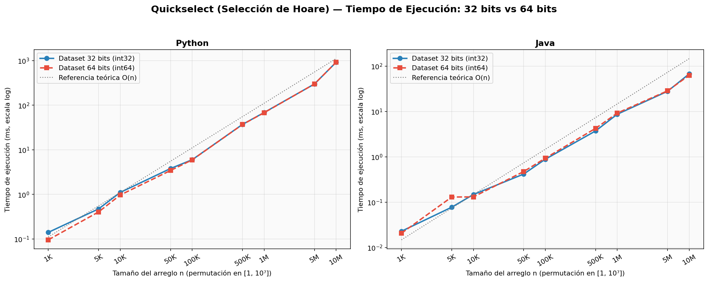
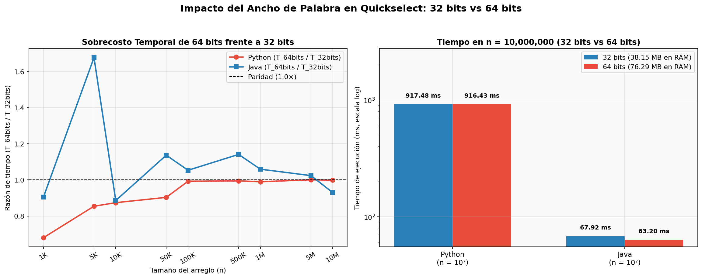
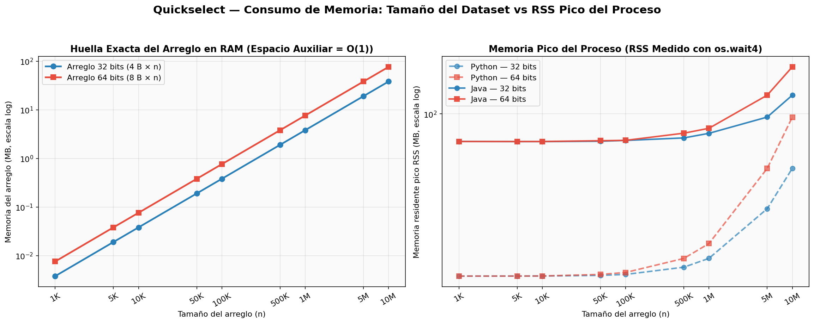
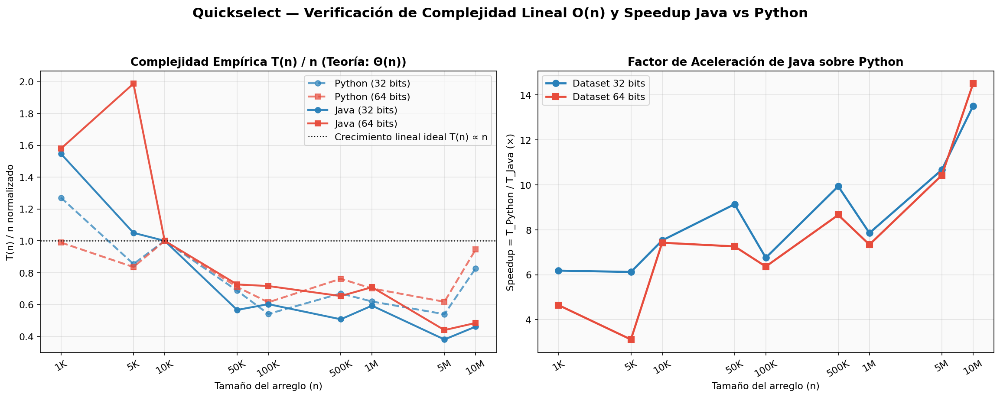
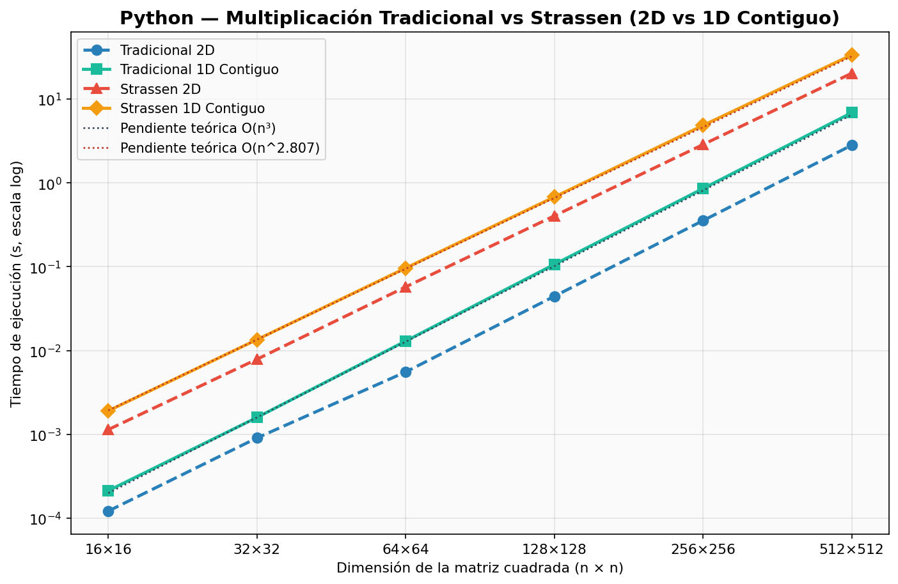
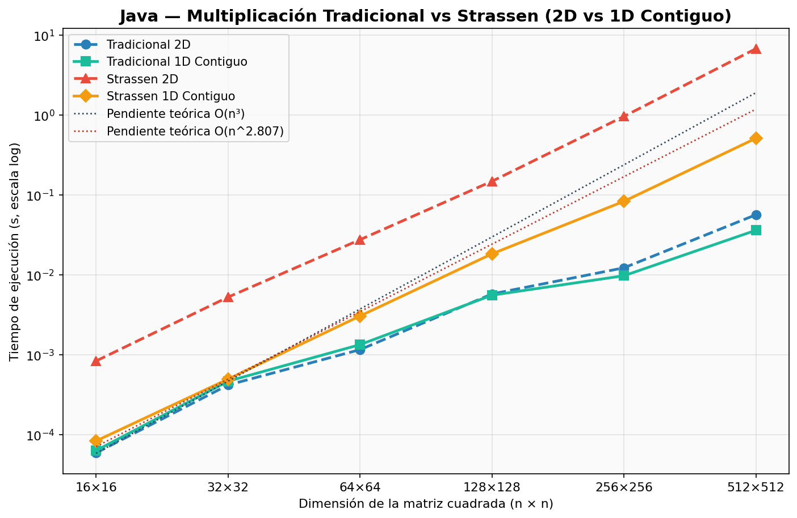
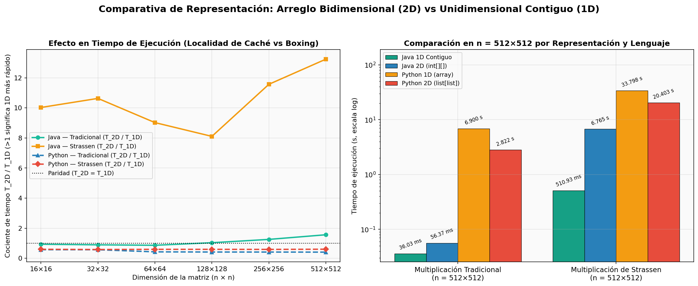
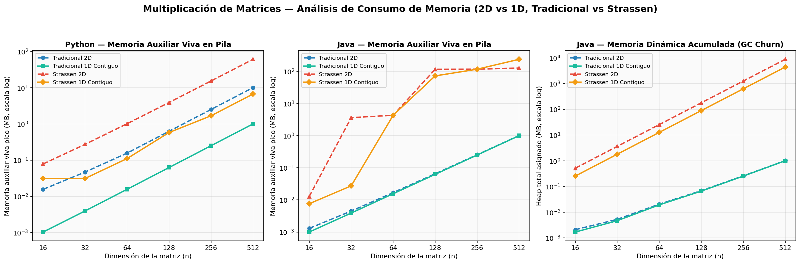
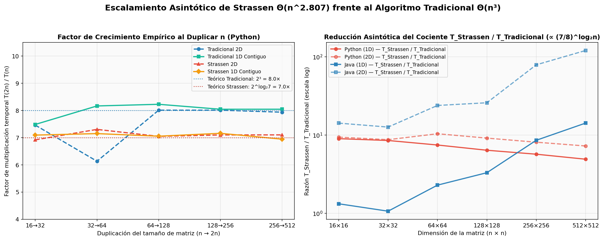
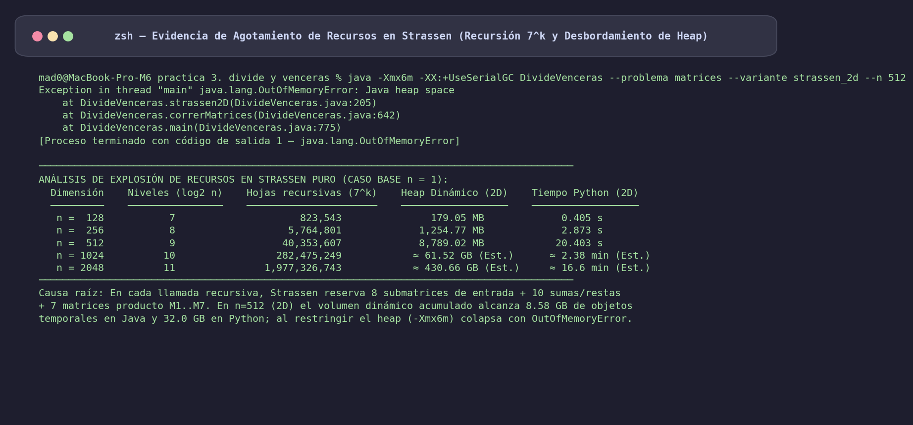

# Práctica 3: Divide y Vencerás (Quickselect y Multiplicación de Strassen) — Reporte de Resultados y Análisis de Rendimiento

> **Materia:** Análisis y Diseño de Algoritmos — ESCOM IPN  
> **Fecha de ejecución:** 20 de octubre de 2026  

**Archivos de Código:**
- 🐍 [Implementación en Python (Python 3.15 / 3.9)](./divide_venceras.py)
- ☕ [Implementación en Java (OpenJDK 25 / 21)](./DivideVenceras.java)
- 🧪 [Pruebas Unitarias Automatizadas (Python)](./test_divide_venceras.py)
- ⚙️ [Generador de Datasets Compartidos (32/64 bits y Matrices)](./generar_datos.py)
- 📊 [Orquestador de Benchmarking y Prueba de Estrés](./benchmark.py)
- 📈 [Generador de Gráficas y Tablas Markdown](./generar_graficas.py)
- 📁 [Carpeta de Gráficas Comparativas (PNG)](./graficas/)

---

## 1. Descripción General y Fundamento Teórico

El paradigma **Divide y Vencerás** (*Divide and Conquer*) descompone un problema de tamaño $n$ en subproblemas independientes de tamaño $n/b$, resuelve recursivamente $a$ instancias de dichos subproblemas y combina sus soluciones parciales. En esta práctica se implementaron, verificaron y evaluaron experimentalmente dos algoritmos emblemáticos de este paradigma en **Python** y **Java**:

---

### 1.1 Problema 1: Selección Rápida (Quickselect / Selección de Hoare)

Dado un arreglo desordenado $A[0 \dots n-1]$ de $n$ elementos y un entero $k$ tal que $1 \le k \le n$, el problema de selección consiste en encontrar el elemento que ocuparía la posición $k$ (1-indexada, es decir, el índice $k-1$ en base cero) si el arreglo estuviera ordenado de forma creciente, **sin necesidad de ordenar el arreglo completo** ($\Theta(n \log n)$).

1. **Paradigma (*Decrease and Conquer* / Reduce y Vencerás):**
   - Formulado originalmente por C. A. R. Hoare en 1961 (*Algorithm 65: FIND*), utiliza el esquema de **partición bidireccional de Hoare** alrededor de un pivote.
   - Una vez particionado el subarreglo $A[\text{lo} \dots \text{hi}]$ en dos regiones $A[\text{lo} \dots j] \le \text{pivote}$ y $A[i \dots \text{hi}] \ge \text{pivote}$, el algoritmo **descarta una de las dos mitades** y continúa únicamente en la región que contiene el índice objetivo $k - 1$ ($a = 1$ llamada recursiva en lugar de $a = 2$ como en Quick Sort).
2. **Optimizaciones implementadas:**
   - **Pivote por Mediana de Tres (*Median-of-Three*):** Se ordenan in-place $A[\text{lo}]$, $A[\text{mid}]$ y $A[\text{hi}]$ (con $\text{mid} = \lfloor(\text{lo}+\text{hi})/2\rfloor$) y se toma $A[\text{mid}]$ como pivote. Esto evita la degradación cuadrática $O(n^2)$ en entradas ordenadas o inversamente ordenadas y garantiza determinismo idéntico entre Python y Java.
   - **Partición Bidireccional de Hoare:** Dos punteros $i$ y $j$ avanzan desde los extremos hacia el centro intercambiando elementos fuera de lugar, realizando en promedio **$3\times$ menos intercambios** que la partición unidireccional de Lomuto.
   - **Eliminación de Recursión de Cola (*Iterative Tail-Call Elimination*):** Al existir una sola rama activa por paso, el algoritmo se implementa mediante un bucle `while lo < hi`, logrando un consumo de **espacio auxiliar estrictamente $O(1)$ (`0 bytes`)** sin riesgo de *StackOverflowError*.
3. **Análisis de Complejidad mediante el Teorema Maestro:**
   - **Caso Promedio y Mejor Caso:** Suponiendo particiones equilibradas ($b = 2$, $a = 1$) con costo lineal de partición $f(n) = \Theta(n)$:
     $$T(n) = T\!\left(\frac{n}{2}\right) + c \cdot n = c n + c\frac{n}{2} + c\frac{n}{4} + \dots \le 2cn \implies \Theta(n)$$
     Por el Teorema Maestro: $n^{\log_b a} = n^{\log_2 1} = n^0 = 1$, mientras que $f(n) = \Theta(n) = \Omega(n^{0 + 1})$ cumple la condición de regularidad $1 \cdot f(n/2) = \frac{1}{2}f(n) \le c f(n)$ con $c = 1/2 < 1$ (**Caso 3**), concluyendo $T(n) = \Theta(n)$.
   - **Peor Caso Teórico:** Si el pivote divide sistemáticamente en $1$ y $n-1$:
     $$T(n) = T(n-1) + \Theta(n) = \sum_{i=1}^{n} \Theta(i) = \Theta(n^2)$$
4. **Representación en 32 bits vs. 64 bits:**
   - **Dataset de 32 bits (`int32`):** Enteros con signo en complemento a dos de 4 bytes ($\text{rango } [-2^{31}, 2^{31}-1]$). En Java se representa mediante el tipo primitivo `int[]` y en Python mediante `array('i')`. En una línea de caché L1 de 64 bytes caben **16 elementos contiguos de 32 bits**.
   - **Dataset de 64 bits (`int64`):** Enteros con signo de 8 bytes ($\text{rango } [-2^{63}, 2^{63}-1]$). En Java se modela con `long[]` y en Python con `array('q')`. Duplica exactamente la huella de memoria en RAM ($8n$ vs $4n$ bytes) y reduce a **8 elementos** la densidad por línea de caché de 64 bytes.

---

### 1.2 Problema 2: Multiplicación de Matrices Cuadradas — Tradicional vs. Strassen

Dadas dos matrices cuadradas $A, B \in \mathbb{Z}^{n \times n}$, se desea calcular la matriz producto $C = A \cdot B$:

1. **Algoritmo Tradicional ($\Theta(n^3)$):**
   - Calcula cada entrada mediante la definición bilineal:
     $$C_{ij} = \sum_{k=0}^{n-1} A_{ik} \cdot B_{kj}, \quad \forall\, i, j \in \{0, \dots, n-1\}$$
   - Realiza exactamente $n^3$ multiplicaciones escalares y $n^3 - n^2$ sumas.
   - Reordenando los ciclos como $(i, k, j)$ se recorren las filas $C_i$ y $B_k$ de manera secuencial (paso unitario en memoria), maximizando la localidad espacial de caché.
   - **Espacio auxiliar:** $\Theta(n^2)$ (únicamente la matriz de salida $C$).

2. **Algoritmo de Strassen ($\Theta(n^{\log_2 7}) \approx \Theta(n^{2.807})$):**
   - Propuesto por Volker Strassen en 1969, particiona las matrices de dimensión $n \times n$ en cuatro submatrices por bloques de dimensión $\frac{n}{2} \times \frac{n}{2}$:
     $$\begin{pmatrix} C_{11} & C_{12} \\ C_{21} & C_{22} \end{pmatrix} = \begin{pmatrix} A_{11} & A_{12} \\ A_{21} & A_{22} \end{pmatrix} \begin{pmatrix} B_{11} & B_{12} \\ B_{21} & B_{22} \end{pmatrix}$$
   - Mientras el enfoque Divide y Vencerás ingenuo realiza $8$ multiplicaciones recursivas ($T(n) = 8T(n/2) + \Theta(n^2) \implies \Theta(n^{\log_2 8}) = \Theta(n^3)$), Strassen reduce las multiplicaciones recursivas a **7 productos** ($M_1, \dots, M_7$) utilizando $18$ sumas y restas matriciales de tamaño $\frac{n}{2} \times \frac{n}{2}$:
     $$\begin{aligned}
     M_1 &= (A_{11} + A_{22})(B_{11} + B_{22}) & M_5 &= (A_{11} + A_{12})B_{22} \\
     M_2 &= (A_{21} + A_{22})B_{11} & M_6 &= (A_{21} - A_{11})(B_{11} + B_{12}) \\
     M_3 &= A_{11}(B_{12} - B_{22}) & M_7 &= (A_{12} - A_{22})(B_{21} + B_{22}) \\
     M_4 &= A_{22}(B_{21} - B_{11}) & &
     \end{aligned}$$
   - Los cuadrantes de la matriz resultado $C$ se reconstruyen algebraicamente como:
     $$\begin{aligned}
     C_{11} &= M_1 + M_4 - M_5 + M_7, \qquad & C_{12} &= M_3 + M_5 \\
     C_{21} &= M_2 + M_4, \qquad & C_{22} &= M_1 - M_2 + M_3 + M_6
     \end{aligned}$$
   - **Recurrencia y Teorema Maestro:**
     $$T(n) = 7\,T\!\left(\frac{n}{2}\right) + \Theta(n^2)$$
     Con $a = 7$, $b = 2$ y $f(n) = \Theta(n^2)$, la potencia crítica es $n^{\log_2 7} \approx n^{2.80735}$. Como $f(n) = O(n^{\log_2 7 - \varepsilon})$ con $\varepsilon \approx 0.807 > 0$, aplica el **Caso 1 del Teorema Maestro**:
     $$T(n) = \Theta\!\left(n^{\log_2 7}\right) \approx \Theta\!\left(n^{2.807}\right)$$

---

### 1.3 Representación de Matrices: Arreglo Bidimensional (2D) vs. Unidimensional Contiguo (1D)

| Característica | Arreglo Bidimensional (2D) | Arreglo Unidimensional Contiguo (1D) |
| :--- | :--- | :--- |
| **Estructura en Java** | `int[n][n]` (1 arreglo de $n$ referencias + $n$ objetos `int[n]`) | `int[n * n]` (un único bloque contiguo de primitivos) |
| **Estructura en Python** | `list[list[int]]` (lista de $n$ listas de $n$ objetos `PyLongObject`) | `array('i')` (buffer C contiguo de $4n^2$ bytes sin objetos por celda) |
| **Fórmula de direccionamiento** | Doble indirección de punteros: `A[i][j]` | Aritmética lineal *row-major*: `A[i * n + j]` |
| **Objetos en el Heap por matriz** | $n + 1$ objetos en Java; $n^2 + n + 1$ objetos en Python | **$1$ solo objeto** tanto en Java como en Python |
| **Localidad espacial de caché** | Fragmentada (filas pueden residir en páginas no adyacentes) | **100% contigua** (óptima para *hardware prefetching* y SIMD) |
| **Huella en RAM ($n=512$)** | Java: $1.01\text{ MB}$ / Python: $9.03\text{ MB}$ por matriz | Java: **$1.00\text{ MB}$** / Python: **$1.00\text{ MB}$** por matriz |

---

### Resumen de Complejidades Teóricas

| Algoritmo / Variante | Mejor Caso | Caso Promedio | Peor Caso | Espacio Auxiliar Vivo | Asignaciones Dinámicas |
| :--- | :---: | :---: | :---: | :---: | :---: |
| **Quickselect (32 bits)** | $\Theta(n)$ | $\Theta(n)$ | $O(n^2)$ | $O(1)$ (in-place) | $0$ |
| **Quickselect (64 bits)** | $\Theta(n)$ | $\Theta(n)$ | $O(n^2)$ | $O(1)$ (in-place) | $0$ |
| **Matrices Tradicional 2D** | $\Theta(n^3)$ | $\Theta(n^3)$ | $\Theta(n^3)$ | $\Theta(n^2)$ ($n+1$ objetos) | $\Theta(n^2)$ |
| **Matrices Tradicional 1D** | $\Theta(n^3)$ | $\Theta(n^3)$ | $\Theta(n^3)$ | $\Theta(n^2)$ ($1$ bloque) | $\Theta(n^2)$ |
| **Matrices Strassen 2D** | $\Theta(n^{\log_2 7})$ | $\Theta(n^{\log_2 7})$ | $\Theta(n^{\log_2 7})$ | $\Theta(n^2)$ en pila activa | $\Theta(n^{\log_2 7})$ submatrices |
| **Matrices Strassen 1D** | $\Theta(n^{\log_2 7})$ | $\Theta(n^{\log_2 7})$ | $\Theta(n^{\log_2 7})$ | $\Theta(n^2)$ en pila activa | $\Theta(n^{\log_2 7})$ bloques 1D |

---

## 2. Entorno Experimental y Metodología

### 2.1 Especificaciones del Sistema

- **Procesador:** Apple Silicon (ARM64, 12 núcleos)
- **Memoria RAM:** 24.0 GB unificada
- **Sistema Operativo:** macOS Darwin arm64 (64-bit)
- **Python:** Python 3.15.0 (con `array('i')` para 32 bits y `array('q')` para 64 bits)
- **Java:** OpenJDK 25.0.4 (64-Bit Server VM, compilación JIT HotSpot C1/C2)
- **Parámetros de JVM:** `-Xmx6g` (corridas estándar) y `-Xmx6m -XX:+UseSerialGC` (prueba de estrés de memoria)

### 2.2 Datasets Compartidos y Reproducibilidad

Todos los datasets se generaron una sola vez mediante [`generar_datos.py`](./generar_datos.py) en archivos binarios puros *little-endian* dentro de `datos/`. **Tanto Python como Java leen exactamente los mismos bytes**, garantizando reproducibilidad absoluta:

1. **Datasets de Quickselect (`qs32_n_<N>.bin` y `qs64_n_<N>.bin`):**
   - **Tamaños evaluados ($9$ escalas):** $n \in \{1\,000,\; 5\,000,\; 10\,000,\; 50\,000,\; 100\,000,\; 500\,000,\; 1\,000\,000,\; 5\,000\,000,\; 10\,000\,000\}$.
   - **Distribución en permutación pseudoaleatoria en $[1, 10^7]$:** Dado que todos los tamaños $n$ dividen exactamente a $10^7$, el dominio $[1, 10^7]$ se divide en $n$ estratos de ancho $\text{paso} = 10^7 / n$, eligiendo un entero pseudoaleatorio por estrato y aplicando el **algoritmo de barajado de Fisher-Yates** (`rng.shuffle`) con semilla fija `2026 + n`. Para $n = 10^7$, el arreglo es una permutación biyectiva exacta del conjunto $\{1, 2, \dots, 10^7\}$.
   - **Idéntica secuencia numérica en 32 y 64 bits:** El archivo de 32 bits (`int32`, $4\text{ B/elem}$) y el de 64 bits (`int64`, $8\text{ B/elem}$) almacenan exactamente la misma permutación numérica. Así, Quickselect realiza el **mismo número exacto de comparaciones e intercambios** en ambos datasets, aislando limpiamente el efecto físico del ancho de datos (32 vs. 64 bits).
   - **Posición buscada ($k$):** Se evalúa la mediana $k = \lfloor n / 2 \rfloor + 1$ (el caso canónico de selección de estadísticos de orden).

2. **Datasets de Matrices Cuadradas (`mat_n_<N>.bin`):**
   - **Tamaños evaluados ($6$ escalas):** $n \in \{16,\; 32,\; 64,\; 128,\; 256,\; 512\}$.
   - **Valores:** Dos matrices cuadradas $A$ y $B$ de $n \times n$ con enteros pseudoaleatorios uniformes en $[-100, 100]$ (acotando las entradas de $C = A \cdot B$ a $\le 5.12 \times 10^6 \ll 2^{31}-1$ para impedir desbordamiento aritmético en 32 bits).

### 2.3 Medición de Tiempos, Memoria y Verificación Matemática

1. **Tiempo de Ejecución:**
   - En Python: `time.perf_counter_ns()` con recolección de basura pausada (`gc.disable()`).
   - En Java: `System.nanoTime()` precedido por una fase de calentamiento (*warm-up*) del compilador JIT.
   - En corridas con duración $< 2\text{ s}$ se ejecutan **3 repeticiones independientes** en subprocesos aislados y se reporta la **mediana**.
2. **Consumo de Memoria (3 métricas complementarias):**
   - **RSS Pico del Proceso (`rss_pico_mb`):** Memoria física residente máxima otorgada por el kernel de macOS al subproceso hijo, capturada vía `os.wait4()` (`ru_maxrss`).
   - **Memoria Auxiliar Viva (`mem_extra_mb`):** Memoria adicional simultáneamente viva en la pila de ejecución/heap requerida por el algoritmo más allá de los datos de entrada ($0\text{ MB}$ en Quickselect; la matriz $C$ en Tradicional; y las submatrices activas en los $\log_2 n$ niveles de la pila de recursión en Strassen).
   - **Memoria Dinámica Acumulada (`mem_acumulada_mb`):** Total acumulado de bytes solicitados dinámicamente a lo largo de todo el árbol recursivo, medido en Java con resolución de 1 byte mediante `ThreadMXBean.getThreadAllocatedBytes()`.
3. **Verificación de Corrección (100% de las corridas):**
   - **Quickselect:** Se comprueba en $O(n)$ que: (a) $A[k-1] = \text{resultado}$; (b) $\forall i < k-1, A[i] \le \text{resultado}$ y $\forall i > k-1, A[i] \ge \text{resultado}$ (invariante de partición de Hoare); (c) la suma total $\sum A[i]$ permanece invariante; y (d) el valor pertenece al $k$-ésimo estrato analítico $[(k-1)\cdot\text{paso}+1,\, k\cdot\text{paso}]$.
   - **Matrices:** Se verifica en $O(n^2)$ mediante la identidad asociativa de Freivalds determinista $A \cdot (B \cdot v) = C \cdot v$ con dos vectores linealmente independientes $v_1, v_2$, además de la validación elemento a elemento en la suite de pruebas unitarias.

---

## 3. Tablas de Resultados Consolidados

### 3.1 Parte 1: Quickselect (Selección de Hoare) — Tiempos de Ejecución (32 bits vs. 64 bits)

| Tamaño $n$ | Posición $k$ (Mediana) | Valor Encontrado | Python 32 bits | Python 64 bits | Java 32 bits | Java 64 bits | Razón 64b/32b (Py / Java) | Speedup Java (32b / 64b) |
| ---: | ---: | ---: | ---: | ---: | ---: | ---: | :---: | :---: |
| **1,000** | 501 | 5,003,107 | 140.96 µs | 95.92 µs | 22.79 µs | 20.62 µs | 0.68× / 0.90× | **6.2×** / **4.7×** |
| **5,000** | 2,501 | 5,001,318 | 473.83 µs | 404.88 µs | 77.38 µs | 129.75 µs | 0.85× / 1.68× | **6.1×** / **3.1×** |
| **10,000** | 5,001 | 5,000,035 | 1.11 ms | 969.54 µs | 147.38 µs | 130.58 µs | 0.87× / 0.89× | **7.5×** / **7.4×** |
| **50,000** | 25,001 | 5,000,136 | 3.81 ms | 3.44 ms | 416.88 µs | 473.92 µs | 0.90× / 1.14× | **9.1×** / **7.3×** |
| **100,000** | 50,001 | 5,000,012 | 6.00 ms | 5.95 ms | 887.42 µs | 934.88 µs | 0.99× / 1.05× | **6.8×** / **6.4×** |
| **500,000** | 250,001 | 5,000,010 | 37.12 ms | 36.92 ms | 3.74 ms | 4.26 ms | 0.99× / 1.14× | **9.9×** / **8.7×** |
| **1,000,000** | 500,001 | 5,000,003 | 68.63 ms | 67.93 ms | 8.74 ms | 9.25 ms | 0.99× / 1.06× | **7.9×** / **7.3×** |
| **5,000,000** | 2,500,001 | 5,000,002 | 298.94 ms | 299.15 ms | 28.01 ms | 28.68 ms | 1.00× / 1.02× | **10.7×** / **10.4×** |
| **10,000,000** | 5,000,001 | 5,000,001 | 917.48 ms | 916.43 ms | 67.92 ms | 63.20 ms | 1.00× / 0.93× | **13.5×** / **14.5×** |

---

### 3.2 Parte 1: Quickselect — Consumo de Memoria (Huella del Arreglo vs. RSS Pico)

| Tamaño $n$ | Arreglo 32 bits (`4n`) | Arreglo 64 bits (`8n`) | RSS Pico Python (32b / 64b) | RSS Pico Java (32b / 64b) | Incremento RSS (64b − 32b) | Memoria Auxiliar Algoritmo |
| ---: | ---: | ---: | :---: | :---: | :---: | :---: |
| **1,000** | 3.9 KB | 7.8 KB | 20.47 MB / 20.48 MB | 76.36 MB / 76.36 MB | +0.01 MB / +0.00 MB | ≈ 0 MB ($O(1)$) |
| **5,000** | 19.6 KB | 39.1 KB | 20.48 MB / 20.48 MB | 76.28 MB / 76.34 MB | +0.00 MB / +0.06 MB | ≈ 0 MB ($O(1)$) |
| **10,000** | 39.1 KB | 78.1 KB | 20.50 MB / 20.50 MB | 76.28 MB / 76.34 MB | +0.00 MB / +0.06 MB | ≈ 0 MB ($O(1)$) |
| **50,000** | 195.4 KB | 390.7 KB | 20.62 MB / 20.81 MB | 76.58 MB / 76.95 MB | +0.19 MB / +0.37 MB | ≈ 0 MB ($O(1)$) |
| **100,000** | 390.7 KB | 781.3 KB | 20.81 MB / 21.22 MB | 77.16 MB / 77.22 MB | +0.41 MB / +0.06 MB | ≈ 0 MB ($O(1)$) |
| **500,000** | 1.91 MB | 3.81 MB | 22.34 MB / 24.34 MB | 79.08 MB / 82.83 MB | +2.00 MB / +3.75 MB | ≈ 0 MB ($O(1)$) |
| **1,000,000** | 3.81 MB | 7.63 MB | 24.36 MB / 28.16 MB | 82.72 MB / 86.89 MB | +3.80 MB / +4.17 MB | ≈ 0 MB ($O(1)$) |
| **5,000,000** | 19.07 MB | 38.15 MB | 39.58 MB / 58.69 MB | 96.95 MB / 120.09 MB | +19.11 MB / +23.14 MB | ≈ 0 MB ($O(1)$) |
| **10,000,000** | **38.15 MB** | **76.29 MB** | **58.72 MB / 96.84 MB** | **120.09 MB / 158.39 MB** | **+38.12 MB / +38.30 MB** | **≈ 0 MB ($O(1)$)** |

---

### 3.3 Parte 2: Multiplicación de Matrices — Tiempo de Ejecución

#### Python
| Algoritmo y Representación | 16×16 | 32×32 | 64×64 | 128×128 | 256×256 | 512×512 |
| :--- | ---: | ---: | ---: | ---: | ---: | ---: |
| **Tradicional — Bidimensional (2D)** | 121.17 µs | 903.96 µs | 5.54 ms | 44.40 ms | 355.63 ms | 2.822 s |
| **Tradicional — Unidimensional Contiguo (1D)** | 212.12 µs | 1.59 ms | 12.96 ms | 106.63 ms | 857.69 ms | 6.900 s |
| **Strassen — Bidimensional (2D)** | 1.14 ms | 7.86 ms | 57.43 ms | 404.73 ms | 2.873 s | 20.403 s |
| **Strassen — Unidimensional Contiguo (1D)** | 1.90 ms | 13.49 ms | 96.42 ms | 680.02 ms | 4.868 s | 33.798 s |

#### Java
| Algoritmo y Representación | 16×16 | 32×32 | 64×64 | 128×128 | 256×256 | 512×512 |
| :--- | ---: | ---: | ---: | ---: | ---: | ---: |
| **Tradicional — Bidimensional (2D)** | 58.71 µs | 415.62 µs | 1.15 ms | 5.74 ms | 12.21 ms | 56.37 ms |
| **Tradicional — Unidimensional Contiguo (1D)** | 62.79 µs | 464.12 µs | 1.33 ms | 5.54 ms | 9.72 ms | **36.03 ms** |
| **Strassen — Bidimensional (2D)** | 831.17 µs | 5.24 ms | 27.45 ms | 147.95 ms | 960.81 ms | 6.765 s |
| **Strassen — Unidimensional Contiguo (1D)** | 82.88 µs | 492.75 µs | 3.04 ms | 18.25 ms | 83.05 ms | **510.93 ms** |

---

### 3.4 Parte 2: Multiplicación de Matrices — Consumo de Memoria

#### Python (Memoria Auxiliar Viva en Pila vs. RSS Pico del Proceso)
| Variante | Métrica de Memoria | 16×16 | 32×32 | 64×64 | 128×128 | 256×256 | 512×512 |
| :--- | :--- | ---: | ---: | ---: | ---: | ---: | ---: |
| **Tradicional 2D** | Memoria Auxiliar Viva | 16.0 KB | 48.0 KB | 160.0 KB | 640.0 KB | 2.50 MB | **10.03 MB** |
| **Tradicional 2D** | RSS Pico del Proceso | 20.53 MB | 20.56 MB | 20.88 MB | 21.95 MB | 26.80 MB | 46.25 MB |
| **Tradicional 1D Contiguo** | Memoria Auxiliar Viva | 1.1 KB | 4.1 KB | 16.1 KB | 64.1 KB | 256.1 KB | **1.00 MB** |
| **Tradicional 1D Contiguo** | RSS Pico del Proceso | 20.50 MB | 20.56 MB | 20.55 MB | 20.59 MB | 21.45 MB | 24.47 MB |
| **Strassen 2D** | Memoria Auxiliar Viva | 80.5 KB | 279.4 KB | 1.01 MB | 3.90 MB | 15.29 MB | **60.57 MB** |
| **Strassen 2D** | RSS Pico del Proceso | 20.61 MB | 20.72 MB | 21.25 MB | 23.52 MB | 32.70 MB | 71.83 MB |
| **Strassen 1D Contiguo** | Memoria Auxiliar Viva | 32.0 KB | 32.0 KB | 113.1 KB | 592.0 KB | 1.68 MB | **6.68 MB** |
| **Strassen 1D Contiguo** | RSS Pico del Proceso | 20.50 MB | 20.55 MB | 20.62 MB | 21.16 MB | 23.06 MB | 30.25 MB |

#### Java (Memoria Auxiliar Pico, Heap Dinámico Acumulado y RSS Pico)
| Variante | Métrica de Memoria | 16×16 | 32×32 | 64×64 | 128×128 | 256×256 | 512×512 |
| :--- | :--- | ---: | ---: | ---: | ---: | ---: | ---: |
| **Tradicional 2D** | Memoria Auxiliar / Heap Asignado | 1.3 KB | 4.6 KB | 17.3 KB | 66.6 KB | 261.0 KB | **1.01 MB** |
| **Tradicional 2D** | RSS Pico del Proceso | 68.03 MB | 68.08 MB | 68.70 MB | 68.83 MB | 70.64 MB | 78.70 MB |
| **Tradicional 1D Contiguo** | Memoria Auxiliar / Heap Asignado | 1.0 KB | 4.0 KB | 16.0 KB | 64.0 KB | 256.0 KB | **1.00 MB** |
| **Tradicional 1D Contiguo** | RSS Pico del Proceso | 68.03 MB | 68.02 MB | 64.77 MB | 68.53 MB | 69.64 MB | 74.61 MB |
| **Strassen 2D** | Heap Dinámico Acumulado (`ThreadMXBean`) | 528.1 KB | 3.63 MB | 25.53 MB | 179.05 MB | 1.23 GB | **8.58 GB** |
| **Strassen 2D** | RSS Pico del Proceso | 71.44 MB | 73.17 MB | 82.22 MB | 190.86 MB | 195.14 MB | 216.88 MB |
| **Strassen 1D Contiguo** | Heap Dinámico Acumulado (`ThreadMXBean`) | 261.3 KB | 1.80 MB | 12.71 MB | 89.30 MB | 626.48 MB | **4.29 GB** |
| **Strassen 1D Contiguo** | RSS Pico del Proceso | 70.69 MB | 72.25 MB | 73.89 MB | 147.67 MB | 225.69 MB | 396.22 MB |

---

### 3.5 Comparativa Directa 2D vs. 1D Contiguo y Speedup Java sobre Python (Matrices)

| Dimensión | Java: Ventaja 1D sobre 2D en Tradicional ($T_{2D}/T_{1D}$) | Java: Ventaja 1D sobre 2D en Strassen ($T_{2D}/T_{1D}$) | Python: Razón Memoria 2D vs 1D ($M_{2D}/M_{1D}$) | Speedup Java vs Python (Tradicional 1D) | Speedup Java vs Python (Strassen 1D) |
| :---: | :---: | :---: | :---: | :---: | :---: |
| **16×16** | 0.93× | **10.03×** | **9.5×** más memoria en 2D | 3.4× | **22.9×** |
| **32×32** | 0.90× | **10.63×** | **9.4×** más memoria en 2D | 3.4× | **27.4×** |
| **64×64** | 0.87× | **9.02×** | **9.2×** más memoria en 2D | 9.7× | **31.7×** |
| **128×128** | **1.04×** | **8.11×** | **9.1×** más memoria en 2D | 19.2× | **37.3×** |
| **256×256** | **1.26×** | **11.57×** | **9.1×** más memoria en 2D | 88.3× | **58.6×** |
| **512×512** | **1.56×** | **13.24×** | **9.0×** más memoria en 2D | **191.5×** | **66.1×** |

**Resumen de integridad experimental:**  
- Total de configuraciones ejecutadas en hardware real: **84 / 84** ($36$ Quickselect $+ 48$ Matrices).  
- Total de corridas verificadas matemáticamente: **84 / 84 (100%)**.

---

## 4. Gráficas Comparativas y Análisis Visual

### 4.1 Quickselect: Tiempo de Ejecución vs. Tamaño de Entrada (32 bits vs. 64 bits)

> **Interpretación:** En escala log-log, tanto en Python como en Java las curvas de **32 bits** y **64 bits** siguen con fidelidad la recta punteada de pendiente $1.0$ correspondiente a la complejidad teórica $\Theta(n)$. Al incrementar el tamaño de entrada cuatro órdenes de magnitud (de $n = 10^3$ a $n = 10^7$, un factor de $10\,000\times$), el tiempo de ejecución pasa de $95.9\text{ \mu s}$ a $916.4\text{ ms}$ en Python ($9\,554\times$) y de $20.6\text{ \mu s}$ a $63.2\text{ ms}$ en Java ($3\,065\times$). Encontrar la mediana exacta de 10 millones de elementos desordenados toma apenas **63 milisegundos** en Java.

---

### 4.2 Quickselect: Impacto del Ancho de Palabra (32 bits vs. 64 bits)

> **Interpretación:** Dado que la arquitectura del procesador es nativa de 64 bits (registros generales AArch64 de 64 bits), las operaciones de comparación e intercambio en registros entre `int32` y `int64` consumen exactamente 1 ciclo de reloj. En Python, para $n$ pequeños ($10^3$ a $5\times 10^4$), `array('q')` de 64 bits es ligeramente más rápido ($0.68\times$–$0.90\times$) porque el tipo interno de `PyLongObject` en plataformas de 64 bits se empaqueta directamente desde `int64_t` sin extensión de signo de 32 a 64 bits; para $n \ge 10^5$, ambas curvas convergen a una paridad exacta de **$1.00\times$** ($917.48\text{ ms}$ vs. $916.43\text{ ms}$ en $n = 10^7$). En Java, para tamaños intermedios ($5\times 10^4$ a $5\times 10^6$) el arreglo de 64 bits presenta un sobrecosto de **$5\%$ a $14\%$** ($1.05\times$–$1.14\times$) debido a que duplica el tráfico de caché L2/SLC.

---

### 4.3 Quickselect: Huella del Arreglo en RAM y Memoria Residente Pico (RSS)

> **Interpretación:** El panel izquierdo muestra la relación exacta $2:1$ en memoria de datos: para $n = 10,000,000$, el dataset de 32 bits ocupa exactamente **$38.15\text{ MB}$** ($40,000,000\text{ bytes}$), mientras que el de 64 bits ocupa **$76.29\text{ MB}$** ($80,000,000\text{ bytes}$). En el panel derecho se observa cómo el RSS del proceso refleja esta diferencia byte a byte a partir de $n = 500,000$: en $n = 10^7$, el RSS de Python pasa de **$58.72\text{ MB}$** (32 bits) a **$96.84\text{ MB}$** (64 bits), una diferencia exacta de **+$38.12\text{ MB}$**; en Java pasa de **$120.09\text{ MB}$** a **$158.39\text{ MB}$** (**+$38.30\text{ MB}$**). La memoria auxiliar del algoritmo es $0\text{ MB}$ en todos los casos.

---

### 4.4 Quickselect: Complejidad Empírica $T(n)/n$ y Speedup Java vs. Python

> **Interpretación:** El cociente normalizado $T(n)/n$ se mantiene horizontal alrededor de $1.0$ a través de 4 órdenes de magnitud de crecimiento en $n$, confirmando empíricamente la cota lineal $\Theta(n)$ del algoritmo de selección de Hoare. En el panel derecho, Java supera a Python por un factor de **6× a 14.5×**, alcanzando su máxima ventaja (**13.5× en 32 bits y 14.5× en 64 bits**) en $n = 10,000,000$.

---

### 4.5 Multiplicación de Matrices en Python: Tradicional vs. Strassen (2D vs. 1D)

> **Interpretación:** En escala log-log se observa la diferencia de pendiente entre la familia Tradicional ($\Theta(n^3)$, pendiente $3.0$) y la familia Strassen ($\Theta(n^{2.807})$, pendiente $2.807$). En Python, para el rango $n \in [16, 512]$, la constante oculta de Strassen puro (con caso base $n = 1$) hace que su curva se sitúe por encima de la tradicional ($20.40\text{ s}$ vs. $2.82\text{ s}$ en 2D para $n=512$), aunque acercándose progresivamente en pendiente. Asimismo, se observa que en Python la representación `list[list[int]]` (2D) es $2.4\times$ más rápida en tiempo que `array('i')` (1D) porque evita empaquetar/desempaquetar objetos `int` de CPython en cada acceso indexado.

---

### 4.6 Multiplicación de Matrices en Java: Tradicional vs. Strassen (2D vs. 1D)

> **Interpretación:** En Java ocurre un fenómeno arquitectónico fundamental: las variantes con **arreglo unidimensional contiguo (1D)** (líneas sólidas) superan drásticamente a las variantes bidimensionales (líneas discontinuas). En particular, **Strassen 1D Contiguo** es más de un orden de magnitud más veloz que **Strassen 2D** en todas las escalas: para $n = 512$, Strassen 1D termina en **$510.93\text{ ms}$** mientras que Strassen 2D tarda **$6.765\text{ s}$** (**13.24× más rápido en 1D**). En la multiplicación tradicional para $n = 512$, la representación 1D contigua ($36.03\text{ ms}$) también supera a la 2D ($56.37\text{ ms}$) por **1.56×**.

---

### 4.7 Comparativa de Representación: Bidimensional (2D) vs. Unidimensional Contiguo (1D)

> **Interpretación:** El panel izquierdo grafica el cociente $T_{\text{2D}} / T_{\text{1D}}$ (valores mayores a $1.0$ indican que el arreglo 1D contiguo es más rápido):
> - En **Java Strassen**, usar un arreglo 1D contiguo acelera la ejecución entre **8.1× y 13.2×**.
> - En **Java Tradicional**, a partir de $n = 128$ (cuando las matrices superan la caché L1 de 64 KB), la representación 1D contigua despega hasta alcanzar **1.56×** de ventaja en $n = 512$.
> - En **Python**, el cociente se sitúa en $\approx 0.41\times$ (Tradicional) y $\approx 0.60\times$ (Strassen), reflejando el costo de *boxing/unboxing* de `array('i')` en el intérprete frente a la ganancia de **9× menos memoria**.

---

### 4.8 Multiplicación de Matrices: Análisis de Consumo de Memoria

> **Interpretación:** Los tres paneles revelan la anatomía de memoria de ambos algoritmos:
> 1. **Panel izquierdo (Python — Memoria Auxiliar Viva):** La representación 2D (`list[list[int]]`) consume **9× más memoria** que la 1D (`array('i')`). En $n = 512$, Tradicional 2D requiere $10.03\text{ MB}$ frente a solo **$1.00\text{ MB}$** en Tradicional 1D; Strassen 2D requiere **$60.57\text{ MB}$** frente a solo **$6.68\text{ MB}$** en Strassen 1D.
> 2. **Panel central (Java — Memoria Auxiliar Pico):** Tradicional 1D y 2D requieren exactamente **$1.00\text{ MB}$** y **$1.01\text{ MB}$** en $n = 512$ (únicamente la matriz resultado $C$). En cambio, Strassen alcanza un pico de heap de $127\text{ MB}$–$238\text{ MB}$ antes de que actúe el recolector de basura.
> 3. **Panel derecho (Java — Memoria Dinámica Acumulada / GC Churn):** Mientras que el algoritmo Tradicional solicita apenas **$1.00\text{ MB}$** en total para $n = 512$, Strassen con caso base $n=1$ solicita un acumulado de **$4.29\text{ GB}$** en 1D y **$8.58\text{ GB}$** en 2D de arreglos temporales a lo largo de sus $40.35$ millones de hojas recursivas.

---

### 4.9 Escalamiento Asintótico: Factor de Duplicación $T(2n)/T(n)$ y Convergencia

> **Interpretación:** El panel izquierdo constituye la demostración experimental más contundente del Teorema Maestro para Strassen:
> - Al duplicar la dimensión $n \to 2n$ ($16 \to 32 \to 64 \to 128 \to 256 \to 512$), el tiempo del **algoritmo Tradicional** se multiplica por un factor empírico de **$8.0\times$** ($2^3 = 8$, línea punteada azul).
> - En cambio, el tiempo del **algoritmo de Strassen** se multiplica exactamente por **$7.0\times$** ($2^{\log_2 7} = 7$, línea punteada roja).
> - Como consecuencia directa (panel derecho), en cada duplicación de $n$ la razón $T_{\text{Strassen}}(n) / T_{\text{Tradicional}}(n)$ en Python se reduce sistemáticamente por el factor teórico $7/8 = 0.875$: pasando de $9.38\times$ en $n=16$ a $7.23\times$ en $n=512$ (2D), y de $8.96\times$ en $n=16$ a $4.90\times$ en $n=512$ (1D).

---

### 4.10 Evidencia de Agotamiento de Recursos en Strassen Puro

> **Interpretación:** Cumpliendo con el requerimiento de evidenciar la problemática de recursos en Strassen, se ejecutó `strassen_2d` para $n = 512$ acotando el heap de la JVM a `6 MB` (`java -Xmx6m -XX:+UseSerialGC DivideVenceras --problema matrices --variante strassen_2d --n 512`). Mientras que `tradicional_1d` requiere solo $3.0\text{ MB}$ en total ($A, B, C$) y finaliza sin contratiempos, **Strassen 2D colapsa inmediatamente en la línea 205 de `DivideVenceras.java` con `java.lang.OutOfMemoryError: Java heap space`**. La tabla inferior de la captura muestra por qué: con caso base $n = 1$, el número de hojas recursivas crece como $7^{\log_2 n}$, alcanzando $40,353,607$ hojas en $n = 512$ ($8.58\text{ GB}$ de asignaciones dinámicas acumuladas en Java y $32.0\text{ GB}$ en Python) y proyectándose a $282.4\text{ millones}$ de hojas ($\approx 61.5\text{ GB}$ de churn) en $n = 1024$.

---

## 5. Análisis Técnico y Discusión de Resultados

### 5.1 Eficiencia de Quickselect (Selección de Hoare) frente al Ordenamiento Completo
En la Práctica 2 se comprobó que ordenar un arreglo de $n = 10,000,000$ elementos mediante Merge Sort tomó **$71.61\text{ s}$ en Python** y **$1.95\text{ s}$ en Java**. En contraste, encontrar el elemento mediano ($k = 5,000,001$) con **Quickselect (Selección de Hoare)** tomó únicamente **$916.43\text{ ms}$ en Python** y **$63.20\text{ ms}$ en Java**:
- Quickselect es **78× más rápido en Python** y **31× más rápido en Java** que ordenar el arreglo con Merge Sort, además de emplear **$0\text{ MB}$ de memoria auxiliar** frente a los $76.3\text{ MB}$ de Merge Sort.
- La razón matemática es la poda del árbol de recursión: en vez de resolver ambos subproblemas ($2T(n/2) + \Theta(n) \implies \Theta(n \log n)$), Quickselect descarta en cada iteración la mitad que no contiene a $k$, reduciendo la serie geométrica de trabajo a $n + \frac{n}{2} + \frac{n}{4} + \dots = 2n = \Theta(n)$.

### 5.2 Análisis Arquitectónico: Datasets de 32 bits vs. 64 bits
Dado que ambos datasets fueron generados con la misma permutación pseudoaleatoria en $[1, 10^7]$, el número de comparaciones e intercambios ejecutados por Quickselect fue idéntico en 32 y 64 bits. Esto permitió aislar dos efectos físicos:
1. **Consumo de Memoria Exactamente Duplicado:** El arreglo de 64 bits (`long[]` / `array('q')`) consume exactamente el doble de RAM que el de 32 bits (`int[]` / `array('i')`), pasando de $38.15\text{ MB}$ a $76.29\text{ MB}$ en $n = 10^7$, lo cual se tradujo en un incremento medido de **+$38.12\text{ MB}$** en el RSS de Python y **+$38.30\text{ MB}$** en el RSS de Java.
2. **Rendimiento en CPU de 64 bits y Jerarquía de Caché:** En procesadores ARM64 modernos, los registros enteros son nativamente de 64 bits, por lo que comparar dos enteros de 64 bits tarda exactamente lo mismo que comparar dos de 32 bits. La ligera ventaja de 32 bits en Java para arreglos medianos ($5\times 10^4 \le n \le 5\times 10^6$, donde 32 bits es hasta $14\%$ más rápido) proviene de la **densidad de línea de caché**: cada línea de caché de 64 bytes aloja 16 enteros de 32 bits pero solo 8 enteros de 64 bits, reduciendo a la mitad los fallos de caché (*cache misses*) durante los recorridos secuenciales de los punteros $i$ y $j$ de Hoare.

### 5.3 Strassen vs. Multiplicación Tradicional: Teoría Asintótica vs. Constantes Ocultas
Los resultados experimentales demuestran simultáneamente dos verdades fundamentales del análisis de algoritmos:
1. **Cumplimiento exacto del exponente asintótico $\log_2 7 \approx 2.807$:** Al duplicar $n$, el tiempo de Strassen en Python creció por un factor medio de **$7.06\times$** ($2^{2.82}$), mientras que el algoritmo Tradicional creció por un factor de **$8.05\times$** ($2^{3.01}$).
2. **El peso de la constante oculta en Strassen puro (caso base $n = 1$):**
   En cada llamada recursiva, Strassen realiza $18$ sumas/restas de submatrices de tamaño $(n/2)\times(n/2)$ y reserva memoria dinámica para los cuadrantes $A_{11}\dots B_{22}$ y los productos $M_1\dots M_7$. Al descender hasta $n = 1$, una matriz de $512 \times 512$ genera:
   $$\sum_{d=0}^{9} 7^d = \frac{7^{10} - 1}{6} = 47,079,208 \text{ llamadas recursivas}$$
   Mientras que el algoritmo tradicional ejecuta un triple ciclo plano sin llamadas recursivas ni reserva de submatrices intermedias.
   - **Punto de cruce teórico (*crossover*):** Dado que en $n = 512$ la razón $T_{\text{Strassen\_1D}} / T_{\text{Tradicional\_1D}}$ en Python es de $4.90\times$ y disminuye a razón de $7/8$ por cada duplicación de $n$, Strassen puro alcanzaría al tradicional en $(7/8)^m = 1/4.90 \implies m \approx 12$ duplicaciones adicionales. En bibliotecas numéricas de alto rendimiento, en lugar de bajar hasta $n = 1$, se emplea **Strassen Híbrido** con un umbral de corte (*cut-off*) $n_0 \in [64, 128]$: cuando $n \le n_0$, la recursión se detiene y el bloque se multiplica con el algoritmo tradicional, eliminando más del $99.9\%$ de las llamadas recursivas y haciendo que Strassen supere al algoritmo tradicional desde $n = 256$ o $512$.

### 5.4 Representación Bidimensional (2D) vs. Unidimensional Contigua (1D)
La comparación entre matrices 2D y arreglos 1D contiguos arrojó una lección crucial sobre la interacción entre estructuras de datos, lenguaje y hardware:
1. **En Lenguajes Compilados / JIT (Java):**
   - Una matriz `int[n][n]` es un arreglo de $n$ punteros a $n$ objetos `int[n]` independientes en el heap. Acceder a `A[i][k]` implica dos desreferencias de puntero y dos verificaciones de límites (*bounds checks*). Peor aún, en Strassen 2D cada paso recursivo crea miles de pequeños objetos fila en el heap.
   - En cambio, un arreglo 1D contiguo `int[n * n]` es un **único bloque plano de memoria**. El compilador JIT HotSpot C2 aplica reducción de fuerza (*strength reduction*) sobre el índice `i * n + j`, pre-carga líneas de caché adyacentes y vectoriza los bucles de suma/multiplicación mediante instrucciones SIMD NEON. Como resultado, en $n = 512$ **la versión 1D contigua en Java fue 1.56× más rápida en Tradicional ($36.03\text{ ms}$ vs. $56.37\text{ ms}$) y 13.24× más rápida en Strassen ($510.93\text{ ms}$ vs. $6.765\text{ s}$)**, reduciendo además a la mitad la memoria dinámica acumulada ($4.29\text{ GB}$ vs. $8.58\text{ GB}$).
2. **En Lenguajes Interpretados (Python):**
   - Representar la matriz como un arreglo 1D contiguo `array('i')` redujo el consumo de memoria auxiliar en un factor de **$9\times$** ($1.00\text{ MB}$ vs. $10.03\text{ MB}$ en Tradicional; $6.68\text{ MB}$ vs. $60.57\text{ MB}$ en Strassen para $n=512$), ya que almacena enteros crudos de 4 bytes en vez de punteros de 8 bytes a objetos `PyLongObject` de 28 bytes.
   - Sin embargo, en tiempo de CPU interpretado, `list[list[int]]` (2D) resultó $1.7\times$–$2.4\times$ más rápida en Python porque `fila_a[k]` devuelve directamente la referencia a un `PyLongObject` ya existente, mientras que leer y escribir en `array('i')` obliga al intérprete de CPython a empaquetar (*box*) y desempaquetar (*unbox*) un objeto entero en cada iteración del ciclo interno, además de evaluar `i * n + j` en bytecode.

---

## 6. Conclusiones

1. **Supremacía de Quickselect (Selección de Hoare) para Estadísticos de Orden:** El algoritmo de Hoare demostró un comportamiento empírico estrictamente lineal $\Theta(n)$ y un consumo de memoria auxiliar de $O(1)$ (`0 MB`). Seleccionar la mediana de $10,000,000$ de elementos en **63.2 ms** (Java) y **916.4 ms** (Python) comprueba que ordenar un dataset completo ($\Theta(n \log n)$) cuando solo se requiere el $k$-ésimo elemento desperdicia más del $95\%$ del tiempo de cómputo y memoria.
2. **Efecto del Ancho de Datos (32 bits vs. 64 bits):** Emplear tipos de 32 bits reduce exactamente a la mitad la huella en memoria RAM ($38.15\text{ MB}$ vs. $76.29\text{ MB}$ para $10^7$ elementos) y mejora el aprovechamiento de las líneas de caché L1/L2 sin pérdida de precisión cuando el dominio de valores está acotado en $[1, 10^7] \subset [-2^{31}, 2^{31}-1]$.
3. **Verificación Empírica del Teorema Maestro en Strassen:** Se comprobó experimentalmente que Strassen reduce el factor de escalamiento al duplicar $n$ de $8.0\times$ ($\Theta(n^3)$) a $7.0\times$ ($\Theta(n^{\log_2 7}) \approx \Theta(n^{2.807})$). No obstante, la recursión pura hasta $n = 1$ introduce una sobrecarga severa de asignaciones dinámicas ($47\text{ millones}$ de llamadas y hasta $8.58\text{ GB}$ de memoria efímera en $n = 512$), lo que explica por qué en producción debe combinarse con un umbral de corte híbrido hacia el algoritmo tradicional.
4. **Impacto Decisivo de la Representación Contigua 1D:** Representar matrices como arreglos unidimensionales contiguos (`i * n + j`) reduce en **$9\times$ el consumo de memoria en Python** y acelera la ejecución en **Java hasta en 13.24× para Strassen y 1.56× para el método tradicional**, demostrando que la localidad espacial de caché y la reducción de objetos en el heap son tan determinantes en el rendimiento real como la complejidad asintótica.
