# Práctica 4: Algoritmos Voraces y Codificación Huffman
## Fase 1: Teoría sin ayuda de la IA

---

### 1. Análisis del Mensaje y Codificación Huffman

Se analiza la cadena de entrada $\mathcal{M}$ de longitud total $N = 36$ caracteres (8 bits por carácter en codificación ASCII estándar, equivalente a $36\text{ bytes} = 288\text{ bits}$):

$$\mathcal{M} = \texttt{"ABRACADABRA\_ALGORITMO\_AVANZADO\_ESCOM"}$$

#### Desglose Posicional de la Cadena de Entrada ($\mathcal{M}[0 \dots 35]$)

```text
Índice:   00 01 02 03 04 05 06 07 08 09 10 11 12 13 14 15 16 17
Carácter:  A  B  R  A  C  A  D  A  B  R  A  _  A  L  G  O  R  I

Índice:   18 19 20 21 22 23 24 25 26 27 28 29 30 31 32 33 34 35
Carácter:  T  M  O  _  A  V  A  N  Z  A  D  O  _  E  S  C  O  M
```

* **Longitud del mensaje ($N$):** $36$ caracteres.
* **Cardinalidad del alfabeto fuente ($k = |\Sigma|$):** $17$ símbolos únicos.
* **Cota de código de longitud fija sin compresión estadística:**
  - En **ASCII estándar ($8\text{ bits/símbolo}$):** $36 \times 8 = \mathbf{288\text{ bits}}$ ($36\text{ bytes}$).
  - En **Longitud fija mínima ($\lceil \log_2 k \rceil$):** $\lceil \log_2 17 \rceil = \lceil 4.087463 \rceil = 5\text{ bits/símbolo} \implies 36 \times 5 = \mathbf{180\text{ bits}}$ ($23\text{ bytes}$).

---

#### A. Tabla de Frecuencias Absolutas, Relativas y Autoinformación

Contabilizando la ocurrencia exacta de cada carácter $c_i \in \Sigma$ dentro de $\mathcal{M}$, se define su probabilidad empírica $p_i$ y su cantidad de autoinformación individual $I(c_i)$ (en *shannons* o bits):

$$p_i = \frac{f_i}{N} = \frac{f_i}{36}, \qquad \sum_{i=1}^{17} f_i = 36, \qquad \sum_{i=1}^{17} p_i = 1$$

$$I(c_i) = -\log_2(p_i) = \log_2\left(\frac{1}{p_i}\right)\text{ bits}$$

| Carácter ($c_i$) | Representación / Significado | Frecuencia ($f_i$) | Probabilidad ($p_i$) | $p_i$ (decimal) | Porcentaje | Autoinformación $I(c_i)$ (bits) | Entropía Parcial $p_i I(c_i)$ |
| :--------------: | :--------------------------: | :----------------: | :------------------: | :-------------: | :--------: | :-----------------------------: | :---------------------------: |
|      **A**       |          Letra 'A'           |         9          |     $9/36 = 1/4$     |   $0.250000$    |  $25.00\%$ |           $2.000000$            |          $0.500000$           |
|      **O**       |          Letra 'O'           |         4          |     $4/36 = 1/9$     |   $0.111111$    |  $11.11\%$ |           $3.169925$            |          $0.352214$           |
|      **R**       |          Letra 'R'           |         3          |    $3/36 = 1/12$     |   $0.083333$    |  $8.33\%$  |           $3.584963$            |          $0.298747$           |
|      **\_**      |     Guion bajo / Espacio     |         3          |    $3/36 = 1/12$     |   $0.083333$    |  $8.33\%$  |           $3.584963$            |          $0.298747$           |
|      **B**       |          Letra 'B'           |         2          |    $2/36 = 1/18$     |   $0.055556$    |  $5.56\%$  |           $4.169925$            |          $0.231663$           |
|      **C**       |          Letra 'C'           |         2          |    $2/36 = 1/18$     |   $0.055556$    |  $5.56\%$  |           $4.169925$            |          $0.231663$           |
|      **D**       |          Letra 'D'           |         2          |    $2/36 = 1/18$     |   $0.055556$    |  $5.56\%$  |           $4.169925$            |          $0.231663$           |
|      **M**       |          Letra 'M'           |         2          |    $2/36 = 1/18$     |   $0.055556$    |  $5.56\%$  |           $4.169925$            |          $0.231663$           |
|      **E**       |          Letra 'E'           |         1          |        $1/36$        |   $0.027778$    |  $2.78\%$  |           $5.169925$            |          $0.143609$           |
|      **G**       |          Letra 'G'           |         1          |        $1/36$        |   $0.027778$    |  $2.78\%$  |           $5.169925$            |          $0.143609$           |
|      **I**       |          Letra 'I'           |         1          |        $1/36$        |   $0.027778$    |  $2.78\%$  |           $5.169925$            |          $0.143609$           |
|      **L**       |          Letra 'L'           |         1          |        $1/36$        |   $0.027778$    |  $2.78\%$  |           $5.169925$            |          $0.143609$           |
|      **N**       |          Letra 'N'           |         1          |        $1/36$        |   $0.027778$    |  $2.78\%$  |           $5.169925$            |          $0.143609$           |
|      **S**       |          Letra 'S'           |         1          |        $1/36$        |   $0.027778$    |  $2.78\%$  |           $5.169925$            |          $0.143609$           |
|      **T**       |          Letra 'T'           |         1          |        $1/36$        |   $0.027778$    |  $2.78\%$  |           $5.169925$            |          $0.143609$           |
|      **V**       |          Letra 'V'           |         1          |        $1/36$        |   $0.027778$    |  $2.78\%$  |           $5.169925$            |          $0.143609$           |
|      **Z**       |          Letra 'Z'           |         1          |        $1/36$        |   $0.027778$    |  $2.78\%$  |           $5.169925$            |          $0.143609$           |
|    **Total**     |    **17 símbolos únicos**    |       **36**       |   **$36/36 = 1$**    | **$1.000000$**  | **$100\%$**|                —                |    **$H(X) = 3.668839$**      |

---

#### B. Entropía Empírica de Shannon

De acuerdo con el **Primer Teorema de Shannon** (*Teorema de Codificación de Fuente*), la entropía $H(X)$ mide la incertidumbre promedio de la fuente de información y establece el límite teórico inferior infranqueable (en bits por símbolo) para cualquier esquema de compresión sin pérdida:

$$H(X) = -\sum_{i=1}^{k} p_i \log_2(p_i) = \sum_{i=1}^{k} p_i \log_2\left(\frac{1}{p_i}\right)$$

Agrupando los cálculos por las 5 clases de equivalencia de frecuencias ($f_i \in \{9, 4, 3, 2, 1\}$) para mantener precisión analítica exacta:

1. **Clase $f_i = 9$ ($1$ símbolo: `A`):**
   $$H_9 = 1 \times \left[ \frac{9}{36} \log_2\left(\frac{36}{9}\right) \right] = \frac{1}{4} \log_2(4) = 0.25 \times 2 = \mathbf{0.500000\text{ bits}}$$

2. **Clase $f_i = 4$ ($1$ símbolo: `O`):**
   $$H_4 = 1 \times \left[ \frac{4}{36} \log_2\left(\frac{36}{4}\right) \right] = \frac{1}{9} \log_2(9) \approx 0.111111 \times 3.169925 = \mathbf{0.352214\text{ bits}}$$

3. **Clase $f_i = 3$ ($2$ símbolos: `R`, `_`):**
   $$H_3 = 2 \times \left[ \frac{3}{36} \log_2\left(\frac{36}{3}\right) \right] = \frac{6}{36} \log_2(12) = \frac{1}{6} \times 3.584963 = \mathbf{0.597494\text{ bits}}$$

4. **Clase $f_i = 2$ ($4$ símbolos: `B`, `C`, `D`, `M`):**
   $$H_2 = 4 \times \left[ \frac{2}{36} \log_2\left(\frac{36}{2}\right) \right] = \frac{8}{36} \log_2(18) = \frac{2}{9} \times 4.169925 = \mathbf{0.926650\text{ bits}}$$

5. **Clase $f_i = 1$ ($9$ símbolos: `E`, `G`, `I`, `L`, `N`, `S`, `T`, `V`, `Z`):**
   $$H_1 = 9 \times \left[ \frac{1}{36} \log_2\left(\frac{36}{1}\right) \right] = \frac{9}{36} \log_2(36) = \frac{1}{4} \times 5.169925 = \mathbf{1.292481\text{ bits}}$$

**Suma total de la entropía empírica de la fuente:**
$$H(X) = 0.500000 + 0.352214 + 0.597494 + 0.926650 + 1.292481 = \mathbf{3.668839\text{ bits/símbolo}}$$

* **Cota inferior teórica absoluta de bits para todo el mensaje $\mathcal{M}$ ($N = 36$):**
  $$B_{\min} = N \cdot H(X) = 36 \times 3.668839 = \mathbf{132.0782\text{ bits}} \implies \lceil B_{\min} \rceil = \mathbf{133\text{ bits}}$$
  *(Ningún compresor sin pérdida símbolo a símbolo en el universo puede representar $\mathcal{M}$ en menos de $133\text{ bits}$ enteros).*

---

#### C. Construcción Paso a Paso del Árbol de Huffman

El algoritmo de Huffman aplica una estrategia **voraz ascendente (*bottom-up greedy*)** fundamentada en dos propiedades formales:
1. **Propiedad de Elección Voraz (*Greedy-Choice Property*):** Los dos símbolos con las frecuencias más bajas de todo el alfabeto ($x, y$) deben situarse como nodos hojas hermanos a la máxima profundidad del árbol óptimo, minimizando su impacto en la suma ponderada $B(T) = \sum f_i \cdot l_i$.
2. **Subestructura Óptima (*Optimal Substructure*):** Al fusionar $x$ e $y$ en un supernodo interno $z$ con peso $f(z) = f(x) + f(y)$, el árbol óptimo para el alfabeto reducido $\Sigma' = (\Sigma \setminus \{x, y\}) \cup \{z\}$ induce directamente el árbol óptimo para $\Sigma$.

##### 1. Bosque Inicial ($k = 17$ nodos hoja en el Min-Heap $Q_0$)

Criterio de ordenamiento en la cola de prioridad de mínimos (*Min-Heap*):
* **Clave primaria:** Menor peso/frecuencia ($f$).
* **Criterio de desempate determinista:** Ante igual frecuencia, se priorizan las hojas en orden lexicográfico ASCII y posteriormente los nodos internos según su orden cronológico de creación (`N1` $\prec$ `N2` $\prec \dots \prec$ `N15`).

```text
Peso 1 (9 hojas): [E:1, G:1, I:1, L:1, N:1, S:1, T:1, V:1, Z:1]
Peso 2 (4 hojas): [B:2, C:2, D:2, M:2]
Peso 3 (2 hojas): [R:3, _:3]
Peso 4 (1 hoja):  [O:4]
Peso 9 (1 hoja):  [A:9]
```

---

##### 2. Trazado de las $k - 1 = 16$ Iteraciones (Fusión en Min-Heap)

Convención de codificación de ramas: **Hijo izquierdo = bit `0`**, **Hijo derecho = bit `1`**.

| Paso | Extraído Izq. (`0`) | Extraído Der. (`1`) | Nodo Padre Creado | Peso Padre ($f_{\text{izq}} + f_{\text{der}}$) | Estado del Min-Heap tras la inserción ($Q_i$) |
| :--: | :-----------------: | :-----------------: | :---------------: | :--------------------------------------------: | :-------------------------------------------- |
| **1** | `E:1` | `G:1` | `N1` | $1 + 1 = \mathbf{2}$ | `[I:1, L:1, N:1, S:1, T:1, V:1, Z:1, B:2, C:2, D:2, M:2, N1:2, R:3, _:3, O:4, A:9]` |
| **2** | `I:1` | `L:1` | `N2` | $1 + 1 = \mathbf{2}$ | `[N:1, S:1, T:1, V:1, Z:1, B:2, C:2, D:2, M:2, N1:2, N2:2, R:3, _:3, O:4, A:9]` |
| **3** | `N:1` | `S:1` | `N3` | $1 + 1 = \mathbf{2}$ | `[T:1, V:1, Z:1, B:2, C:2, D:2, M:2, N1:2, N2:2, N3:2, R:3, _:3, O:4, A:9]` |
| **4** | `T:1` | `V:1` | `N4` | $1 + 1 = \mathbf{2}$ | `[Z:1, B:2, C:2, D:2, M:2, N1:2, N2:2, N3:2, N4:2, R:3, _:3, O:4, A:9]` |
| **5** | `Z:1` | `B:2` | `N5` | $1 + 2 = \mathbf{3}$ | `[C:2, D:2, M:2, N1:2, N2:2, N3:2, N4:2, R:3, _:3, N5:3, O:4, A:9]` |
| **6** | `C:2` | `D:2` | `N6` | $2 + 2 = \mathbf{4}$ | `[M:2, N1:2, N2:2, N3:2, N4:2, R:3, _:3, N5:3, O:4, N6:4, A:9]` |
| **7** | `M:2` | `N1:2` | `N7` | $2 + 2 = \mathbf{4}$ | `[N2:2, N3:2, N4:2, R:3, _:3, N5:3, O:4, N6:4, N7:4, A:9]` |
| **8** | `N2:2` | `N3:2` | `N8` | $2 + 2 = \mathbf{4}$ | `[N4:2,N5:3, R:3, _:3, O:4, N6:4, N7:4, N8:4, A:9]` |
| **9** | `N4:2` | `N5:3` | `N9` | $2 + 3 = \mathbf{5}$ | `[R:3, _:3, O:4, N6:4, N7:4, N8:4, N9:5, A:9]` |
| **10**| `R:3` | `_:3` | `N10`| $3 + 3 = \mathbf{6}$ | `[O:4, N6:4, N7:4, N8:4, N9:5, N10:6, A:9]` |
| **11**| `O:4` | `N6:4` | `N11`| $4 + 4 = \mathbf{8}$ | `[N7:4, N8:4, N9:5, N10:6, N11:8, A:9]` |
| **12**| `N7:4` | `N8:4` | `N12`| $4 + 4 = \mathbf{8}$ | `[N9:5, N10:6, N11:8, N12:8, A:9]` |
| **13**| `N9:5` | `N10:6`| `N13`| $5 + 6 = \mathbf{11}$| `[N11:8, A:9, N12:8, N13:11]` |
| **14**| `N11:8`| `A:9`  | `N14`| $8 + 9 = \mathbf{17}$| `[N12:8, N13:11, N14:17]` |
| **15**| `N12:8`| `N13:11`| `N15`| $8 + 11 = \mathbf{19}$| `[N14:17, N15:19]` |
| **16**| `N14:17`| `N15:19`| `ROOT`| $17 + 19 = \mathbf{36}$| `[ROOT:36]` *(Árbol consolidado)* |

---

##### 3. Representación Estructural del Árbol Final

Se presentan tres vistas complementarias de la topología final del árbol de Huffman ($33$ nodos totales: $17$ hojas y $16$ nodos internos):

###### Vista 1: Diagrama Vectorial en Mermaid (`flowchart TD`)
Muestra gráficamente la jerarquía completa con bifurcaciones etiquetadas (`0 = izquierda`, `1 = derecha`), diferenciando cromáticamente la raíz, los nodos internos de fusión y las hojas terminales con su código resultante:

```mermaid
flowchart TD
    ROOT["ROOT (peso: 36)"]
    ROOT -- "0" --> N14["N14 (peso: 17)"]
    ROOT -- "1" --> N15["N15 (peso: 19)"]
    
    N14 -- "0" --> N11["N11 (peso: 8)"]
    N14 -- "1" --> A["Hoja 'A' (f: 9) | cód: 01"]
    
    N11 -- "0" --> O["Hoja 'O' (f: 4) | cód: 000"]
    N11 -- "1" --> N6["N6 (peso: 4)"]
    
    N6 -- "0" --> C["Hoja 'C' (f: 2) | cód: 0010"]
    N6 -- "1" --> D["Hoja 'D' (f: 2) | cód: 0011"]
    
    N15 -- "0" --> N12["N12 (peso: 8)"]
    N15 -- "1" --> N13["N13 (peso: 11)"]
    
    N12 -- "0" --> N7["N7 (peso: 4)"]
    N12 -- "1" --> N8["N8 (peso: 4)"]
    
    N7 -- "0" --> M["Hoja 'M' (f: 2) | cód: 1000"]
    N7 -- "1" --> N1["N1 (peso: 2)"]
    
    N1 -- "0" --> E["Hoja 'E' (f: 1) | cód: 10010"]
    N1 -- "1" --> G["Hoja 'G' (f: 1) | cód: 10011"]
    
    N8 -- "0" --> N2["N2 (peso: 2)"]
    N8 -- "1" --> N3["N3 (peso: 2)"]
    
    N2 -- "0" --> I["Hoja 'I' (f: 1) | cód: 10100"]
    N2 -- "1" --> L["Hoja 'L' (f: 1) | cód: 10101"]
    
    N3 -- "0" --> N["Hoja 'N' (f: 1) | cód: 10110"]
    N3 -- "1" --> S["Hoja 'S' (f: 1) | cód: 10111"]
    
    N13 -- "0" --> N9["N9 (peso: 5)"]
    N13 -- "1" --> N10["N10 (peso: 6)"]
    
    N9 -- "0" --> N4["N4 (peso: 2)"]
    N9 -- "1" --> N5["N5 (peso: 3)"]
    
    N4 -- "0" --> T["Hoja 'T' (f: 1) | cód: 11000"]
    N4 -- "1" --> V["Hoja 'V' (f: 1) | cód: 11001"]
    
    N5 -- "0" --> Z["Hoja 'Z' (f: 1) | cód: 11010"]
    N5 -- "1" --> B["Hoja 'B' (f: 2) | cód: 11011"]
    
    N10 -- "0" --> R["Hoja 'R' (f: 3) | cód: 1110"]
    N10 -- "1" --> SPACE["Hoja '_' (f: 3) | cód: 1111"]

    classDef root fill:#ffe0b2,stroke:#f57c00,stroke-width:2px;
    classDef internal fill:#e1f5fe,stroke:#0288d1,stroke-width:2px;
    classDef leaf fill:#e8f5e9,stroke:#388e3c,stroke-width:2px;

    class ROOT root;
    class N1,N2,N3,N4,N5,N6,N7,N8,N9,N10,N11,N12,N13,N14,N15 internal;
    class A,O,R,SPACE,B,C,D,M,E,G,I,L,N,S,T,V,Z leaf;
```



###### Vista 2: Diagrama Estructural en Texto (ASCII Art por Niveles)
Representación espacial clásica por niveles de profundidad ($d = 0 \dots 5$):

```text
Nivel 0:                                       [ROOT: 36]
                                              /          \
                                            0/            \1
                                            /              \
Nivel 1:                           [N14: 17]                [N15: 19]
                                  /         \              /         \
                                0/           \1          0/           \1
                                /             \          /             \
Nivel 2:                   [N11: 8]         [A: 9]   [N12: 8]         [N13: 11]
                          /        \                 /      \          /       \
                        0/          \1             0/        \1      0/         \1
                        /            \             /          \      /           \
Nivel 3:             [O: 4]        [N6: 4]     [N7: 4]     [N8: 4] [N9: 5]     [N10: 6]
                                  /       \     /    \     /    \   /    \      /     \
                                0/       1\   0/    1\   0/    1\ 0/    1\    0/     1\
Nivel 4:                       C:2       D:2 M:2   N1:2 N2:2  N3:2 N4:2 N5:3  R:3     _:3
                                                   /  \  / \   / \  / \  / \
                                                 0/  1\ 0/ 1\ 0/ 1\0/ 1\0/ 1\
Nivel 5:                                        E:1 G:1 I:1 L:1 N:1 S:1 T:1 V:1 Z:1 B:2
```

###### Vista 3: Esquema Jerárquico Vertical (`tree` de Prefijos Directos)
Representación vertical libre de desbordamiento horizontal que permite rastrear directamente el camino binario desde la raíz hasta cada hoja:

```text
[ROOT: 36]
├── [0] [N14: 17]
│   ├── [0] [N11: 8]
│   │   ├── [0] Hoja 'O' (f: 4)  ──> Código: 000   (longitud: 3 bits)
│   │   └── [1] [N6: 4]
│   │       ├── [0] Hoja 'C' (f: 2)  ──> Código: 0010  (longitud: 4 bits)
│   │       └── [1] Hoja 'D' (f: 2)  ──> Código: 0011  (longitud: 4 bits)
│   └── [1] Hoja 'A' (f: 9)  ──> Código: 01    (longitud: 2 bits)
└── [1] [N15: 19]
    ├── [0] [N12: 8]
    │   ├── [0] [N7: 4]
    │   │   ├── [0] Hoja 'M' (f: 2)  ──> Código: 1000  (longitud: 4 bits)
    │   │   └── [1] [N1: 2]
    │   │       ├── [0] Hoja 'E' (f: 1)  ──> Código: 10010 (longitud: 5 bits)
    │   │       └── [1] Hoja 'G' (f: 1)  ──> Código: 10011 (longitud: 5 bits)
    │   └── [1] [N8: 4]
    │       ├── [0] [N2: 2]
    │       │   ├── [0] Hoja 'I' (f: 1)  ──> Código: 10100 (longitud: 5 bits)
    │       │   └── [1] Hoja 'L' (f: 1)  ──> Código: 10101 (longitud: 5 bits)
    │       └── [1] [N3: 2]
    │           ├── [0] Hoja 'N' (f: 1)  ──> Código: 10110 (longitud: 5 bits)
    │           └── [1] Hoja 'S' (f: 1)  ──> Código: 10111 (longitud: 5 bits)
    └── [1] [N13: 11]
        ├── [0] [N9: 5]
        │   ├── [0] [N4: 2]
        │   │   ├── [0] Hoja 'T' (f: 1)  ──> Código: 11000 (longitud: 5 bits)
        │   │   └── [1] Hoja 'V' (f: 1)  ──> Código: 11001 (longitud: 5 bits)
        │   └── [1] [N5: 3]
        │       ├── [0] Hoja 'Z' (f: 1)  ──> Código: 11010 (longitud: 5 bits)
        │       └── [1] Hoja 'B' (f: 2)  ──> Código: 11011 (longitud: 5 bits)
        └── [1] [N10: 6]
            ├── [0] Hoja 'R' (f: 3)  ──> Código: 1110  (longitud: 4 bits)
            └── [1] Hoja '_' (f: 3)  ──> Código: 1111  (longitud: 4 bits)
```

---

#### D. Tabla de Códigos Generada, Longitud Promedio y Desigualdad de Shannon

Recorriendo el árbol desde la raíz hacia cada una de las 17 hojas (donde $l_i = \lvert c_i \rvert$ representa la longitud en bits de la palabra de código binario asignada al símbolo $c_i$):

| Símbolo ($c_i$) | Frecuencia ($f_i$) | Probabilidad ($p_i$) | Código Binario | Longitud ($l_i$) | Aporte longitud ($f_i \cdot l_i$) | Aporte ponderado ($p_i \cdot l_i$) | Contribución de Kraft ($2^{-l_i}$) |
| :-------------: | :----------------: | :------------------: | :------------: | :--------------: | :-------------------------------: | :--------------------------------: | :--------------------------------: |
|      **A**      |         9          |      $0.250000$      |      `01`      |        2         |                18                 |             $0.500000$             |          $2^{-2} = 8/32$           |
|      **O**      |         4          |      $0.111111$      |     `000`      |        3         |                12                 |             $0.333333$             |          $2^{-3} = 4/32$           |
|      **R**      |         3          |      $0.083333$      |     `1110`     |        4         |                12                 |             $0.333333$             |          $2^{-4} = 2/32$           |
|      **\_**     |         3          |      $0.083333$      |     `1111`     |        4         |                12                 |             $0.333333$             |          $2^{-4} = 2/32$           |
|      **B**      |         2          |      $0.055556$      |    `11011`     |        5         |                10                 |             $0.277778$             |          $2^{-5} = 1/32$           |
|      **C**      |         2          |      $0.055556$      |     `0010`     |        4         |                 8                 |             $0.222222$             |          $2^{-4} = 2/32$           |
|      **D**      |         2          |      $0.055556$      |     `0011`     |        4         |                 8                 |             $0.222222$             |          $2^{-4} = 2/32$           |
|      **M**      |         2          |      $0.055556$      |     `1000`     |        4         |                 8                 |             $0.222222$             |          $2^{-4} = 2/32$           |
|      **E**      |         1          |      $0.027778$      |    `10010`     |        5         |                 5                 |             $0.138889$             |          $2^{-5} = 1/32$           |
|      **G**      |         1          |      $0.027778$      |    `10011`     |        5         |                 5                 |             $0.138889$             |          $2^{-5} = 1/32$           |
|      **I**      |         1          |      $0.027778$      |    `10100`     |        5         |                 5                 |             $0.138889$             |          $2^{-5} = 1/32$           |
|      **L**      |         1          |      $0.027778$      |    `10101`     |        5         |                 5                 |             $0.138889$             |          $2^{-5} = 1/32$           |
|      **N**      |         1          |      $0.027778$      |    `10110`     |        5         |                 5                 |             $0.138889$             |          $2^{-5} = 1/32$           |
|      **S**      |         1          |      $0.027778$      |    `10111`     |        5         |                 5                 |             $0.138889$             |          $2^{-5} = 1/32$           |
|      **T**      |         1          |      $0.027778$      |    `11000`     |        5         |                 5                 |             $0.138889$             |          $2^{-5} = 1/32$           |
|      **V**      |         1          |      $0.027778$      |    `11001`     |        5         |                 5                 |             $0.138889$             |          $2^{-5} = 1/32$           |
|      **Z**      |         1          |      $0.027778$      |    `11010`     |        5         |                 5                 |             $0.138889$             |          $2^{-5} = 1/32$           |
|    **Total**    |       **36**       |    **$1.000000$**    |       —        |        —         |        **133 bits útiles**        |   **$\overline{L} = 3.694444$**    |      **$\sum = 32/32 = 1.0$**      |

---

##### 1. Cálculo de la Longitud Promedio de Palabra de Código ($\overline{L}$)

La longitud esperada de código por carácter se obtiene ponderando la longitud $l_i$ de cada símbolo por su probabilidad de aparición $p_i$:

$$\overline{L} = \sum_{i=1}^{k} p_i \cdot l_i = \frac{1}{N} \sum_{i=1}^{k} (f_i \cdot l_i)$$

Desglosando la suma por longitudes de código:
* **Longitud $l_i = 2$ (`A`):** $9 \times 2 = 18\text{ bits}$
* **Longitud $l_i = 3$ (`O`):** $4 \times 3 = 12\text{ bits}$
* **Longitud $l_i = 4$ (`R`, `_`, `C`, `D`, `M`):** $(3 + 3 + 2 + 2 + 2) \times 4 = 12 \times 4 = 48\text{ bits}$
* **Longitud $l_i = 5$ (`B`, `E`, `G`, `I`, `L`, `N`, `S`, `T`, `V`, `Z`):** $(2 + 9 \times 1) \times 5 = 11 \times 5 = 55\text{ bits}$

$$B(T) = 18 + 12 + 48 + 55 = \mathbf{133\text{ bits útiles}}$$

$$\overline{L} = \frac{133\text{ bits}}{36\text{ caracteres}} = \mathbf{3.694444\text{ bits/símbolo}}$$

---

##### 2. Verificación de la Desigualdad de Kraft-McMillan

Todo código instantáneo (libre de prefijo) sobre un alfabeto binario debe satisfacer la **Desigualdad de Kraft** ($\sum 2^{-l_i} \le 1$). Evaluando la distribución de longitudes obtenida ($1$ código de $2\text{ bits}$, $1$ de $3\text{ bits}$, $5$ de $4\text{ bits}$ y $10$ de $5\text{ bits}$):

$$\sum_{i=1}^{17} 2^{-l_i} = 1\cdot 2^{-2} + 1\cdot 2^{-3} + 5\cdot 2^{-4} + 10\cdot 2^{-5} = \frac{8}{32} + \frac{4}{32} + \frac{10}{32} + \frac{10}{32} = \frac{32}{32} = \mathbf{1.000000}$$

Al cumplirse la **igualdad estricta ($\sum 2^{-l_i} = 1$)**, se demuestra matemáticamente que el árbol de Huffman generado es un **árbol binario estricto completo** (*full binary tree*) y que el espacio de códigos está saturado de forma óptima (es imposible acortar un código sin violar la condición de prefijo).

---

##### 3. Verificación de la Desigualdad Fundamental de Shannon

El Teorema de Codificación de Fuente (*Shannon's Source Coding Theorem*) exige que para cualquier código libre de prefijo óptimo se cumpla la cota:

$$H(X) \le \overline{L} < H(X) + 1$$

Sustituyendo los valores analíticos obtenidos:

$$3.668839 \le 3.694444 < 3.668839 + 1$$
$$3.668839 \le 3.694444 < 4.668839 \quad \mathbf{[CUMPLE\ SATISFACTORIAMENTE]}$$

* **Redundancia absoluta del código ($R$):**
  $$R = \overline{L} - H(X) = 3.694444 - 3.668839 = \mathbf{0.025605\text{ bits/símbolo}}$$
* **Redundancia relativa:**
  $$\frac{R}{H(X)} \times 100\% = \frac{0.025605}{3.668839} \times 100\% \approx \mathbf{0.70\%}$$
* **Eficiencia de codificación ($\eta$):**
  $$\eta = \frac{H(X)}{\overline{L}} = \frac{3.668839}{3.694444} \approx \mathbf{99.31\%}$$
  *(El código de Huffman alcanza el $99.31\%$ de la eficiencia teórica máxima posible, gastando en total $133\text{ bits}$ frente al límite físico ideal de $N \cdot H(X) = 132.08\text{ bits}$).*

---

##### 4. Flujo de Bits Comprimido para el Mensaje $\mathcal{M}$ y Tasas de Ahorro

Sustituyendo cada carácter de $\mathcal{M}$ por su código binario de la Tabla D:

```text
1. "ABRACADABRA_" (12 símbolos -> 38 bits):
   A(01) B(11011) R(1110) A(01) C(0010) A(01) D(0011) A(01) B(11011) R(1110) A(01) _(1111)

2. "ALGORITMO_" (10 símbolos -> 41 bits):
   A(01) L(10101) G(10011) O(000) R(1110) I(10100) T(11000) M(1000) O(000) _(1111)

3. "AVANZADO_" (9 símbolos -> 32 bits):
   A(01) V(11001) A(01) N(10110) Z(11010) A(01) D(0011) O(000) _(1111)

4. "ESCOM" (5 símbolos -> 22 bits):
   E(10010) S(10111) C(0010) O(000) M(1000)
```

* **Total de bits útiles:** $38 + 41 + 32 + 22 = \mathbf{133\text{ bits}}$.
* **Alineación a nivel de byte (*Byte Padding*):**
  $$\text{Bytes de datos} = \left\lceil \frac{133}{8} \right\rceil = \mathbf{17\text{ bytes}} \quad (136\text{ bits totales, con } 3\text{ bits de padding } \texttt{000}\text{ al final})$$
* **Representación hexadecimal de los 17 bytes empaquetados:**
  `77 C9 26 EF 9F 6B 31 D4 C4 0F 72 DB 49 8F 95 C8 40`

| Esquema de Codificación | Bits por Símbolo | Bits Totales ($N=36$) | Tamaño en Bytes | Ahorro respecto a ASCII |
| :---------------------- | :--------------: | :-------------------: | :-------------: | :---------------------: |
| **ASCII Estándar** | $8.000000$ | $288\text{ bits}$ | $36\text{ B}$ | $0.00\%$ *(Referencia)* |
| **Longitud Fija ($\lceil \log_2 17 \rceil$)** | $5.000000$ | $180\text{ bits}$ | $23\text{ B}$ | $37.50\%$ |
| **Codificación de Huffman** | **$3.694444$** | **$133\text{ bits}$** | **$17\text{ B}$** | **$53.82\%$ (en bits) / $52.78\%$ (en bytes)** |
| **Límite de Shannon ($H(X)$)** | $3.668839$ | $132.08\text{ bits}$ | $17\text{ B}$ | $54.14\%$ *(Cota teórica)* |

---

### 2. Diseño Formal del Protocolo de Serialización

En el esquema de **Huffman Estático de dos pasadas**, el descompresor no conoce a priori ni el alfabeto $\Sigma$ ni la distribución de frecuencias del archivo original. Por consiguiente, todo archivo comprimido autónomo debe estructurarse en una trama binaria dividida en **Cabecera (*Header*)** y **Cuerpo (*Payload*)**:

```text
+---------------------------------------------------+------------------------------------+
|           CABECERA (Metadata del Árbol)           |       CUERPO (Flujo Comprimido)    |
+------------------------+--------------------------+------------------------+-----------+
| Topología / Tabla Frec | Bits Padding / Longitud  |  133 bits útiles (M)   | 000 (Pad) |
+------------------------+--------------------------+------------------------+-----------+
```

A continuación se analizan y contrastan rigurosamente las dos estrategias de diseño para serializar el modelo en la cabecera.

---

#### Opción A: Guardar la Tabla de Frecuencias Completa

##### 1. Mecanismo de Operación
* Se reserva un arreglo estático contiguo al inicio del archivo correspondiente a los $256$ símbolos posibles del alfabeto byte (`0x00` a `0xFF`).
* Cada posición $i \in [0, 255]$ almacena la frecuencia absoluta $f_i$ como un entero sin signo de 32 bits (`uint32_t`, $4\text{ bytes}$ en formato *little-endian* o *big-endian*), permitiendo contabilizar archivos de hasta $2^{32} - 1 \approx 4.29\text{ GB}$.
* **Proceso de Descompresión:**
  1. El descompresor lee exactamente los primeros $1024\text{ bytes}$ del archivo y reconstruye el vector de frecuencias `freq[256]`.
  2. Inserta en un *Min-Heap* únicamente los símbolos con `freq[i] > 0` aplicando exactamente la misma regla de desempate determinista que el compresor.
  3. Ejecuta las $k - 1$ fusiones en tiempo $O(k \log k)$ para regenerar en RAM una copia idéntica del árbol de Huffman y procede a decodificar el flujo de bits.

##### 2. Cálculo Matemático de Sobrecarga (*Overhead*)
$$\text{Sobrecarga}_{\text{Opción A}} = |\Sigma_{\text{ASCII}}| \times \text{sizeof}(\texttt{uint32\_t}) = 256 \times 4\text{ bytes} = \mathbf{1024\text{ bytes}} \quad (8192\text{ bits})$$

* **Impacto en nuestro mensaje $\mathcal{M}$ ($36\text{ bytes}$ originales):**
  - Tamaño de cabecera: $1024\text{ bytes}$ (de los cuales $239 \times 4 = 956\text{ bytes}$ son ceros inútiles para caracteres que no aparecen en $\mathcal{M}$).
  - Cuerpo comprimido: $\lceil 133 / 8 \rceil = 17\text{ bytes}$.
  - Tamaño final del archivo: $1024 + 17 = \mathbf{1041\text{ bytes}}$.
  - **Tasa de expansión:**
    $$\text{Ratio} = \frac{1041\text{ bytes}}{36\text{ bytes}} \times 100\% = \mathbf{2891.67\%} \quad (\text{expansión neta de } +1005\text{ bytes})$$

---

#### Opción B: Guardar el Árbol Serializado mediante Recorrido en Preorden

##### 1. Mecanismo de Operación a Nivel de Bits
En lugar de transmitir las frecuencias numéricas para recalcular el árbol, se codifica directamente la **topología geométrica del árbol** mediante un recorrido en profundidad en **Preorden (Raíz $\to$ Subárbol Izquierdo $\to$ Subárbol Derecho)**:
* **Bit de control `0` (Nodo Interno):** Indica una bifurcación. No lleva carga adicional de datos; el descompresor instancia un nodo interno y realiza dos llamadas recursivas consecutivas para construir su hijo izquierdo y su hijo derecho.
* **Bit de control `1` (Nodo Hoja):** Indica un nodo terminal, seguido inmediatamente por los **$8\text{ bits}$** (`uint8_t`) del código ASCII del símbolo almacenado en dicha hoja.

##### 2. Demostración de las Propiedades Estructurales de un Árbol de Huffman con $k$ Hojas
> **Lema (Relación Hojas vs. Nodos Internos en Árboles Binarios Estrictos):**
> Todo árbol de Huffman óptimo con $k \ge 2$ hojas es un árbol binario estricto (cada nodo interno tiene exactamente grado de salida $2$) y posee exactamente $I = k - 1$ nodos internos.
>
> *Demostración:* El algoritmo inicia con un bosque de $k$ árboles disjuntos (las $k$ hojas). Cada paso de fusión extrae $2$ raíces y las reemplaza por $1$ nuevo nodo interno, reduciendo el número de árboles en el bosque exactamente en $1$ unidad por iteración. Para pasar de $k$ árboles a $1$ único árbol raíz se requieren necesariamente:
> $$I = k - 1\text{ fusiones (nodos internos)}$$
> Por lo tanto, el número total de nodos del árbol es:
> $$N_{\text{nodos}} = k + I = k + (k - 1) = \mathbf{2k - 1\text{ nodos}}$$

##### 3. Fórmula General y Cálculo Exacto de Sobrecarga para $\mathcal{M}$ ($k = 17$)
Para cualquier alfabeto de $k$ símbolos únicos:
* **Bits de estructura topológica:** $1\text{ bit}$ por cada uno de los $2k - 1$ nodos.
* **Bits de carga útil (símbolos ASCII):** $8\text{ bits}$ por cada una de las $k$ hojas.

$$\text{Bits}_{\text{Opción B}}(k) = (2k - 1)\times 1 + k \times 8 = \mathbf{10k - 1\text{ bits}}$$

Evaluando para nuestro mensaje $\mathcal{M}$ con $k = 17$ símbolos únicos:
1. **Nodos internos ($I$):** $17 - 1 = \mathbf{16\text{ nodos internos}}$.
2. **Nodos hojas ($k$):** $\mathbf{17\text{ nodos hoja}}$.
3. **Total de nodos ($N_{\text{nodos}}$):** $17 + 16 = \mathbf{33\text{ nodos}}$.
4. **Bits de estructura topológica:** $33\text{ nodos} \times 1\text{ bit} = \mathbf{33\text{ bits}}$ ($16$ ceros y $17$ unos).
5. **Bits de caracteres ASCII en hojas:** $17\text{ hojas} \times 8\text{ bits} = \mathbf{136\text{ bits}}$.
6. **Total exacto de bits de serialización:**
   $$\text{Bits}_{\text{Opción B}}(17) = 33 + 136 = 10(17) - 1 = \mathbf{169\text{ bits}}$$
7. **Sobrecarga en Bytes:**
   $$\text{Sobrecarga}_{\text{Opción B}} = \left\lceil \frac{169}{8} \right\rceil = \left\lceil 21.125 \right\rceil = \mathbf{22\text{ bytes}}$$
   *(21 bytes completos más 1 bit útil en el byte número 22, quedando 7 bits libres en dicho byte que pueden aprovecharse para iniciar el flujo de datos o almacenar los 3 bits del contador de padding).*

##### 4. Trazado Exacto del Flujo de Preorden de $169\text{ bits}$ para Nuestro Árbol
Recorriendo nuestro árbol desde `ROOT` en orden `(Raíz, Izquierda, Derecha)`:

```text
0(ROOT) -> 0(N14) -> 0(N11) -> 1['O':0x4F] -> 0(N6) -> 1['C':0x43] -> 1['D':0x44] -> 1['A':0x41]
        -> 0(N15) -> 0(N12) -> 0(N7)  -> 1['M':0x4D] -> 0(N1) -> 1['E':0x45] -> 1['G':0x47]
                  -> 0(N8)  -> 0(N2)  -> 1['I':0x49] -> 1['L':0x4C]
                            -> 0(N3)  -> 1['N':0x4E] -> 1['S':0x53]
        -> 0(N13) -> 0(N9)  -> 0(N4)  -> 1['T':0x54] -> 1['V':0x56]
                            -> 0(N5)  -> 1['Z':0x5A] -> 1['B':0x42]
                  -> 0(N10) -> 1['R':0x52] -> 1['_':0x5F]
```
*(Conteo de verificación: $16$ bits `0` de nodos internos $+ 17$ bloques `1[byte]` de $9\text{ bits}$ cada uno $= 16 + 153 = \mathbf{169\text{ bits}}$).*

---

#### Cuadro Comparativo de Sobrecarga de Serialización

| Criterio de Evaluación | Opción A (Tabla de Frecuencias) | Opción B (Árbol en Preorden) | Análisis de Ventaja |
| :--- | :---: | :---: | :---: |
| **Fórmula de Tamaño (en bits)** | $256 \times 32 = 8192\text{ bits}$ | $10k - 1\text{ bits}$ | **Opción B** siempre es menor (incluso si $k=256$, consume $2559\text{ bits} = 320\text{ B}$ vs. $1024\text{ B}$) |
| **Tamaño de cabecera en $\mathcal{M}$ ($k=17$)** | **1024 bytes** (fijo) | **22 bytes** ($\approx 1.25k\text{ B}$) | **Opción B (reducción del $97.85\%$ en cabecera)** |
| **Dependencia Asintótica** | $\Theta(\lvert\Sigma_{\text{total}}\rvert)$ constante respecto a $k$ y $N$ | $\Theta(k)$ proporcional solo a los símbolos activos | **Opción B** se adapta a la complejidad real del mensaje |
| **Complejidad de Reconstrucción** | $O(\lvert\Sigma\rvert + k \log k)$ (requiere ejecutar *Min-Heap*) | $\Theta(k)$ recursivo directo en una sola pasada | **Opción B** evita ordenar o usar colas de prioridad al descomprimir |
| **Riesgo de Ambigüedad en Empates** | Alto si compresor y descompresor difieren en desempates del *Heap* | **Nulo ($0\%$):** la topología viaja explícitamente | **Opción B** garantiza interoperabilidad total entre plataformas |
| **Tamaño Total del Archivo para $\mathcal{M}$** | $1024\text{ B} + 17\text{ B} = \mathbf{1041\text{ bytes}}$ | $22\text{ B} + 17\text{ B} = \mathbf{39\text{ bytes}}$ | **Opción B** reduce el archivo total en un **$96.25\%$** frente a la Opción A |

---

#### Algoritmos de Serialización y Reconstrucción del Árbol en Preorden (Opción B en C++)

```cpp
#include <cstdint>
#include <memory>

struct HuffmanNode {
    uint8_t character;
    uint32_t weight;
    std::shared_ptr<HuffmanNode> left;
    std::shared_ptr<HuffmanNode> right;

    // Constructor para nodo hoja
    HuffmanNode(uint8_t ch, uint32_t w)
        : character(ch), weight(w), left(nullptr), right(nullptr) {}

    // Constructor para nodo interno
    HuffmanNode(std::shared_ptr<HuffmanNode> l, std::shared_ptr<HuffmanNode> r)
        : character(0), weight((l ? l->weight : 0) + (r ? r->weight : 0)), left(l), right(r) {}

    bool is_leaf() const {
        return left == nullptr && right == nullptr;
    }
};

// 1. Serialización en Preorden (Compresor -> Cabecera de 169 bits)
// Complejidad Temporal: Theta(2k - 1) = Theta(k) | Espacial: O(altura)
void serialize_tree(const std::shared_ptr<HuffmanNode>& node, BitWriter& writer) {
    if (!node) return;

    if (node->is_leaf()) {
        writer.write_bit(1);                  // Bit '1' indica nodo hoja
        writer.write_byte(node->character);   // Seguido de los 8 bits ASCII del símbolo
    } else {
        writer.write_bit(0);                  // Bit '0' indica nodo interno bifurcador
        serialize_tree(node->left, writer);   // Subárbol izquierdo (rama '0')
        serialize_tree(node->right, writer);  // Subárbol derecho (rama '1')
    }
}

// 2. Deserialización / Reconstrucción en Preorden (Cabecera -> Descompresor)
// Complejidad Temporal: Theta(2k - 1) = Theta(k) sin necesidad de Min-Heap
std::shared_ptr<HuffmanNode> deserialize_tree(BitReader& reader) {
    bool is_leaf = reader.read_bit();
    if (is_leaf) {
        uint8_t character = reader.read_byte();
        return std::make_shared<HuffmanNode>(character, 0);
    } else {
        auto left_child = deserialize_tree(reader);
        auto right_child = deserialize_tree(reader);
        return std::make_shared<HuffmanNode>(left_child, right_child);
    }
}
```
