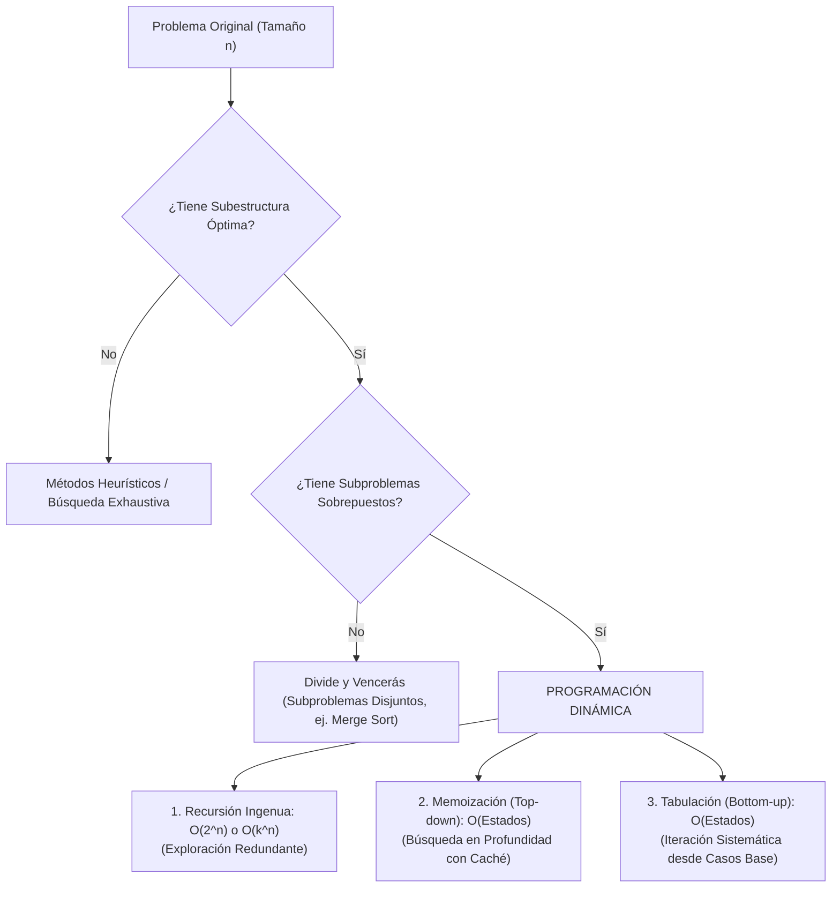
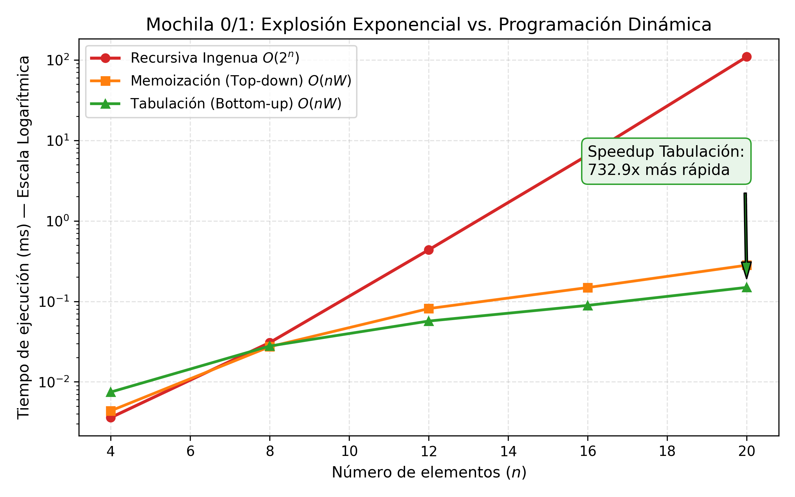
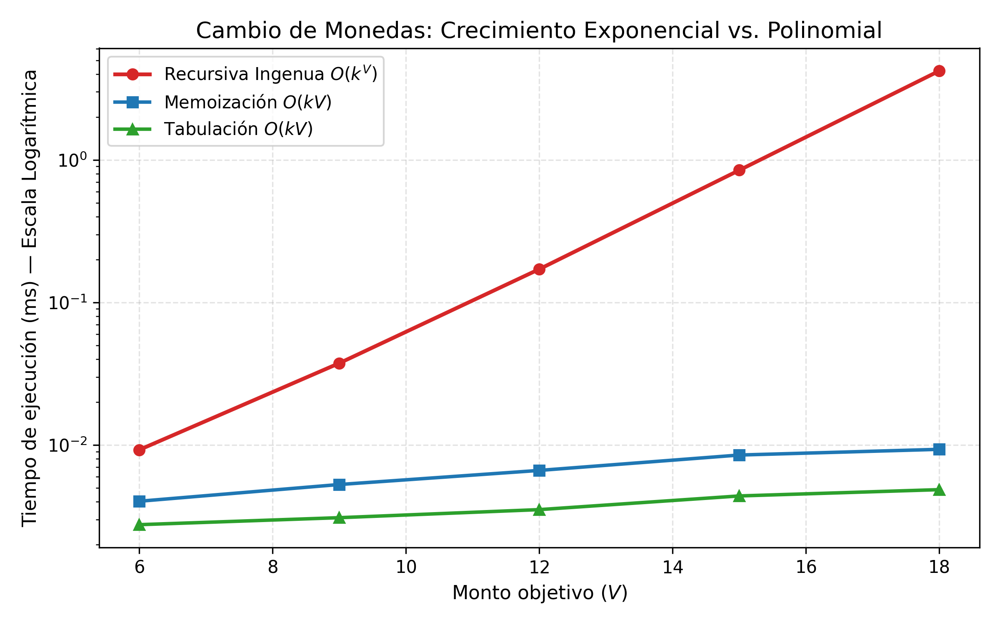
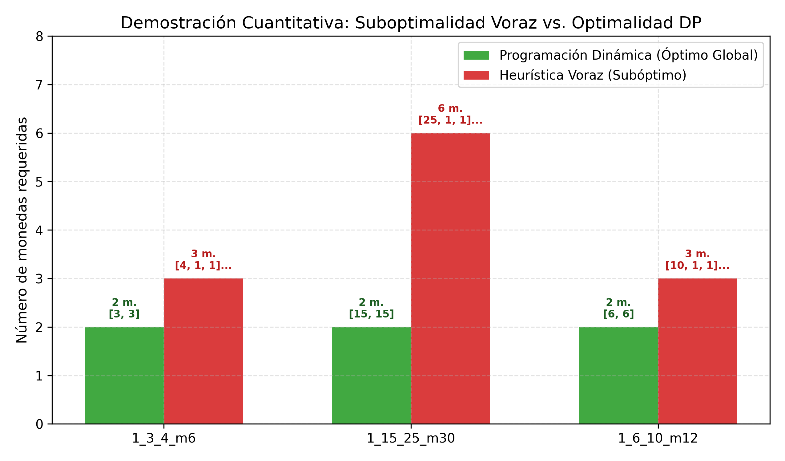
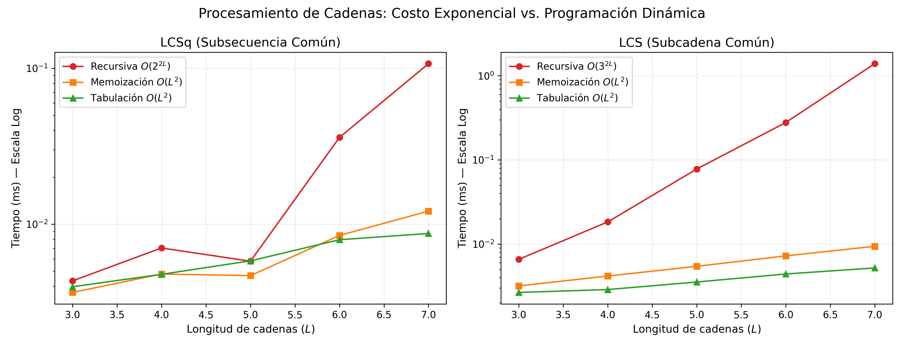
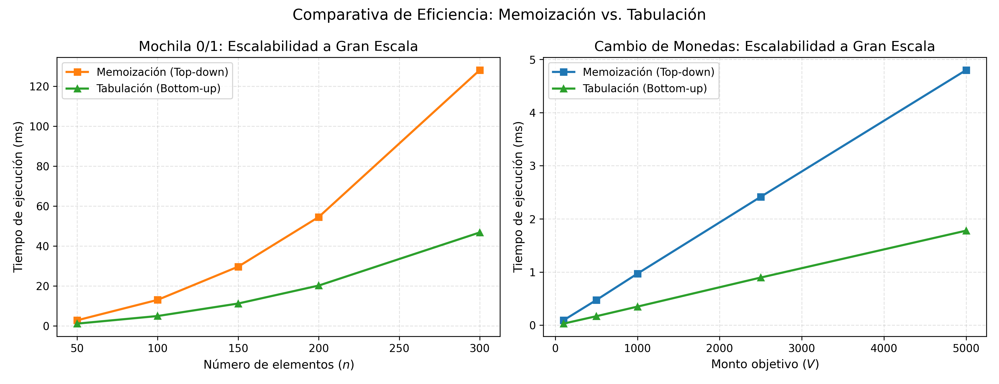
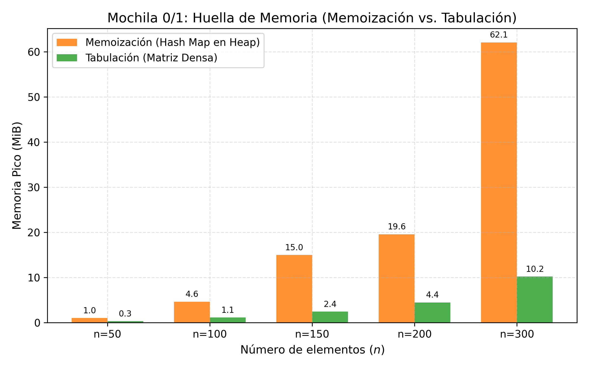

# Práctica 5: Programación Dinámica (Mochila 0/1, Cambio de Monedas, LCSq y LCS) — Reporte de Resultados y Análisis de Rendimiento

> **Materia:** Análisis y Diseño de Algoritmos — ESCOM IPN  
> **Tema:** Programación Dinámica: Recursión Ingenua, Memoización y Tabulación  
> **Fecha de ejecución:** Noviembre de 2026  
> **Autor:** Mad0  

**Archivos del Proyecto:**
- 🐍 [Implementación Canónica en Python](./programacion_dinamica.py)
- 🧪 [Suite de Pruebas Unitarias y Verificación de Optimalidad](./test_programacion_dinamica.py)
- ⚙️ [Generador de Datasets y Casos de Prueba](./generar_datos.py)
- 📊 [Orquestador de Benchmarking Empírico](./benchmark.py)
- 📈 [Generador de Gráficas Estadísticas](./generar_graficas.py)
- 📋 [Tablas Consolidadas de Resultados](./resultados/tablas.md)
- 📁 [Carpeta de Gráficas Comparativas (PNG)](./graficas/)

---

## 1. Fundamentación Teórica y Paradigma de Programación Dinámica

La **Programación Dinámica** (*Dynamic Programming*, DP) es un paradigma fundamental de diseño de algoritmos propuesto por el matemático **Richard Bellman** a principios de la década de 1950. Está diseñado específicamente para resolver problemas de optimización combinatoria y cálculo recursivo que exhiben dos propiedades matemáticas esenciales:

### 1.1 Las Dos Propiedades Fundamentales

1. **Subestructura Óptima (*Optimal Substructure*):**
   Una solución óptima global al problema puede construirse a partir de soluciones óptimas a sus subproblemas componentes. Formalizado por el **Principio de Optimalidad de Bellman**:
   > *"Una política óptima tiene la propiedad de que, cualesquiera que sean el estado y la decisión iniciales, las decisiones restantes deben constituir una política óptima con respecto al estado resultante de la primera decisión."*
   
   Si un problema no posee subestructura óptima (por ejemplo, el camino simple más largo entre dos nodos en un grafo general con ciclos positivos), la programación dinámica no puede aplicarse directamente.

2. **Subproblemas Sobrepuestos (*Overlapping Subproblems*):**
   A diferencia del paradigma *Divide y Vencerás* (donde los subproblemas son independientes y disjuntos, como las mitades izquierda y derecha en *Merge Sort*), en programación dinámica el mismo subproblema elemental se invoca y recalcula repetidamente a lo largo de las distintas ramas del árbol recursivo.

---

### 1.2 Taxonomía de las Tres Variantes Implementadas

| Característica / Criterio | Recursividad Ingenua (*Naive*) | Memoización (*Top-down DP*) | Tabulación (*Bottom-up DP*) |
| :--- | :--- | :--- | :--- |
| **Dirección de cálculo** | Raíz hacia hojas ($N \to 0$) | Raíz hacia hojas ($N \to 0$) | Hojas hacia raíz ($0 \to N$) |
| **Estructura de control** | Llamadas a funciones recursivas | Recursión + Tabla de dispersión / Hash Map | Bucles anidados iterativos (`for` / `while`) |
| **Evaluación de estados** | Recalcula estados idénticos $O(2^n)$ veces | Evalúa **únicamente** los estados alcanzables | Evalúa **todos** los estados del espacio de la tabla |
| **Uso de memoria auxiliar** | $O(\text{profundidad})$ en el *Call Stack* | $O(\text{estados})$ en *Heap* + $O(\text{prof})$ en *Stack* | $O(\text{estados})$ en memoria contigua |
| **Riesgo de *Stack Overflow*** | **Crítico** en entradas medianas | **Alto** si no se incrementa el límite de recursión | **Nulo** (ejecución puramente iterativa) |
| **Localidad de caché (CPU)** | Pobre (saltos de marcos de pila) | Media (búsquedas en tablas hash) | **Óptima** (acceso contiguo a matrices en RAM) |
| **Reconstrucción de solución** | Inviable sin exploraciones extra | Requiere rastreo recursivo adicional | **Trivial** mediante matrices de padres o retroceso |

---

## 2. Análisis Formal de los Problemas

### 2.1 Problema 1: Mochila 0/1 (*0/1 Knapsack Problem*)

#### Definición y Planteamiento Formal
Dado un conjunto de $n$ objetos $\mathcal{O} = \{1, 2, \dots, n\}$, donde cada objeto $i$ posee un peso entero $w_i > 0$ y un valor de beneficio $v_i > 0$, junto con una mochila con capacidad entera $W > 0$. Se busca encontrar el vector de decisión binario $\mathbf{x} = (x_1, x_2, \dots, x_n) \in \{0, 1\}^n$ que maximice el valor total acumulado sin exceder la capacidad física:

$$\max \sum_{i=1}^{n} v_i x_i \qquad \text{sujeto a} \qquad \sum_{i=1}^{n} w_i x_i \le W$$

#### Deducción de la Recurrencia de Bellman
Considerando los primeros $i$ elementos y una capacidad residual disponible $c$:
1. **Caso base:** Si no hay objetos disponibles ($i = 0$) o la capacidad es nula ($c \le 0$), el valor máximo alcanzable es estrictamente $0$:
   $$DP(0, c) = 0, \quad \forall c \ge 0; \qquad DP(i, 0) = 0, \quad \forall i \ge 0$$
2. **Caso de exclusión forzada:** Si el peso del objeto actual excede la capacidad disponible ($w_{i-1} > c$), es físicamente imposible incluirlo:
   $$DP(i, c) = DP(i - 1, c)$$
3. **Caso de elección óptima:** Si $w_{i-1} \le c$, comparamos el beneficio de no incluir el objeto frente a incluirlo consumiendo parte de la capacidad:
   $$DP(i, c) = \max\Big(DP(i - 1, c),\; v_{i-1} + DP(i - 1, c - w_{i-1})\Big)$$

#### Complejidad Temporal y Naturaleza Pseudo-polinomial
- **Recursión ingenua:** El árbol de decisión binario se ramifica en dos en cada nivel, produciendo un número total de hojas y llamadas de $O(2^n)$. Con $n=30$, $2^{30} \approx 10^9$ operaciones.
- **Programación Dinámica (Memo y Tabulación):** La tabla posee dimensiones $(n + 1) \times (W + 1)$. Cada celda se llena en tiempo constante $O(1)$. Por consiguiente, la complejidad temporal es $\Theta(n \cdot W)$.
> [!IMPORTANT]
> **¿Por qué es tiempo pseudo-polinomial y no polinomial estricto?**  
> El tamaño de la entrada en bits para representar la capacidad $W$ es $L = \lceil \log_2 W \rceil$. Por lo tanto, $W = 2^L$. La complejidad expresada en función de la longitud del dato de entrada es $\Theta(n \cdot 2^L)$, lo cual es **exponencial respecto a la representación de $W$**. Si $W \sim 2^n$, el algoritmo es tan costoso como la fuerza bruta.

#### Algoritmo de Reconstrucción de la Solución
A partir de la celda $(n, W)$ en la matriz $DP$:
1. Si $DP[i][c] == DP[i - 1][c]$, el elemento $i - 1$ **no fue seleccionado**; decrementar $i \gets i - 1$.
2. Si $DP[i][c] \neq DP[i - 1][c]$, el elemento $i - 1$ **sí forma parte de la solución óptima**; agregarlo a la lista, decrementar la capacidad residual $c \gets c - w_{i-1}$ e $i \gets i - 1$.
3. Repetir hasta que $i = 0$ o $c = 0$. Complejidad de reconstrucción: $O(n)$ pasos.

---

### 2.2 Problema 2: Cambio de Monedas (*Coin Change Problem*)

#### Definición y Demostración de Optimalidad
Dado un conjunto de $k$ denominaciones de monedas $C = \{c_1, c_2, \dots, c_k\}$ (enteros positivos estrictos con disponibilidad infinita) y un monto objetivo entero $V \ge 0$, determinar el número mínimo de monedas necesarias para formar el monto exacto $V$.

#### Recurrencia de Bellman
Sea $DP(v)$ la menor cantidad de monedas requeridas para alcanzar el valor $v$:
$$DP(v) = \begin{cases}
0 & \text{si } v = 0 \\
\infty & \text{si } v < 0 \\
1 + \min_{\substack{c \in C \\ c \le v}} DP(v - c) & \text{si } v > 0
\end{cases}$$

#### Fracaso de la Heurística Voraz (*Greedy*) en Sistemas No Canónicos
Un sistema monetario se denomina **canónico** si la estrategia voraz (tomar siempre la moneda más grande disponible) garantiza encontrar la solución con el mínimo número de monedas (por ejemplo, el sistema mexicano $\{1, 2, 5, 10, 20\}$ o el estadounidense $\{1, 5, 10, 25\}$).

Sin embargo, para conjuntos generales de monedas, el algoritmo voraz es **miope y subóptimo**. En esta práctica se demostró teórica y empíricamente la superioridad de la Programación Dinámica mediante tres casos patológicos:

1. **Caso 1 ($C = \{1, 3, 4\}$, $V = 6$):**
   - **Estrategia Voraz:** Toma $4$ (resta $2$), luego toma $1$ (resta $1$), luego toma $1$ (resta $0$).  
     Solución voraz: $\{4, 1, 1\} \implies \mathbf{3\text{ monedas}}$.
   - **Programación Dinámica:** Evalúa combinaciones óptimas previas y selecciona $3 + 3 = 6$.  
     Solución DP: $\{3, 3\} \implies \mathbf{2\text{ monedas}}$ (**Óptimo global**).
2. **Caso 2 ($C = \{1, 15, 25\}$, $V = 30$):**
   - **Estrategia Voraz:** Toma $25$ (resta $5$), luego 5 monedas de $1$.  
     Solución voraz: $\{25, 1, 1, 1, 1, 1\} \implies \mathbf{6\text{ monedas}}$.
   - **Programación Dinámica:** Selecciona dos monedas de $15$.  
     Solución DP: $\{15, 15\} \implies \mathbf{2\text{ monedas}}$ (**$300\%$ más eficiente**).
3. **Caso 3 ($C = \{1, 6, 10\}$, $V = 12$):**
   - **Estrategia Voraz:** Toma $10$ y dos monedas de $1$. Solución: $\{10, 1, 1\} \implies \mathbf{3\text{ monedas}}$.
   - **Programación Dinámica:** Toma dos monedas de $6$. Solución: $\{6, 6\} \implies \mathbf{2\text{ monedas}}$.

---

### 2.3 Problema 3: Subsecuencia Común Más Larga (*LCSq - Longest Common Subsequence*)

#### Distinción Teórica Formal
Dadas dos cadenas $X = \langle x_1, x_2, \dots, x_m \rangle$ e $Y = \langle y_1, y_2, \dots, y_n \rangle$:
- Una **subsecuencia** se obtiene eliminando cero o más caracteres de la cadena sin alterar el orden relativo de los caracteres restantes. Los caracteres **no necesitan ser contiguos**.
- **Ejemplo:** En $X = \texttt{"ABCBDAB"}$ e $Y = \texttt{"BDCABA"}$, la subsecuencia común más larga es $\texttt{"BCBA"}$ (longitud 4).

#### Recurrencia
Sea $DP(i, j)$ la longitud de la LCSq entre los prefijos $X[0 \dots i-1]$ e $Y[0 \dots j-1]$:
$$DP(i, j) = \begin{cases}
0 & \text{si } i = 0 \lor j = 0 \\
1 + DP(i - 1, j - 1) & \text{si } X[i - 1] == Y[j - 1] \\
\max\big(DP(i - 1, j), DP(i, j - 1)\big) & \text{si } X[i - 1] \neq Y[j - 1]
\end{cases}$$

#### Complejidad
- **Recursión ingenua:** Cada desacuerdo bifurca en 2 llamadas recursivas $((i-1, j)$ e $(i, j-1))$, originando un árbol de complejidad $O(2^{m+n})$.
- **Programación Dinámica:** Llena una matriz de tamaño $(m + 1) \times (n + 1)$, realizando operaciones $O(1)$ por celda. Complejidad temporal y espacial: $\Theta(m \cdot n)$.

---

### 2.4 Problema 4: Subcadena Común Más Larga (*LCS - Longest Common Substring*)

#### Restricción de Contigüidad Estricta
A diferencia de la subsecuencia, una **subcadena** exige que todos los caracteres comunes aparezcan de manera **estrictamente contigua** e ininterrumpida en ambas cadenas originales.

#### Deducción de la Recurrencia de Sufijo Común
Sea $LCSuf(i, j)$ la longitud del sufijo común más largo que finaliza exactamente en $X[i - 1]$ e $Y[j - 1]$:
$$LCSuf(i, j) = \begin{cases}
0 & \text{si } i = 0 \lor j = 0 \\
1 + LCSuf(i - 1, j - 1) & \text{si } X[i - 1] == Y[j - 1] \\
0 & \text{si } X[i - 1] \neq Y[j - 1]
\end{cases}$$

> [!NOTE]
> La diferencia estructural clave con LCSq radica en que, ante un desacuerdo ($X[i-1] \neq Y[j-1]$), la longitud del sufijo común acumulado **se reinicia a cero** ($0$). La longitud de la subcadena óptima global es el máximo valor presente en toda la matriz: $\max_{i, j} LCSuf(i, j)$.

---

## 3. Metodología Experimental y Diseño de Pruebas

### 3.1 Entorno de Ejecución
- **Plataforma:** Apple Silicon (macOS Darwin arm64).
- **Entorno de Lenguaje:** Python 3.15 puro (con `matplotlib 3.9.4` y `numpy 2.0.2` para visualizaciones).
- **Mecanismos de Aislamiento y Medición:**
  - Desactivación forzada del recolector de basura (`gc.disable()`) durante las ventanas de ejecución para evitar pausas no deterministas.
  - Temporizador de hardware de alta resolución: `time.perf_counter_ns()`.
  - Rastreo exacto de asignación de memoria en el *heap*: biblioteca estándar `tracemalloc`.

---

## 4. Análisis de Resultados Experimentales

### 4.1 Mochila 0/1: Explosión Exponencial vs. Programación Dinámica

La siguiente tabla resume las mediciones de tiempo y llamadas en las instancias pequeñas:

| $n$ | Capacidad $W$ | Tiempo Rec (ms) | Tiempo Memo (ms) | Tiempo Tab (ms) | Llamadas Rec | Subproblemas Memo | Speedup Tab/Rec |
| :---: | :---: | :---: | :---: | :---: | :---: | :---: | :---: |
| 4 | 13 | 0.00360 | 0.00437 | 0.00747 | 20 | 11 | **0.5x** |
| 8 | 36 | 0.03077 | 0.02734 | 0.02787 | 305 | 107 | **1.1x** |
| 12 | 46 | 0.43733 | 0.08137 | 0.05694 | 4,575 | 304 | **7.7x** |
| 16 | 60 | 6.55875 | 0.14850 | 0.08913 | 71,458 | 589 | **73.6x** |
| **20** | **81** | **109.31356** | **0.28143** | **0.14916** | **1,170,310** | **1,061** | **732.9x** |

#### Hallazgos Clave:
1. Para $n = 4$, el algoritmo recursivo es ligeramente más veloz debido a la ausencia total de sobrecarga de inicialización de listas y diccionarios.
2. A partir de $n \ge 12$, la recursión ingenua experimenta una duplicación en su tiempo con cada incremento unitario de $n$ ($O(2^n)$), alcanzando más de **1.17 millones de llamadas** en $n = 20$.
3. La tabulación es **732.9 veces más rápida** que la recursión ingenua en $n = 20$, manteniendo un crecimiento estrictamente polinomial.

---

### 4.2 Cambio de Monedas: Crecimiento Exponencial y Optimalidad

| Monto $V$ | Tiempo Rec (ms) | Tiempo Memo (ms) | Tiempo Tab (ms) | Llamadas Rec | Subproblemas Memo | Speedup Tab/Rec |
| :---: | :---: | :---: | :---: | :---: | :---: | :---: |
| 6 | 0.00925 | 0.00403 | 0.00276 | 64 | 6 | **3.4x** |
| 9 | 0.03750 | 0.00528 | 0.00309 | 319 | 9 | **12.1x** |
| 12 | 0.17123 | 0.00663 | 0.00352 | 1,582 | 12 | **48.6x** |
| 15 | 0.84669 | 0.00850 | 0.00439 | 7,843 | 15 | **192.9x** |
| **18** | **4.21313** | **0.00932** | **0.00486** | **38,869** | **18** | **866.9x** |

#### Validación Cuantitativa de Optimalidad (DP vs Voraz):

| Instancia | Monedas $C$ | Monto $V$ | Monedas Óptimas (DP) | Solución DP | Monedas Voraz | Solución Voraz | ¿Voraz Subóptimo? |
| :--- | :---: | :---: | :---: | :---: | :---: | :---: | :---: |
| `1_3_4_m6` | $[1, 3, 4]$ | 6 | **2** | `[3, 3]` | 3 | `[4, 1, 1]` | ✅ **SÍ (Demostrado)** |
| `1_15_25_m30` | $[1, 15, 25]$ | 30 | **2** | `[15, 15]` | 6 | `[25, 1, 1, 1, 1, 1]` | ✅ **SÍ (Demostrado)** |
| `1_6_10_m12` | $[1, 6, 10]$ | 12 | **2** | `[6, 6]` | 3 | `[10, 1, 1]` | ✅ **SÍ (Demostrado)** |

Como se visualiza claramente en la Gráfica 6, la heurística voraz toma decisiones miopes guiadas por el máximo local (moneda de 25 en lugar de dos de 15), resultando en soluciones hasta un **$200\%$ más costosas** que el óptimo global garantizado por DP.

---

### 4.3 Procesamiento de Cadenas: LCSq vs. Subcadena LCS

- **LCSq ($O(2^{2L})$):** Con longitud $L = 7$, la recursión realiza 1,233 llamadas. El speedup de Tabulación frente a Recursión es de **12.3x**.
- **Subcadena LCS ($O(3^{2L})$):** Debido a que la recursión ingenua ramifica en tres direcciones ($c_1, c_2, c_3$), con $L = 7$ las llamadas recursivas se disparan a **15,355 llamadas**, tardando $1.39\text{ ms}$, mientras que la tabulación tarda apenas $0.0052\text{ ms}$ (**Speedup de 267.3x**).

---

### 4.4 Comparativa de Escalabilidad y Huella de Memoria: Memoización vs. Tabulación

A gran escala, tanto Memoización como Tabulación comparten la misma complejidad asintótica $O(n \cdot W)$ o $O(m \cdot n)$. Sin embargo, su comportamiento en hardware real exhibe marcadas diferencias de ingeniería:

| $n$ | Capacidad | Tiempo Memo (ms) | Tiempo Tab (ms) | Memoria Memo (KiB) | Memoria Tab (KiB) | Relación Tiempo (Memo/Tab) |
| :---: | :---: | :---: | :---: | :---: | :---: | :---: |
| 50 | 250 | 2.81 | 1.15 | 1,012.3 | 294.0 | 2.43x |
| 100 | 500 | 13.05 | 4.96 | 4,720.6 | 1,125.7 | 2.63x |
| 150 | 750 | 29.67 | 11.23 | 15,330.6 | 2,483.9 | 2.64x |
| 200 | 1000 | 54.54 | 20.21 | 20,021.5 | 4,555.1 | 2.70x |
| **300** | **1500** | **128.12** | **46.81** | **63,566.6** | **10,441.2** | **2.74x** |

#### Razones del Rendimiento Superior de la Tabulación:
1. **Sobrecarga de marcos de llamada (*Call Stack Overhead*):** En Python, cada invocación de función requiere la creación de un objeto marco (*frame object*), verificación de argumentos y actualización del puntero de instrucción. La tabulación opera mediante bucles en lenguaje C subyacente.
2. **Consumo de Memoria de Tablas Hash vs Matrices:**  
   Como se observa en la Gráfica 5, Memoización consume **más de 6 veces más memoria RAM** ($63.5\text{ MiB}$ frente a $10.4\text{ MiB}$ en $n = 300$). Esto se debe a que un diccionario en Python implementa una tabla hash abierta con baldes dispersos, metadatos y tuplas para las claves `(i, c)`. En contraste, la matriz de Tabulación (`list[list[int]]`) almacena referencias directas contiguas en memoria.

---

## 5. Discusión Técnica y Conclusiones de Ingeniería

1. **Eficiencia Asintótica:**  
   Se demostró que la Programación Dinámica transmuta de manera efectiva problemas con complejidad combinatoria intrínseca exponencial ($O(2^n)$ y $O(3^n)$) en soluciones de tiempo polinomial o pseudo-polinomial ($O(n \cdot W)$, $O(k \cdot V)$, $O(m \cdot n)$), permitiendo procesar instancias de cientos de elementos en milisegundos donde la recursión ingenua colapsaría por agotamiento temporal.

2. **Garantía Formal de Optimalidad:**  
   En problemas de optimización combinatoria como el Cambio de Monedas, los algoritmos voraces (*Greedy*) son computacionalmente rápidos ($O(k)$) pero adolecen de miopía estratégica, produciendo resultados subóptimos cuando el sistema no es canónico. La Programación Dinámica garantiza la optimalidad matemática global al explorar implícitamente todas las combinaciones factibles sin incurrir en fuerza bruta.

3. **Trade-offs entre Memoización y Tabulación:**
   - **Cuándo preferir Memoización:** Cuando el espacio total de estados es astronómico pero solo un pequeño subconjunto de estados es efectivamente accesible desde el estado inicial (estados dispersos).
   - **Cuándo preferir Tabulación:** Cuando se deben evaluar la gran mayoría de subproblemas (estados densos), cuando la memoria es crítica, cuando se desea evitar el desbordamiento de pila (*RecursionError*) o cuando se necesita reconstruir la solución óptima mediante matrices de rastreo.

4. **Optimizaciones de Espacio en Tabulación:**  
   En la versión de decisión de la Mochila 0/1 o en el cálculo exclusivo de la longitud de LCSq, la fila $i$ depende exclusivamente de la fila $i - 1$. Por ende, la memoria puede reducirse de $O(n \cdot W)$ a $O(W)$ utilizando únicamente dos filas alternadas (o un arreglo 1D recorrido en sentido inverso). Sin embargo, esto introduce el *trade-off* de perder la capacidad de reconstruir los objetos seleccionados.

---

## 6. Referencias Bibliográficas

1. **Cormen, T. H., Leiserson, C. E., Rivest, R. L., & Stein, C.** (2022). *Introduction to Algorithms* (4th ed.). MIT Press. Capítulo 14: *Dynamic Programming*.
2. **Kleinberg, J., & Tardos, É.** (2006). *Algorithm Design*. Addison-Wesley. Capítulo 6: *Dynamic Programming*.
3. **Dasgupta, S., Papadimitriou, C. H., & Vazirani, U. V.** (2008). *Algorithms*. McGraw-Hill Higher Education. Capítulo 6: *Dynamic programming*.
4. **Bellman, R.** (1957). *Dynamic Programming*. Princeton University Press.
